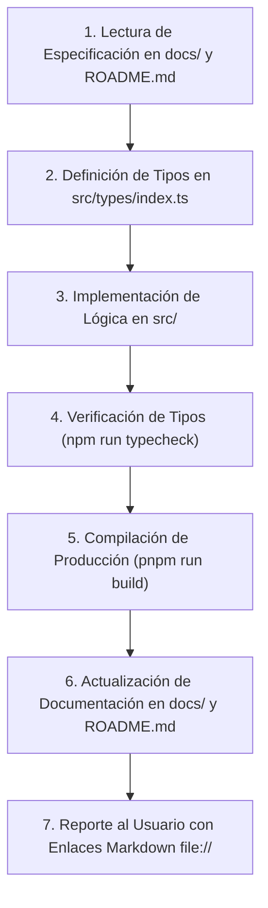

# 🤖 Guía de Desarrollo para Agentes de IA — Open Skylines (`AGENTS.md`)

Este documento define el protocolo operativo obligatorio, los estándares de ingeniería y las normas de documentación que **todo agente de IA (y desarrollador humano)** debe cumplir estrictamente al trabajar en el repositorio de **Open Skylines**.

---

## 📜 1. Protocolo Obligatorio de Documentación

> [!IMPORTANT]
> **Regla de Oro de Documentación Continua:**
> Cada vez que se desarrolle, modifique o amplíe una funcionalidad, sistema, herramienta, shader o mecánica del juego, **ES OBLIGATORIO** actualizar la documentación correspondiente en el directorio `docs/` y marcar el avance en `ROADME.md` antes de dar la tarea por finalizada.

### Requisitos del Protocolo:
1. **Actualización en el Mismo Turno:** El código y su documentación se entregan juntos en el mismo cambio. No se pospone la documentación para tareas posteriores.
2. **Destino de la Documentación:**
   - Si se expande un sistema existente, actualizar el archivo temático en `docs/`:
     - Terreno, relieve, carreteras o cruces $\rightarrow$ [docs/world-and-terrain.md](file:///home/dev/projects/city-builder/docs/world-and-terrain.md)
     - RCI, felicidad, coberturas, economía o presupuestos $\rightarrow$ [docs/simulation-and-economy.md](file:///home/dev/projects/city-builder/docs/simulation-and-economy.md)
     - Tráfico, enrutamiento, peatones o transporte público $\rightarrow$ [docs/traffic-and-transit.md](file:///home/dev/projects/city-builder/docs/traffic-and-transit.md)
     - Renderizado, Three.js, shaders GLSL o instanciación $\rightarrow$ [docs/rendering-and-shaders.md](file:///home/dev/projects/city-builder/docs/rendering-and-shaders.md)
     - Herramientas de cursor o interfaz de usuario $\rightarrow$ [docs/ui-and-tools.md](file:///home/dev/projects/city-builder/docs/ui-and-tools.md)
     - Distritos, ordenanzas o especializaciones $\rightarrow$ [docs/districts-and-policies.md](file:///home/dev/projects/city-builder/docs/districts-and-policies.md)
   - Si se añade un subsistema completamente nuevo (ej: *Recursos Naturales*, *Red de Aguas y Alcantarillado*, *Meteorología*), crear un nuevo documento en `docs/<nuevo-sistema>.md` y enlazarlo en el índice general [docs/README.md](file:///home/dev/projects/city-builder/docs/README.md).
3. **Actualización de la Hoja de Ruta:** Actualizar la lista de hitos y tareas en [ROADME.md](file:///home/dev/projects/city-builder/ROADME.md).

---

## 🏛️ 2. Invariantes de Ingeniería y Arquitectura (*Ground Truths*)

### 2.1 Memoria Tipificada y Rendimiento Zero-GC
- **Cuadrícula en Arrays Planos:** El mapa mide $W \times W = 208 \times 208 = 43.264$ casillas. Cualquier capa de datos masiva debe implementarse en arrays planos contiguos (`Uint8Array`, `Float32Array`, `Int32Array`).
- **Prohibido Crear Objetos por Casilla:** Nunca instanciar clases u objetos dinámicos individuales por casilla en memoria masiva ($43.264$ objetos colapsan el recolector de basura de JavaScript y provocan caídas de FPS).
- **Indexación Canónica:** Utilizar siempre `i = y * W + x` y las utilidades `U.idx(x, y)`, `U.tx(i)` y `U.ty(i)`.

### 2.2 Determinismo de Simulación
- **Sin Aleatoriedad No Controlada:** En los módulos `src/sim/`, `src/world/`, `src/traffic/` y `src/transit/` está prohibido usar `Math.random()` sin semilla o `Date.now()`. Utilizar siempre `Sim.rng()` o funciones hash deterministas `U.hash(x, y, seed)`.
- **Desacoplamiento Gráfico:** La simulación económica y de agentes corre a pasos fijos discretos; nunca debe depender del refresco de la pantalla o del deltaTime de la GPU.

### 2.3 Gráficos y Renderizado Three.js
- **InstancedMesh Siempre:** Cualquier elemento repetitivo (vehículos, árboles, edificios residenciales, postes, farolas) debe emplear mallas instanciadas (`InstancedMesh`) o shaders compuestos.
- **Sin Geometrías Pesadas:** Prohibido importar modelos glTF/FBX de varios megabytes sin optimizar. El estilo visual se basa en geometría paramétrica compacta, texturas proceduradas y shaders GLSL.
- **DataTextures para Capas de Datos:** Modificaciones masivas de calor visual (tráfico, valor del suelo, distritos) deben actualizarse en `ovTex` o `zoneTex`, no recreando geometrías.

### 2.4 Tipado TypeScript Estricto
- Todas las estructuras de datos y estados deben definirse en [src/types/index.ts](file:///home/dev/projects/city-builder/src/types/index.ts) o exportarse con tipos rigurosos.
- Evitar `any` no tipificado en nuevas APIs y no añadir directivas `@ts-ignore`.
- **Verificación Obligatoria:** Todo cambio debe superar sin errores `npm run typecheck` (`tsc --noEmit`) y `pnpm run build`.

### 2.5 Persistencia y Compatibilidad de Partidas
- Al añadir nuevas capas de datos al mapa, deben integrarse en `Sim.serialize()` y `Sim.load(d)` mediante compresión por longitud de series (**RLE**) usando `U.encodeRLE()` y `U.decodeRLE()`.
- Debe mantenerse siempre la compatibilidad con partidas existentes inicializando valores por defecto cuando el campo no exista en el archivo cargado.

---

## 🔄 3. Flujo de Trabajo del Agente (Paso a Paso)



1. **Lectura e Investigación:** Antes de modificar el código, consultar el documento relevante en `docs/` y verificar las constantes en `src/core/constants.ts`.
2. **Implementación Tipada:** Diseñar la solución respetando los arrays tipificados y el ciclo de vida del juego.
3. **Verificación Automática:** Ejecutar en terminal:
   ```bash
   npm run typecheck
   pnpm run build
   ```
   Ambos comandos deben finalizar con código de salida `0` (cero errores).
4. **Documentación:** Explicar las nuevas funciones, fórmulas o variables en `docs/` y marcar las casillas correspondientes en `ROADME.md`.
5. **Comunicación al Usuario:** Responder de forma concisa en Markdown con enlaces clicables bajo el esquema `file://`.
