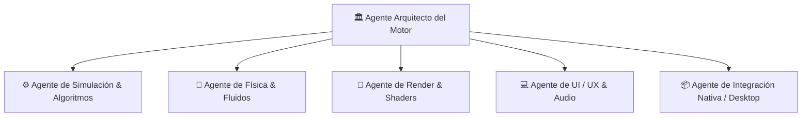

# Criterios y Principios de Desarrollo de Agentes: Agents.md

> Este documento define las directrices arquitectónicas, reglas de ingeniería y roles que deben seguir tanto los desarrolladores humanos como los agentes de IA que colaboren en la construcción del City Builder.

---

## 🧭 1. Principios Fundamentales de Diseño

1. **Separación Estricta: Simulación vs. Render (Determinismo):**
   - La simulación debe poder ejecutarse sin interfaz gráfica ni Three.js (Headless).
   - El estado del mundo reside en el motor de simulación (Worker/ECS); el renderizado es únicamente una proyección visual interpolada.
   - Todo número aleatorio en la simulación debe utilizar un generador pseudoaleatorio con semilla (PRNG - ej. Mulberry32, PCG), garantizando reproducibilidad y guardados deterministas.

2. **Cero Caídas de Frames (60+ FPS Rule):**
   - El hilo principal (`Main Thread`) solo se encarga de: Entrada de usuario (Input), Renderizado gráfico (Draw calls) y Audio.
   - Toda lógica intensiva (Pathfinding, cálculos de cobertura de agua/luz, actualización de presupuestos, crecimiento de población, física de fluidos) corre en hilos secundarios (**Web Workers** o GPGPU compute shaders).
   - Minimizar la presión sobre el Garbage Collector: Reutilizar vectores (`Vector3`), matrices y estructuras de datos; evitar instanciar objetos temporales (`new`) en cada frame.

3. **Arquitectura Orientada a Datos (Data-Oriented Design / ECS & Grids 2D):**
   - Los datos viven en arrays tipados contiguos (`Float32Array`, `Int32Array`) para maximizar el cache-hit de CPU.
   - La topografía del terreno y la hidrodinámica se modelan como campos de altura discretos (`Heightfields`) de doble buffer para swaps instantáneos sin alocación.
   - Las entidades son IDs simples; los componentes son datos puros sin métodos; los sistemas ejecutan la lógica sobre conjuntos de componentes.

4. **Compatibilidad Universal (Web + Desktop):**
   - No usar APIs exclusivas de Node.js en módulos core.
   - El código debe usar capas de abstracción para I/O:
     - `StorageAdapter`: Implementado con `IndexedDB` en navegador y con el sistema de archivos nativo en Desktop (Tauri FS / Rust).
     - `WindowAdapter`: Métodos de pantalla completa, cambio de resolución y controles de ventana abstractos.

5. **Type Safety & TypeScript Estricto:**
   - Prohibido el uso de `any` no justificado; usar `unknown` con validadores de tipo o schemas si es dinámico.
   - Definir interfaces explícitas para todos los mensajes entre el hilo principal y el Worker (`type-safe worker messaging`).

6. **Mantenibilidad, Modularidad y Clean Code:**
   - Principio de Responsabilidad Única (SRP): cada módulo tiene un cometido acotado y dependencias mínimas.
   - Acoplamiento débil y alta cohesión: Los sistemas de simulación no importan nada de `src/render/` ni Three.js.
   - Zero side-effects en la importación de módulos: evitar estado global mutable suelto fuera de los contenedores de contexto/mundo.
   - Comentarios de intención: código autoexplicativo con TypeScript expresivo, documentando el "por qué" y las complejidades algorítmicas con JSDoc.

7. **Optimización de Rendimiento y Memoria (Zero-Allocation Loop):**
   - No instanciar objetos temporales (`new Vector3`, arrays efímeros, closures o lambdas) dentro de los bucles de render (`tick` / `requestAnimationFrame`) ni de simulación.
   - Uso de Object Pools (reciclaje de objetos) para agentes, proyectiles, nodos de búsqueda de ruta y partículas.
   - Preferir arrays planos y estructuras SOA (Structure of Arrays) en el ECS sobre arrays de objetos anidados (AOS).
   - Medición antes de optimizar: Toda optimización crítica debe sustentarse en benchmarks (`vitest bench`) y métricas de profiling.

8. **Simulación Física y Dinámica de Fluidos Desacoplada (Shallow Water Equations - SWE):**
   - La hidrodinámica (ríos, inundaciones, presas y vertidos) se calcula mediante ecuaciones de aguas someras (SWE 2.5D) en una cuadrícula contigua de alturas (`waterHeight`, `momentumX`, `momentumZ`).
   - El agua interactúa físicamente con la terraformación: elevar terreno desplaza agua (olas/tsunamis controlados); excavar crea cauces y cuencas.
   - El cómputo físico corre exclusivamente en el Web Worker a frecuencia fija (Fixed Timestep) para evitar inestabilidades numéricas.

9. **Documentación Viva Exhaustiva y Continua (Docs Obligatoria):**
   - Todo módulo, sistema o arquitectura creada o actualizada debe documentarse de forma detallada en la carpeta `docs/`.
   - La documentación debe incluir explicaciones teóricas, fórmulas matemáticas empleadas, diagramas de flujo/arquitectura, estructuras de datos (`Float32Array`, buffers) y guías prácticas de uso tanto para desarrolladores como para nuevos agentes de IA.
   - Mantener un índice general en `docs/README.md` que referencie todos los subsistemas del motor de forma modular.

10. **Uso Obligatorio de la Librería de Assets (`assets/` y `public/assets/`):**
   - Todo renderizado de terreno, carreteras, vehículos, mobiliario urbano y vegetación debe nutrirse prioritariamente de los assets PBR y modelos 3D (`.glb`, `.gltf`) disponibles en `assets/`:
     - **Terreno:** Texturas PBR tileables continuas (`grass`, `sand`, `aerial_grass_rock`, `Ground033`, `forest_floor`, `Rock030`). Prohibido volver a colores matemáticos planos por vértice que generen artefactos triangulares.
     - **Carreteras:** Texturas PBR para asfalto (`asphalt/albedo.jpg`, `asphalt_light/`) y aceras de losas/adoquín (`paving_slabs/`, `paving_cobble/`, `concrete/`).
     - **Mobiliario Urbano (Props):** Modelos GLTF disponibles en `assets/shared/models/` (`street_lamp_01`, `street_lamp_02`, `painted_wooden_bench`, `fire_hydrant`, `wild_rooibos_bush`, `potted_plant_01`, `planter_box_01`, `metal_trash_can`, `concrete_road_barrier`).
     - **Vehículos:** Modelos GLB en `assets/simulation/models/` (`sedan.glb`, `suv.glb`, `police.glb`, `ambulance.glb`, `firetruck.glb`, `van.glb`, `truck.glb`, `delivery.glb`, `garbage-truck.glb`, `tractor-shovel.glb`).
   - Servir los assets a través de `public/assets/` para que Vite los resuelva estáticamente de manera instantánea tanto en Web como en Desktop.

---

## 🤖 2. Matriz de Roles de Agentes Especializados

Para organizar el desarrollo autónomo o asistido, las tareas deben ser abordadas desde la perspectiva del rol correspondiente:



### 🏛️ Agente Arquitecto del Motor (System Architect)
- **Responsabilidad:** Coordinar el pipeline global, definir los esquemas de mensajes Worker <-> Main, garantizar la serialización de partidas y velar por el rendimiento global.
- **Criterios de Validación:**
  - ¿El formato de guardado es retrocompatible o versionado?
  - ¿Hay memory leaks en la creación y destrucción de objetos o mundos?
  - ¿El bundle size final está optimizado?

### 🎨 Agente de Render & Shaders (Graphics & Shaders)
- **Responsabilidad:** Geometría procedural (carreteras, mallas de terreno dinámicas, agua animada), materiales Three.js (WebGL/WebGPU), instanciación masiva (`InstancedMesh`, `BatchedMesh`), iluminación y efectos de post-procesado low-poly.
- **Criterios de Validación:**
  - Número de Draw Calls menor a 150 para una escena con 20.000 objetos visibles.
  - Sombreado Flat Shading con gradientes cálidos coherentes con la dirección de la luz.
  - Actualización reactiva de vértices de terreno (buffers dinámicos `Float32BufferAttribute` con sub-regiones `updateRange`) al terraformar.

### ⚙️ Agente de Simulación & Algoritmos (Simulation & ECS)
- **Responsabilidad:** Red de carreteras, A* jerárquico, zonificación RCI, economía y conducta de vehículos/peatones.
- **Criterios de Validación:**
  - El tick de simulación (50ms) no debe superar los 15ms de cómputo en un escenario con 10.000 agentes.
  - Las búsquedas de ruta deben usar pooling de nodos para no saturar memoria.
  - Ausencia de deadlocks o bucles infinitos en cruces vehiculares.

### 🌊 Agente de Física & Fluidos (Physics & Water Simulation)
- **Responsabilidad:** Implementación del solver SWE (Shallow Water Equations) 2.5D, propagación de caudales, detección de inundaciones en zonas urbanizadas, interacción con presas/bombas y estabilidad numérica del agua durante la terraformación.
- **Criterios de Validación:**
  - Conservación de masa: El agua no debe multiplicarse infinitamente ni desaparecer sin fuentes/sumideros explícitos.
  - El solver SWE para un grid de 128x128 debe ejecutarse en menos de 4ms por tick en el Worker.
  - Las alertas de inundación deben propagarse inmediatamente a los edificios afectados.

### 💻 Agente de UI / UX & Audio (Frontend & Audio)
- **Responsabilidad:** Interfaz de usuario responsiva y accesible (HUD, menús de zonificación, herramientas de terraformación con tamaño/potencia de brocha ajustable, capas térmicas de datos), interacción con el ratón (raycasting sobre la cuadrícula) y diseño de audio 3D posicional.
- **Criterios de Validación:**
  - Brochas de terraformación con feedback visual claro (radio de influencia, contorno y altura proyectada).
  - Accesibilidad en atajos de teclado y adaptabilidad a resoluciones desde 1280x720 hasta 4K.

### 📦 Agente de Integración Nativa (Desktop & Build Pipeline)
- **Responsabilidad:** Configuración de Tauri v2 / Electron, gestión de permisos nativos, empaquetado para Windows, Linux y Mac, y optimización de assets.
- **Criterios de Validación:**
  - El ejecutable nativo debe consumir menos de 150MB de RAM en reposo.
  - Guardado y carga directos en `%APPDATA%` (Windows) o `~/.config` (Linux) sin fricciones.

---

## 📋 3. Protocolos de Calidad y Convenciones de Código

### Estructura de Directorios Recomendada
```text
city-builder/
├── src-tauri/             # Backend nativo ligero en Rust (Tauri v2)
├── src/
│   ├── core/              # Lógica agnóstica de simulación (ECS, grafos, RCI, fluidos)
│   │   ├── ecs/           # Componentes, entidades y sistemas
│   │   ├── graph/         # Grafo vial y algoritmos A*
│   │   ├── terrain/       # Alturas, terraformación y brochas
│   │   ├── water/         # Solver SWE (Shallow Water Equations 2.5D)
│   │   ├── economy/       # RCI, impuestos, presupuesto
│   │   └── utils/         # PRNG, matemáticas vectoriales fijas, pools
│   ├── render/            # Todo lo dependiente de Three.js / WebGL / WebGPU
│   │   ├── camera/        # Controles de cámara RTS
│   │   ├── terrain/       # Malla procedural reactiva y plano de agua
│   │   ├── instancing/    # Gestión de mallas instanciadas (edificios, coches)
│   │   └── shaders/       # Shaders personalizados GLSL / TSL (agua low-poly, día/noche)
│   ├── worker/            # Entry point del Web Worker de simulación
│   ├── ui/                # Componentes de interfaz (HUD, herramientas, brochas)
│   ├── audio/             # Web Audio API & Soundscape
│   ├── platform/          # Adaptadores (Desktop vs Browser API)
│   └── main.ts            # Bootloader de la aplicación
├── assets/                # Modelos .glb low-poly, texturas mínimas, SFX
├── tests/                 # Pruebas unitarias de simulación y fluidos
├── package.json
├── tsconfig.json
├── ROADMAP.md
└── AGENTS.md
```

### Reglas de Pull Request / Commits para Agentes
1. **Tests unitarios obligatorios:** Todo nuevo sistema en `src/core/` (incluido el solver de agua y terraformación) debe contar con tests unitarios (`vitest`) que validen la lógica matemática sin Three.js.
2. **Benchmark de rendimiento:** Si se altera el solver de agua, el grafo de carreteras o el pathfinding, se debe ejecutar el script de benchmark (`tests/benchmarks/`) para certificar que el rendimiento no decrece.
3. **Control de dependencias:** Evitar librerías pesadas en el bundle de cliente. Todo paquete añadido debe ser justificado y analizado con `bundlephobia` o equivalente.
