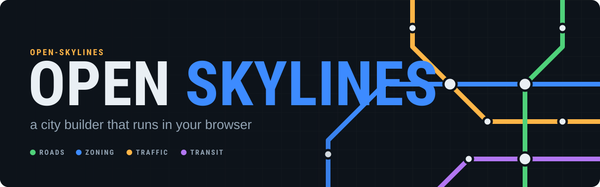

<p align="center">
  
</p>

<p align="center">
  <a href="https://kostslava.github.io/open-skylines/"></a>
</p>

## what is this

a city builder you play in the browser. kinda like cities skylines but way smaller, made in three.js. nothing to install, just open the link.

you start with an empty island and a highway. lay a street, zone some houses, and the town grows. every car, bike and pedestrian is its own agent with its own route, so if you build a dumb intersection you'll watch it jam up, and if you build bike lanes people actually ride them.

water and power are automatic because managing pipes is boring.

## how the city grows

you start with just roads and zoning. services unlock as people move in:

| milestone | pop | unlocks |
|---|---:|---|
| settlement | 0 | small roads, low density homes and shops, industry |
| hamlet | 50 | garbage, medical clinic, bike lanes and paths, small parks |
| village | 150 | police, fire, elementary school, avenues, more small roads, roundabouts |
| small town | 300 | buses, medium density housing, medium parks, protected bike lanes |
| town | 600 | highways, streetcars, high school, recycling, dense commercial |
| large town | 1,200 | boulevards, offices, hospital, police and fire HQ |
| small city | 2,500 | trains and metro, university, high density housing, large parks |
| city | 5,000 | landmarks: claude arch, vs code tower, octocat statue, rubber duck |
| big city | 9,000 | terminal monolith, stack tower, neural net sphere, penguin plaza |
| metropolis | 15,000 | twin serpent towers, container whale, hackathon arena, cloud spire |

## what's in it

- **roads.** small roads are one tile, avenues, boulevards and highways are two tiles wide (one carriageway each way). 29 road types: one-ways, 1+2 asymmetric, gravel, medians, tree-lined, painted and protected bike lanes, tram tracks and ramps. bike and foot paths are half a tile wide (four fit in a tile) and join any sidewalk they touch. the menu is split into tabs like the real thing
- **intersections.** traffic lights go up automatically where avenues or bigger meet; small street crossings stay uncontrolled. every approach gets painted lane arrows. the intersection editor (roads → intersections) lets you switch between lights, stop signs, all-way stops and roundabouts, pick who stops, tune green times, and choose which turns each lane allows. cars plan routes around the arrows
- **traffic.** cars pathfind with direction-aware A*, respect one-ways, pick lanes from the arrows, follow each other and wait at signals. people only drive when it makes sense: short trips are walked, medium trips are cycled if the route is safe (more bike lanes = more cyclists), and transit wins when it's quicker. shifts are staggered so not everyone leaves at 8:00
- **zoning.** residential, commercial, industrial and office. lots fill the zone as deep as it goes, low density homes come in five sizes, and they start out worn and plain and get nicer and more modern as they level up
- **transit.** buses, streetcars, elevated trains and metro
- **services and parks.** garbage, health, police, fire, education, 22 parks from pocket parks to woodland reserves
- **the rest.** day/night cycle, info views, budget and loans, residents who complain about stuff

uff

## controls

| key | does |
|---|---|
| <kbd>W</kbd> <kbd>A</kbd> <kbd>S</kbd> <kbd>D</kbd> | move camera, hold <kbd>Shift</kbd> to go faster |
| <kbd>Q</kbd> <kbd>E</kbd> | rotate |
| <kbd>R</kbd> <kbd>F</kbd> | zoom in / out |
| <kbd>T</kbd> <kbd>G</kbd> | tilt |
| right drag | rotate + tilt |
| middle drag | pan |
| scroll | zoom |
| <kbd>Space</kbd> | pause |
| <kbd>1</kbd> <kbd>2</kbd> <kbd>3</kbd> | game speed |
| <kbd>B</kbd> | bulldoze |
| <kbd>R</kbd> | rotate a building before you place it |
| <kbd>Esc</kbd> | cancel tool |

## if it's your first city

1. drag a small road from the little connector at the end of the highway. roads that aren't connected don't count
2. drag zones along the road and watch the R / C / I demand bars at the top
3. people need jobs and shops, and industry is loud, so don't put it right next to houses
4. at 50 people build a clinic and garbage, at 150 a fire station. fires will wreck you otherwise
5. one-way roads follow the direction you drag. the yellow arrows in the preview show the flow
6. if traffic jams, open the traffic view. add bike lanes, a second route, or fix the intersection in the editor

## graphics

there's a quality dropdown on the start screen (low, medium, high, ultra) and you can change it in settings whenever. low is for older laptops and integrated graphics, ultra is for a real gpu.

## Development & Building

The project has been refactored to modular **TypeScript** powered by **Vite** and **Three.js**.

### Commands

```bash
# Start development server with hot-reload
npm run dev

# Check TypeScript types
npm run typecheck

# Build optimized production bundle
npm run build

# Preview production build locally
npm run preview
```

## Architecture

Modular TypeScript code is organized inside `src/`:

| Module | Location | Description |
|---|---|---|
| **Types** | `src/types/index.ts` | Data structures, interfaces for road networks, zones, vehicles, agents, transit |
| **Core** | `src/core/` | Constants, layout calculations, simplex noise, heaps, RLE, math helpers |
| **World** | `src/world/` | Grid system, heightmaps, bridge decks, connectivity, intersection clustering |
| **Gfx** | `src/render/gfx.ts` | WebGL renderer, custom GLSL shaders, lighting, sky dome, camera controls |
| **Meshes** | `src/render/meshes.ts` | Procedural buildings, roads, bridges, rail viaducts, instanced vehicles, trees |
| **Traffic** | `src/traffic/` | Direction-aware A*, IDM car-following, lane turn arrows, cyclists, pedestrians |
| **Transit** | `src/transit/` | Public transit networks (bus, streetcar, metro), spline physics, routing graph |
| **Sim** | `src/sim/` | Urban simulation, R/C/I demand, jobs, happiness, services, budget, milestones |
| **Tools** | `src/tools/` | Pointer interaction, road snapping, zone drag brush, bulldoze, service placement |
| **UI** | `src/ui/` | Top bar stats, speed controls, tool dock, inspector, modals, Web Audio SFX |
| **Game** | `src/game.ts` | Boot pipeline, game loop, save/load serialization, demo city generator |
| **Main** | `src/main.ts` | Main application entry point and `window.CB` singleton bridge |

<details>
<summary><b>debug url params</b></summary>

<br>

| param | does |
|---|---|
| `?demo=1&ms=7&ff=72` | builds a demo town, unlocks up to milestone 4, fast forwards 72 game hours |
| `&preset=low\|medium\|high\|ultra` | forces a graphics preset |
| `&hour=21` | sets the time of day |
| `&ov=traffic` | opens an info view on load |

</details>
