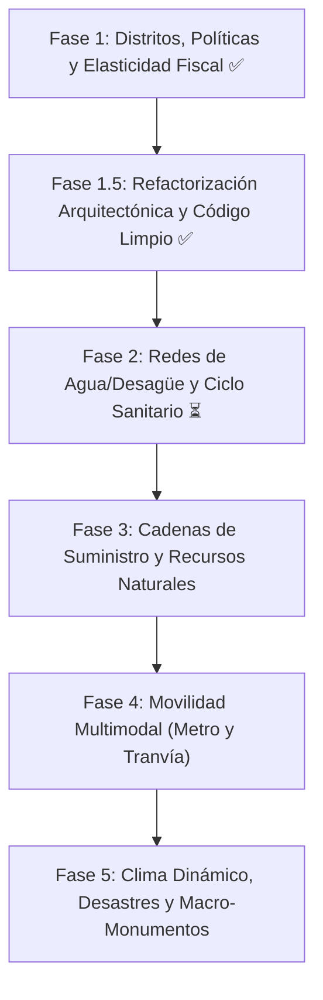

# 🏙️ Open Skylines — Roadmap & Master Management Blueprint (ROADME.md)

Este documento define la visión y hoja de ruta para evolucionar **Open Skylines** hacia un simulador de gestión urbana profundo, modular y de alto rendimiento en el navegador (en la línea de *Cities: Skylines*, *SimCity 4* y *Workers & Resources*), aprovechando al máximo la arquitectura TypeScript, la simulación determinista por cuadrículas (*flat typed arrays*) y el motor de renderizado Three.js.

---

## 📊 1. Diagnóstico del Estado Actual del Motor

| Módulo | Implementación Actual | Oportunidad de Expansión de Gestión |
| :--- | :--- | :--- |
| **Simulación (`src/sim/`)** | Ciclo RCI básico, presupuestos globales, felicidad estática, servicios esenciales (policía, bomberos, salud, colegios, vertederos). | Distritos con políticas locales, demografía por cohortes, cadenas de suministro industriales y elasticidad fiscal. |
| **Mundo (`src/world/`)** | Cuadrícula de $208 \times 208$, mapas procedurales con lagos orgánicos, red vial alineada y alturas en Float32Array. | Yacimientos de recursos naturales, mapas de viento y corrientes de agua, cotas de inundación. |
| **Tráfico (`src/traffic/`)** | Generación estadística de viajes con agentes cosméticos y cálculo de congestión por arista. | Camiones de mercancías físicos, peajes, vehículos de emergencia con prioridad y restricciones de paso (ZBE). |
| **Tránsito (`src/transit/`)** | Redes de autobuses y trenes urbanos con paradas fijas y conteo de pasajeros. | Red de metro subterráneo, tranvías, líneas de cercanías interurbanas y billetes/tarifas dinámicas. |
| **Render (`src/render/`)** | InstancedMesh para edificios, vehículos y vegetación; shader PBR, ciclo día/noche y agua procedural. | Vistas térmicas/infoviews GPU avanzadas, partículas de polución, renderizado subterráneo y efectos climáticos. |
| **UI (`src/ui/`)** | Barra cívica, dock inferior de herramientas, panel de hitos y panel de presupuestos general. | Inspector de ciudadanos/edificios detallado, panel de distritos, gráficos macroeconómicos y avisador de crisis. |

---

## 🎯 2. Pilares de Nuevas Funcionalidades de Gestión

### 🏛️ Pilar A: Distritos y Políticas Municipales Específicas
Permitirá subdividir la metrópoli en barrios o polígonos autónomos con normativas diferenciadas:
1. **Herramienta de Pincel de Distritos (`DistrictBrush`):**
   - Buffer tipificado `World.district: Uint8Array(W * W)` con soporte para hasta 255 distritos nombrables.
   - Estadísticas independientes por distrito: población, renta media, valor del suelo, tasa de desempleo, índice de criminalidad y demanda de servicios.
2. **Políticas Municipales Activables:**
   - **Zona de Bajas Emisiones (ZBE):** Prohíbe el tráfico de vehículos pesados en zonas residenciales densas, reduciendo la polución acústica y atmosférica a costa de aumentar el recorrido de mercancías.
   - **Incentivos Fiscales de Alta Tecnología:** Reduce impuestos al sector terciario (+Oficinas), pero exige mano de obra con educación universitaria.
   - **Plan Ciudad Ciclable & Callejeros Verdes:** Reduce en un 35% el uso del coche privado en viajes cortos y aumenta la salud general.
   - **Campaña de Reciclaje Domiciliario:** Reduce la generación de basura un 25%, con un coste de mantenimiento mensual por habitante.
   - **Tolerancia Cero / Toque de Queda Comercial:** Despliega patrullas intensivas que bajan el crimen al mínimo pero limitan el ocio nocturno y los ingresos comerciales.

---

### 📦 Pilar B: Cadenas de Suministro y Especialización Industrial
Transformar la industria genérica en un ecosistema productivo interconectado:
1. **Yacimientos de Recursos Procedurales (`World.resources`):**
   - **Tierra Fértil:** Localizada en vegas de ríos y cuencas lacustres (ideal para agricultura/granjas).
   - **Masa Forestal Maderera:** En áreas de alta densidad de coníferas.
   - **Depósitos Minerales y Petrolíferos:** En estribaciones montañosas y fallas del relieve.
2. **Flujo de Cadena de Producción (3 Niveles):**
   ```mermaid
   flowchart LR
     A["Recurso Primario (Granja / Mina)"] --> B["Planta Procesadora (Harina / Acero)"]
     B --> C["Bienes Comerciales (Tiendas Locales)"]
     B --> D["Exportación Externa (Autopista / Puerto)"]
     A -.->|"Si hay escasez"| E["Importación Cara"]
   ```
3. **Mecánica de Desabastecimiento Comercial (*Stockouts*):**
   - Si los comercios no reciben mercancías mediante camiones de reparto en un plazo de tiempo, entran en estado de desabastecimiento, despiden empleados y finalmente cierran por quiebra (*Blight*).

---

### 🎓 Pilar C: Demografía Profunda, Educación y Salud
Sustituir el conteo simple de población por un modelo de vida dinámico:
1. **Pirámide Poblacional y Cohortes:**
   - **Infancia (0-14 años):** Demandan guarderías y colegios primarios; dependen de ingresos familiares.
   - **Juventud / Estudiantes (15-24 años):** Acceden a institutos y universidades; determinan el nivel de cualificación laboral.
   - **Fuerza Laboral (25-64 años):** Generan ingresos fiscales, consumen en comercios y se desplazan al trabajo.
   - **Tercera Edad (65+ años):** Demandan atención médica intensiva, residencias y servicios funerarios.
2. **Escalafón Educativo Estructurado:**
   - Colegios de Primaria $\rightarrow$ Institutos de Secundaria $\rightarrow$ Universidades / Campus Tecnológico.
   - La educación desbloquea la evolución de los edificios a Nivel 4 y 5 (rascacielos ecológicos y laboratorios).
3. **Ciclo Funerario y Sanidad Pública:**
   - La falta de hospitales provoca brotes epidémicos que reducen la productividad.
   - Sistema de morgues, cementerios y crematorios con coches fúnebres que recogen fallecidos para evitar el abandono de manzanas completas.

---

### 💰 Pilar D: Motor Financiero y Deuda Municipal
Profundizar en la microgestión económica para evitar que el dinero sea infinito a mitad de partida:
1. **Impuestos Segmentados por Densidad y Categoría:**
   - Residencial de Baja Densidad vs Alta Densidad (desincentivar la especulación o el hacinamiento).
   - Pequeño Comercio Local vs Grandes Almacenes.
   - Oficinas Corporativas vs Industria Pesada.
2. **Mercado de Bonos y Calificación Crediticia (*Credit Rating*):**
   - Emisión de Bonos Municipales a 5, 10 y 20 años con amortizaciones programadas.
   - Calificación de riesgo (AAA $\rightarrow$ B $\rightarrow$ Basura): una ciudad endeudada con flujo de caja negativo paga primas de riesgo severas que pueden forzar la bancarrota municipal (*Default*).
3. **Financiación de Servicios y Paros Laborales:**
   - Si el presupuesto de policía, bomberos o basuras baja del 70%, el personal entra en huelga y la efectividad operativa cae drásticamente.

---

### 🚆 Pilar E: Movilidad Multimodal y Redes de Transporte Avanzadas
1. **Red de Metro Subterráneo (*Subway*):**
   - Modo de vista subterránea con toggle (`PageDown / PageUp`).
   - Trazado libre de túneles bajo las calles sin ocupar espacio en superficie, conectando estaciones de transbordo en áreas de alta densidad.
2. **Tranvías sobre Medianas Urbanas:**
   - Nuevos tipos de avenidas con raíles empotrados en la mediana.
   - Capacidad intermedia entre autobús y metro, ideal para unir suburbios con el distrito financiero.
3. **Aparcamientos Disuasorios (*Park & Ride*) y Peajes:**
   - Estaciones de aparcamiento en las entradas de la ciudad para forzar el trasvase del coche particular al transporte público.
   - Cabinas de peaje en autovías para monetizar los accesos y regular la hora punta.

---

### 🌪️ Pilar F: Impacto Ambiental, Clima Dinámico y Desastres
1. **Contaminación Hidrológica y Red de Saneamiento:**
   - Separación estricta entre **agua potable** y **aguas residuales**.
   - Si los colectores de desagüe vierten residuos cerca o aguas arriba de las bombas de captación de agua dulce, la red se contamina, provocando intoxicaciones masivas.
2. **Dirección de Viento y Dispersión Atmosférica:**
   - Vector dinámico de viento global: el penacho de humo de fábricas y centrales térmicas se desplaza a sotavento, reduciendo drásticamente el valor del suelo en las áreas afectadas.
3. **Gestión de Emergencias y Catástrofes:**
   - Incendios forestales que se propagan con el viento hacia zonas periurbanas.
   - Olas de calor (aumento del 60% en consumo de agua/electricidad).
   - Inundaciones costeras y fluviales durante temporales de lluvia.

---

### 📢 Pilar G: Malestar Social, Manifestaciones, Huelgas y Conflictividad Laboral
Hacer que las decisiones del alcalde tengan consecuencias sociales directas y visuales en la metrópoli:
1. **Presión Fiscal Asfixiante y Manifestaciones Callejeras:**
   - Cuando los impuestos de un sector superan el $13\% - 15\%$ continuadamente o la felicidad global cae por debajo de 35%, surgen **manifestaciones cívicas**.
   - Agentes peatones portando pancartas se congregan en plazas cívicas, frente a ayuntamientos o cortan avenidas neurálgicas.
   - Las marchas y cortes de tráfico generan congestión imprevista y bloquean el paso de camiones de suministro y ambulancias.
2. **Huelgas de Servicios Esenciales (*Service Strikes*):**
   - Si el presupuesto municipal de un servicio (policía, bomberos, vertederos o sanidad) se reduce por debajo del $70\%$ o las condiciones laborales son pésimas:
     - **Huelga de Basuras:** Los camiones recolectores no salen; la basura se acumula rápidamente hasta desbordar solares y pudrir vecindarios enteros.
     - **Huelga de Bomberos y Policía:** El tiempo de respuesta se multiplica o cesa; el vandalismo y los disturbios nocturnos incendian comercios.
     - **Huelga Sanitaria:** Clínicas colapsadas y brotes de enfermedad desatendidos.
3. **Barricadas y Disturbios Urbanos (*Riots*):**
   - Si la combinación de desempleo elevado ($> 15\%$), impuestos abusivos y falta de policía persiste, los barrios marginales entran en revuelta con contenedores ardiendo y desabastecimiento de tiendas.

---

### 🧠 Pilar H: Simulación Compleja — Dinámicas Laborales, Demografía y Gentrificación
Mecánicas avanzadas para transformar Open Skylines en un simulador de máxima profundidad:
1. **Mercado Laboral Dinámico y Fuga de Cerebros (*Brain Drain*):**
   - **Cualificación vs Oferta:** Si hay demasiados graduados universitarios pero solo industria pesada básica, los jóvenes emigran a ciudades vecinas (*Fuga de talento*). Si hay oficinas de alta tecnología pero baja educación, las empresas quiebran por falta de perfiles especializados.
2. **Gentrificación y Desplazamiento Residencial:**
   - Las inversiones cívicas masivas (parques de lujo, metro, monumentos) disparan el valor del suelo (`cv.lv`), elevando el alquiler y expulsando a las familias trabajadoras hacia la periferia, aumentando drásticamente la congestión de desplazamientos diarios (*Commute Crisis*).
3. **Envejecimiento Poblacional y Pensiones (*Aging Society*):**
   - Transición demográfica por cohortes: a medida que la ciudad madura, la fuerza laboral se reduce mientras la demanda de hospitales y residencias de ancianos se multiplica.
4. **Bancarrota Municipal e Intervención Financiera (*Austerity Default*):**
   - Si la tesorería entra en números rojos severos sin capacidad de crédito, entra en juego un *Fondo de Rescate Externo* que congela la construcción de obras públicas y obliga al alcalde a sanear las cuentas bajo supervisión.
5. **Epidemias y Salubridad Pública:**
   - Contaminación cruzada o basuras desatendidas desatan enfermedades transmisibles entre ciudadanos que utilizan el transporte público masivo, exigiendo cuarentenas y campañas sanitarias.
6. **Turismo Internacional, Hotelería y Ocio:**
   - Monumentos, ferias y distritos de vida nocturna atraen turistas internacionales que inyectan divisas a la hostelería pero tensionan las redes de transporte y el aeropuerto.

---

### 💾 Pilar I: Sistema de Persistencia Avanzado y Empaquetado Desktop Nativo
Arquitectura integral para guardar partidas y distribución como aplicación ejecutable de escritorio:
1. **Gestor de Guardados Multiranura (*Multi-Slot Save Hub*):**
   - Múltiples ranuras de guardado con nombre personalizado, fecha, población, fondos y captura en miniatura del mapa.
   - Auto-guardado periódico configurable (cada 5, 10, 15 minutos) con rotación automática de copias de seguridad (*Rolling Autosaves*).
   - Exportación e importación directa de archivos locales `.openskylines` (JSON compacto comprimido con RLE) para compartir ciudades entre jugadores.
2. **Empaquetado de Escritorio — Evaluación Arquitectónica:**
   - **Opción Recomendada: TAURI (Rust + Webview Nativo):**
     - **Tamaño Ultraligero:** Binario instalable final de solo $\sim 10 - 15\text{ MB}$ (frente a los $\sim 150 - 200\text{ MB}$ de un ejecutable Electron).
     - **Rendimiento y Memoria:** Utiliza el motor web nativo del sistema operativo (Edge WebView2 en Windows, WebKitGTK en Linux, WKWebView en macOS). No duplica instancias pesadas de NodeJS/Chromium, liberando cientos de megabytes de RAM para la simulación determinista y el renderizado Three.js.
     - **Acceso a Sistema de Archivos:** Backend nativo en Rust con I/O directa para guardar y leer archivos masivos en directorios estándar del sistema operativo (`~/.local/share/openskylines/saves/` en Linux o `%APPDATA%/OpenSkylines/saves/` en Windows) sin los límites de almacenamiento de `localStorage`/`IndexedDB` del navegador.
     - **Compatibilidad Futura:** Preparado para integración nativa con Steam SDK (Steam Cloud Saves, logros, Steam Workshop).
   - **Alternativa Secundaria: ELECTRON:**
     - Mayor consumo de recursos y tamaño abultado, pero garantiza exactamente el mismo motor Chromium en cualquier plataforma sin depender del webview instalado en el sistema operativo del usuario.

---

## 🗺️ 3. Plan de Implementación por Fases



### Fase 1: Distritos y Políticas Locales (¡Completada! ✅)
- [x] Implementar `World.district` y gestión de distritos en [src/world/world.ts](file:///home/dev/projects/city-builder/src/world/world.ts).
- [x] Crear herramienta interactiva de pincel/borrador `DistrictBrush` en [src/tools/tools.ts](file:///home/dev/projects/city-builder/src/tools/tools.ts) con vista previa de shader en tiempo real.
- [x] Desarrollar panel de gestión de distritos, métricas en vivo, 7 especializaciones y 8 políticas municipales en [src/ui/ui.ts](file:///home/dev/projects/city-builder/src/ui/ui.ts).
- [x] Añadir etiquetas 3D flotantes en perspectiva (*badges proyectados*) sobre los centroides de los distritos en [src/render/gfx.ts](file:///home/dev/projects/city-builder/src/render/gfx.ts).
- [x] Ajustar el motor de simulación [src/sim/sim.ts](file:///home/dev/projects/city-builder/src/sim/sim.ts) para computar bonificadores de políticas (basura, incendios, consumo, felicidad, impuestos) y persistencia en save/load.
- [x] Integrar restricción de tráfico pesado (ZBE) y estímulo de ciclismo urbano en el cálculo de costes de ruta en [src/traffic/traffic.ts](file:///home/dev/projects/city-builder/src/traffic/traffic.ts).

### Fase 1.5: Refactorización Arquitectónica, Modularización y Código Limpio (¡Completada! ✅)
> [!IMPORTANT]
> **Objetivo Cumplido:** Reorganización y desacoplamiento de la base de código para elevar la mantenibilidad y escalabilidad, eliminando deuda técnica y aplicando tipado TypeScript estricto **sin alterar la lógica de negocio ni degradar el rendimiento**.

- [x] **Eliminación Total de `// @ts-nocheck`, `@ts-ignore` y erradicación sistemática de `any`:** Tipado estricto en el 100% de los módulos ([src/game.ts](file:///home/dev/projects/city-builder/src/game.ts), [src/sim/sim.ts](file:///home/dev/projects/city-builder/src/sim/sim.ts), [src/traffic/traffic.ts](file:///home/dev/projects/city-builder/src/traffic/traffic.ts), [src/transit/transit.ts](file:///home/dev/projects/city-builder/src/transit/transit.ts), [src/render/meshes.ts](file:///home/dev/projects/city-builder/src/render/meshes.ts), [src/tools/tools.ts](file:///home/dev/projects/city-builder/src/tools/tools.ts) y [src/ui/ui.ts](file:///home/dev/projects/city-builder/src/ui/ui.ts)). Modelos de dominio tipados rigurosamente en [src/types/index.ts](file:///home/dev/projects/city-builder/src/types/index.ts) (`Vehicle`, `SoftAgent`, `SerializedCity`, `Bezier2D`, `VehicleSpawnRequest`, `TransitGraph`, `ToolState`).
- [x] **Descomposición Modular de Archivos Monolíticos:**
  - **Mallas y Renderizado:** [src/render/meshes.ts](file:///home/dev/projects/city-builder/src/render/meshes.ts) reducido de 3.432 a 1.256 líneas mediante generadores especializados en [src/render/generators/](file:///home/dev/projects/city-builder/src/render/generators/) (`buildingGenerators.ts`, `vehicleGenerators.ts`, `parkSpots.ts`).
  - **Interfaz de Usuario:** [src/ui/ui.ts](file:///home/dev/projects/city-builder/src/ui/ui.ts) reducido de 1.620 a 569 líneas extrayendo [src/ui/catalog.ts](file:///home/dev/projects/city-builder/src/ui/catalog.ts), [src/ui/goals.ts](file:///home/dev/projects/city-builder/src/ui/goals.ts), [src/ui/panels/junction.ts](file:///home/dev/projects/city-builder/src/ui/panels/junction.ts) y [src/ui/panels/inspector.ts](file:///home/dev/projects/city-builder/src/ui/panels/inspector.ts).
  - **Simulación y Tráfico:** [src/traffic/traffic.ts](file:///home/dev/projects/city-builder/src/traffic/traffic.ts) reducido de 1.482 a 901 líneas extrayendo [src/traffic/trajectories.ts](file:///home/dev/projects/city-builder/src/traffic/trajectories.ts), [src/traffic/signals.ts](file:///home/dev/projects/city-builder/src/traffic/signals.ts) y [src/traffic/visitorActivities.ts](file:///home/dev/projects/city-builder/src/traffic/visitorActivities.ts).
  - **Mundo y Terreno:** [src/world/world.ts](file:///home/dev/projects/city-builder/src/world/world.ts) reducido de 1.405 a 983 líneas extrayendo [src/world/terrainGen.ts](file:///home/dev/projects/city-builder/src/world/terrainGen.ts) y [src/world/districts.ts](file:///home/dev/projects/city-builder/src/world/districts.ts).
  - **Simulación Económica:** [src/sim/sim.ts](file:///home/dev/projects/city-builder/src/sim/sim.ts) reducido de 1.849 a 1.584 líneas extrayendo [src/sim/demand.ts](file:///home/dev/projects/city-builder/src/sim/demand.ts) y [src/sim/buildings.ts](file:///home/dev/projects/city-builder/src/sim/buildings.ts).
- [x] **Desacoplamiento del Puente Global `window.CB`:** Reemplazado el acceso interno a través del objeto global `CB` por importaciones ES6 nativas directas, manteniendo `window.CB` exclusivamente como interfaz de depuración interactiva en consola.
- [x] **Documentación Algorítmica JSDoc:** Comentarios matemáticos exhaustivos explicando la convolución de amortiguación inversa de coberturas (`computeCoverage`), balance de demanda RCI (`computeDemand`), A* en grafo dirigido (`search`), cálculo de splines Bézier y funciones de coste vial (`roadCost`).
- [x] **Rediseño Ergonómico de Interfaz (Estilo Cities: Skylines & Cero Solapamientos):**
  - **HUD Consolidado No-Rompible:** Barra cívica unificada (`.topbar`) en una sola línea que nunca colapsa verticalmente sobre los paneles.
  - **Constantes Vitales con Drill-Down Directo:** Clic en Fondos abre Presupuesto, clic en Población abre Estadísticas, clic en Felicidad abre Infovistas y clic en Demanda abre Zonificación.
  - **Eliminación Total de Solapamientos:** El cajón de metas (`#goals`) se ancla limpiamente bajo el hito cívico y se retira automáticamente cuando el jugador abre el inspector (`#infoPanel`), evitando cualquier conflicto espacial en el cuadrante izquierdo.
  - **Estante de Construcción Contextual (`#palette`):** Acoplado de forma fluida sobre el dock de categorías con barra de título (`.phead-bar`), pestañas de subcategorías, selector de modos viales (`straight`, `curve`, `sbend`, `grid`), botón de cierre directo `✕` y atajo de teclado `Escape`.
  - **Dock de Construcción Inferior (`#toolbar`):** Centrado en la base con indicadores luminosos de estado activo, señalización de peligro en demolición y exclusión mutua frente a paneles laterales para máxima visibilidad de obra.
- [x] **Limpieza Integral de Código Legado JavaScript:** Eliminado por completo el directorio legado `js/` (más de 550 KB de archivos `.js` obsoletos: `core.js`, `gfx.js`, `main.js`, `meshes.js`, `sim.js`, `tools.js`, `traffic.js`, `transit.js`, `ui.js`, `world.js`) y los scripts residuales de concatenación `build.sh` y `build.ps1`. El proyecto es ahora 100% TypeScript moderno gobernado por Vite.
- [x] **Blindaje de Regresiones:** El proyecto supera `npm run typecheck` (`tsc --noEmit`) y compila limpiamente con `pnpm run build` con 0 errores y 0 avisos críticos.

### Fase 2: Ciclo de Agua Completo, Contaminación y Sanidad
- [ ] Separar tuberías de agua limpia y colectores fecales con plantas depuradoras.
- [ ] Simulación de contaminación de aguas subterráneas y costeras.
- [ ] Sistema de hospitales de campaña y ambulancias dirigidas a emergencias locales.
- [ ] Cementerios y coches fúnebres con cobertura de radio de influencia.

### Fase 3: Recursos Naturales, Cadenas de Suministro e Industria Especializada
- [x] **Generación Procedural de Capas de Recursos Naturales:** Buffer tipificado contiguo `World.resource: Uint8Array(W * W)` con 4 tipos de yacimientos (`C.RES_FERTILE`, `C.RES_FOREST`, `C.RES_ORE`, `C.RES_OIL`) distribuidos armónicamente mediante ruido Simplex / FBM en [src/world/terrainGen.ts](file:///home/dev/projects/city-builder/src/world/terrainGen.ts), con persistencia RLE en [src/sim/serialization.ts](file:///home/dev/projects/city-builder/src/sim/serialization.ts).
- [x] **Modelo Económico en 4 Niveles (*Supply Chain 4-Tier*):**
  - **Nivel 1 (Extracción Primaria):** Industrias especializadas en distritos agrarios, forestales, mineros o petrolíferos con bonificación de rendimiento por coincidencia de yacimiento en el suelo.
  - **Nivel 2 (Refinado y Procesamiento):** Transformación de cosechas, madera, minerales y crudo en materias procesadas.
  - **Nivel 3 (Manufactura):** Síntesis en bienes de consumo terminados (`goods`) producidos por la industria local.
  - **Nivel 4 (Comercio Minorista y Consumo):** Los comercios gestionan inventario físico (`b.stock`); el consumo vacía las existencias y los camiones de reparto las reponen.
- [x] **Crisis de Desabastecimiento Comercial (*Stockouts*):** Comercios sin inventario entran en alerta `stockout` ("No goods to sell"), sufren penalizaciones graves de felicidad (-26%) y recaudación tributaria, y si persisten más de 48 horas quiebran y quedan abandonados (`b.state = 'aband'`).
- [x] **Logística Física y Camiones de Carga (*Freight Trucks*):** Agentes de transporte (`kind: 'truck'`) en [src/traffic/traffic.ts](file:///home/dev/projects/city-builder/src/traffic/traffic.ts) y [src/sim/sim.ts](file:///home/dev/projects/city-builder/src/sim/sim.ts) que trasladan mercancías desde fábricas locales a tiendas, o importan vía autopista exterior (`World.outside`) si no hay suficiente producción local.
- [x] **Comercio Exterior y Balanza Comercial (Import / Export):** Exportación de excedentes industriales a la conexión exterior para inyectar ingresos a las arcas municipales (`last.inc.export`), o importación con sobrecoste arancelario si la ciudad es deficitaria (`last.exp.imports`).
- [x] **Infovista GPU de Recursos Naturales:** Capa de datos `'resources'` en `overlayFn` de [src/sim/sim.ts](file:///home/dev/projects/city-builder/src/sim/sim.ts) y [src/ui/panels/views.ts](file:///home/dev/projects/city-builder/src/ui/panels/views.ts) que colorea el relieve según la riqueza del subsuelo.
- [x] **Panel de Gestión de Cadena de Suministro y Logística:** Vista dedicada en [src/ui/panels/supply.ts](file:///home/dev/projects/city-builder/src/ui/panels/supply.ts) con balances de producción vs demanda, desglose por recurso primario, volumen y saldo de exportaciones/importaciones y acceso directo al mapa de yacimientos.
- [x] **Inspector Enriquecido:** Monitoreo en tiempo real de existencias en tiendas (`Inventory Stock [████░░░░]`) y especialización, tasa de producción y yacimiento en fábricas en [src/ui/panels/inspector.ts](file:///home/dev/projects/city-builder/src/ui/panels/inspector.ts).

### Fase 3.5: Malestar Social, Huelgas, Manifestaciones y Conflictividad Fiscal
- [ ] **Simulador de Tensión Social (`Sim.unrest`):** Medidor de conflictividad social derivado de la presión fiscal por distrito, desempleo, polución y falta de servicios básicos.
- [ ] **Manifestaciones Callejeras con Agentes Físicos:**
  - Si la presión fiscal supera el $13\% - 15\%$ o la felicidad cae de 35%, los ciudadanos convocan manifestaciones.
  - Spawning de grupos de peatones portando pancartas en el ayuntamiento y plazas públicas que cortan cruces y calzadas.
  - Congestión inducida por protestas en el cálculo de rutas de [src/traffic/traffic.ts](file:///home/dev/projects/city-builder/src/traffic/traffic.ts).
- [ ] **Huelgas de Servicios Esenciales (*Service Strikes*):**
  - **Huelga de Recogida de Residuos:** Bloqueo de salida de camiones en vertederos si el presupuesto de basura se recorta; la basura rebasa los solares en días.
  - **Huelga de Bomberos y Policía:** Tiempos de respuesta lentos o nulos; aumento drástico de incendios descontrolados y actos vandálicos nocturnos.
  - **Paro de Trabajadores de Tránsito:** Conductores de autobús y tranvía en huelga, forzando a los ciudadanos a usar el coche privado y colapsando la red viaria.
- [ ] **Barricadas y Disturbios Urbanos (*Riots*):** Eventos de crisis con contenedores incendiados si los disturbios persisten durante más de 72 horas.
- [ ] **Panel de Negociación y Paz Social:** Interfaz en UI para dialogar con los sindicatos y comités vecinales, pactar moratorias fiscales o subsidios de choque.

### Fase 3.8: Sistema de Guardado Avanzado, Exportación de Archivos y Empaquetado Desktop (Tauri)
- [ ] **Gestor de Guardados Multiranura (*Save/Load Hub*):**
  - Selector de partidas guardadas con nombre, fecha/hora, población, dinero disponible y miniatura previa (*screenshot*) generada con `renderer.domElement.toDataURL()`.
  - Sistema de guardado automático rotativo (*Rolling Autosaves*) cada 5, 10 o 15 minutos en ranuras independientes (`autosave_1`, `autosave_2`, `autosave_3`).
- [ ] **Exportación e Importación de Archivos `.openskylines`:**
  - Descarga directa de archivos de partida para respaldo local o intercambio con otros jugadores en formato JSON comprimido / GZIP binario.
  - Carga mediante arrastrar y soltar (*drag & drop*) de archivos `.openskylines` directamente sobre el lienzo del juego.
- [ ] **Empaquetado de Aplicación de Escritorio con TAURI:**
  - Configuración del entorno de compilación nativo `src-tauri` con Rust y Tauri v2.
  - Acceso nativo y seguro al sistema de archivos local (`~/.config/openskylines/saves/` en Linux y `%APPDATA%/OpenSkylines/saves/` en Windows) sin los límites de almacenamiento del navegador ni cuotas de `localStorage`.
  - Menús nativos de ventana (Guardar, Cargar, Salir, Pantalla Completa, Atajos de Teclado).
  - Rendimiento óptimo: binario compilado de solo $\sim 10 - 15\text{ MB}$ con el webview nativo del sistema operativo (Edge WebView2 / WebKitGTK).
  - Preparado para distribución en Steam (soporte nativo de Steam Cloud Saves y Steam Overlay).

### Fase 3.9: Arquitectura de Internacionalización (i18n) y Localización Multilingüe
- [ ] **Motor Ligero de Internacionalización (`src/i18n/`):**
  - Función tipificada de traducción `t('key', { params })` con interpolación de variables y pluralización.
  - Paquetes de idioma JSON desacoplados en `src/i18n/locales/` (`en.json`, `es.json`, `de.json`, `fr.json`, `zh.json`, `ja.json`).
- [ ] **Extracción y Tokenización Exhaustiva de Cadenas:**
  - Migración de textos estáticos de la interfaz, botones de construcción, descripciones de edificios, mensajes del inspector e infovistas.
  - Mensajes de avisador cívico (*Chirps*), problemas de edificios y tutoriales contextuales.
- [ ] **Selector de Idioma Dinámico:**
  - Menú desplegable en el panel de Configuración (`Settings`) que conmuta el idioma en caliente sin reiniciar la simulación ni perder el contexto de la partida.
  - Formateo regionalizado de divisas monetarias, separadores de millares y fechas mediante APIs nativas `Intl.NumberFormat` e `Intl.DateTimeFormat`.

### Fase 4: Infraestructuras de Metro y Tránsito Masivo
- [ ] Modo de cámara subterránea con renderizado de túneles en [src/render/gfx.ts](file:///home/dev/projects/city-builder/src/render/gfx.ts).
- [ ] Trazado de vías de metro y estaciones bajo tierra.
- [ ] Avenidas con carril tranvía dedicado y postes de catenaria instanciados.
- [ ] Panel de rentabilidad por línea de transporte público (billetes cobrados vs coste de mantenimiento).

### Fase 5: Dinámicas Demográficas, Mercado Laboral, Gentrificación y Epidemias
- [ ] **Pirámide Poblacional y Cohortes:** Infancia, estudiantes universitarios, fuerza laboral activa y pensionistas con demandas de servicio diferenciadas.
- [ ] **Desajuste Laboral y Fuga de Cerebros (*Brain Drain*):** Si no hay empleo cualificado, los universitarios emigran; si la industria pesada carece de operarios, las fábricas quiebran.
- [ ] **Gentrificación y Desplazamiento Residencial:** Inversiones cívicas elevadas disparan el valor del suelo, expulsando a rentas bajas hacia zonas periféricas.
- [ ] **Epidemias y Salubridad Pública:** Propagación de enfermedades infecciosas por mala higiene urbana o agua contaminada, saturando hospitales y reduciendo la productividad laboral.
- [ ] **Economía Turística y Hotelería:** Complejos de ocio, palacios de congresos y hoteles para captar visitantes foráneos.

### Fase 6: Eventos de Emergencia, Clima Dinámico y Mega-Edificios
- [ ] Viento dinámico afectando a la dispersión de humo de partículas.
- [ ] Propagación de incendios estructurales y forestales con vector de viento.
- [ ] Edificios emblemáticos desbloqueables por hitos (Ópera, Estadio, Aeropuerto Internacional).
- [ ] Bancarrota municipal y rescates externos (*Austerity Default Mode*).

---

## 💡 4. Buenas Prácticas Arquitectónicas para la Expansión
1. **Memoria Tipificada Zero-GC:** Mantener todas las capas masivas del mundo en `TypedArrays` continuos (`Uint8Array`, `Float32Array`, `Int32Array`) para que el recolector de basura de JavaScript no introduzca tirones de fotogramas (*frame drops*).
2. **Simulación en Pasos Discretos:** Mantener la simulación económica y de agentes a $4\text{ Hz}$ o $10\text{ Hz}$ desacoplada de la tasa de refresco del renderizado (60 FPS), garantizando determinismo.
3. **InstancedMesh y Shaders Compuestos:** Toda nueva infraestructura (estaciones, postes, tranvías, ambulancias) debe reutilizar geometrías instanciadas con paletas de color y transformaciones matriciales compactas.
