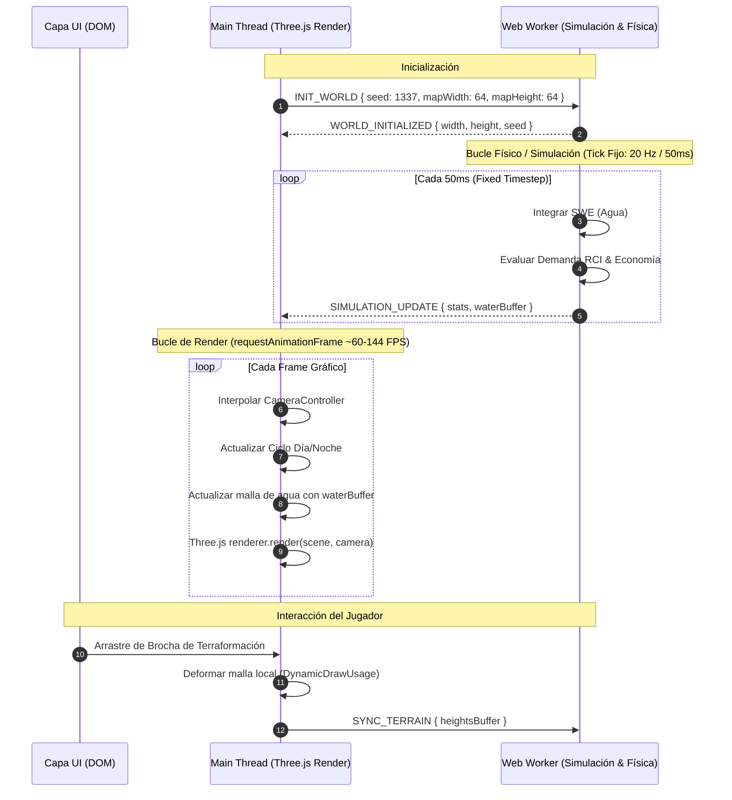

# 01. Arquitectura General y Loop Dual

Este documento explica el desacoplamiento entre el hilo de renderizado (`Main Thread`) y el hilo de simulación (`Web Worker`), garantizando 60+ FPS sin importar la complejidad del mundo.

---

## 🏛️ Diagrama de Flujo del Dual Loop

---

## 📦 Estructuras de Datos y Mensajería Tipada

Todos los mensajes que viajan a través del canal de Worker están estrictamente tipados en [`src/core/messages.ts`](../src/core/messages.ts):

* **`MainToWorkerMessage`**: Contiene órdenes de control (`INIT_WORLD`, `SET_SIMULATION_SPEED`, `SYNC_TERRAIN`, `SET_WATER_SOURCE`).
* **`WorkerToMainMessage`**: Emite deltas de simulación (`WORLD_INITIALIZED`, `SIMULATION_UPDATE`) transfiriendo arrays binarios contiguos (`Float32Array`) sin serialización costosa de JSON.

---

## ⚡ Zero-Allocation Loops

Para evitar recolecciones de basura (*Garbage Collector pauses*):
- No se usa `new` en bucles continuos.
- [`ObjectPool`](../src/core/utils/pool.ts) se utiliza para objetos reciclables.
- Las operaciones matemáticas de simulación usan [`Vec2`](../src/core/utils/math.ts) y mutaciones sobre arrays planos de memoria contigua.
