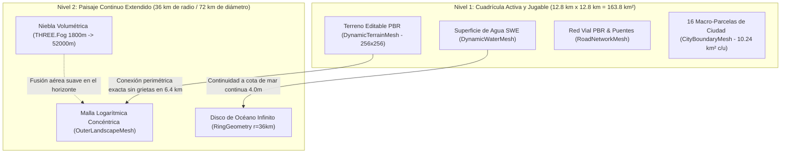

# 03. Terreno Dinámico, Falda del Horizonte y Macro-Parcelas

Este módulo describe la arquitectura de generación de terreno en dos niveles (*Two-Tier World Generation*), el generador geomorfológico regional (~160 km² estilo CityRT / Cities: Skylines), la falda del horizonte continuo (*Horizon Backdrop Mesh hasta 36 km*), el confinamiento elástico de cámara (*Camera Pan Bounds*), el sistema de macro-parcelas a escala real con hitos demográficos (*City Milestones*), y las brochas de terraformación continua en tiempo real.

---

## 🏔️ 1. Arquitectura de Terreno en Dos Niveles (Two-Tier World Generation)

Para garantizar un mundo que se extiende hasta el infinito sin sensación de isla flotante ni bordes recortados en el vacío negro:



### A. Cuadrícula Activa (Nivel 1)
* **Dimensiones:** $256 \times 256$ celdas con resolución métrica de 50.0m ($12.800\text{m} \times 12.800\text{m} = 163.84\text{ km}^2 \approx 160\text{ km}^2$).
* **Topología:** Malla indexada compartida `DynamicTerrainMesh` (66.049 vértices) que elimina cualquier aspecto de cuadrícula o facetas low-poly.
* **Normales Analíticas Continuas por Diferencias Centrales:**
  $$n_x = -\frac{h(x+1, z) - h(x-1, z)}{2 \cdot \Delta x}, \quad n_z = -\frac{h(x, z+1) - h(x, z-1)}{2 \cdot \Delta z}, \quad \vec{n} = \text{normalize}(n_x, 1.0, n_z)$$
* **Splatting Multiescala PBR:** Hierba viva (`Grass004`), tierra fértil (`Ground048`), arena de ribera y playas (`Ground033`), roca triplanar en paredes verticales y cumbres (`Rock030`) y nieve alpina sobre los 220m.

### B. Paisaje Continuo Extendido (Nivel 2: `OuterLandscapeMesh`)
* **Topología Radial Concéntrica Logarítmica:** Anillo con $18$ anillos radiales y $128$ sectores angulares que se extiende desde el perímetro exacto del terreno activo ($6.400\text{m}$) hasta $36.000\text{m}$ ($36\text{km}$ de radio / $72\text{km}$ de diámetro de horizonte visible).
* **Conexión Perimétrica Exacta (Zero-Gap):**
  Para cada ángulo $\theta$, el radio del anillo interior coincide exactamente con el cuadrado del terreno activo:
  $$r_{\text{inner}}(\theta) = \frac{\text{halfSize} - 0.4}{\max(|\sin\theta|, |\cos\theta|)}$$
  $$r(t, \theta) = r_{\text{inner}}(\theta) \cdot \left(\frac{r_{\text{outer}}}{r_{\text{inner}}(\theta)}\right)^t, \quad t \in [0, 1]$$
* **Shader PBR Idéntico:** Comparte exactamente el mismo shader PBR multiescala, texturas PBR y proyección triplanar en roca que el terreno activo. Cero saltos cromáticos.
* **Continuidad Orográfica:** Evalúa la misma función geomorfológica $H(wx, wz)$ calculada por `NaturalLandscapeGenerator`.
* **Fusión Atmosférica:** Sincronizada con `DayNightCycle` y `THREE.Fog(0xb5dcfa, 1800, 52000)`, transicionando entre cielo diurno, atardecer ámbar y noche profunda.

---

## 📷 2. Restricción Cinemática de Cámara (Camera Soft & Hard Bounds)

Implementado en [`src/render/camera/camera_controller.ts`](../src/render/camera/camera_controller.ts):
* **Pan Bounding Box:** El punto focal de mira (`target.x`, `target.z`) se confina dinámicamente a la caja envolvente de las parcelas desbloqueadas de la ciudad:
  $$\text{target}_x \in [\min X - \text{margin}, \, \max X + \text{margin}]$$
  $$\text{target}_z \in [\min Z - \text{margin}, \, \max Z + \text{margin}]$$
* **Margen Elástico Suave ($\text{margin} = 40.0\text{m}$):** Permite encuadrar holgadamente la periferia y los límites municipales sin permitir al jugador alejarse hacia zonas no exploradas.
* **Zoom Dinámico Regional:** Rango de distancia de $15\text{m}$ a $6.500\text{m}$, permitiendo desde vistas peatonales a nivel de acera hasta majestuosas panorámicas aéreas regionales.

---

## 🏛️ 3. Sistema de Macro-Parcelas de Escala Real (CityTileManager)

Ubicado en [`src/core/world/city_tile_manager.ts`](../src/core/world/city_tile_manager.ts) y [`src/render/terrain/city_boundary_mesh.ts`](../src/render/terrain/city_boundary_mesh.ts):

### A. Macro-Escala Realista (160 km² Regional Scale)
* **Superación de parcelas mínimas:** El territorio se organiza en una cuadrícula de $4 \times 4 = 16$ macro-parcelas de $64 \times 64$ celdas ($3.200\text{m} \times 3.200\text{m} = 10.24\text{ km}^2 = 1.024\text{ hectáreas}$ cada una).
* **Superficie Total:** $16 \times 10.24\text{ km}^2 = 163.84\text{ km}^2$, coincidente con el estándar de $159\text{ km}^2 - 160\text{ km}^2$ de *Cities: Skylines II* y *CityRT*.
* **Capacidad:** Una sola macro-parcela ofrece más de 1.000 hectáreas, espacio suficiente para una metrópolis completa con autopistas, distritos, puertos fluviales y polígonos industriales.
* **Parcela Inicial:** La partida arranca con **1 macro-parcela inicial desbloqueada** en el fértil valle aluvial central (`tx: 1, tz: 1`), atravesada por la red fluvial continua y con la autovía regional de conexión exterior.
* **Presupuesto Inicial:** Fondos estándar de **$50.000**.

### B. Progresión por Hitos Demográficos (City Milestones)
El número máximo de macro-parcelas adquiribles está regulado por la población de la ciudad:

| Nivel | Hito Demográfico | Población Mínima | Macro-Parcelas Máx. |
| :---: | :--- | :---: | :---: |
| **0** | **Pionero** | 0 hab | 1 macro-parcela (Inicial) |
| **1** | **Aldea** | 250 hab | 2 macro-parcelas |
| **2** | **Pueblo** | 1.000 hab | 4 macro-parcelas |
| **3** | **Villa Próspera** | 3.500 hab | 6 macro-parcelas |
| **4** | **Ciudad** | 8.000 hab | 9 macro-parcelas |
| **5** | **Gran Metrópolis** | 20.000 hab | 16 macro-parcelas |

### C. Recursos Orográficos y Mantenimiento Territorial
* **Análisis Orográfico Automático:**
  - `% Suelo Llano`: Pendiente $< 0.22$, idóneo para edificación rápida.
  - `% Masa de Agua`: Superficie fluvial o marítima.
  - `% Cobertura Forestal`: Densidad de masa arbórea aprovechable.
* **Tasa de Mantenimiento Territorial (`upkeepWeekly`):** Coste administrativo semanal por parcela para penalizar la sobreexpansión prematura.
* **Restricción Estricta de Construcción:** Las carreteras, edificios y terraformación solo pueden ejecutarse dentro de sectores desbloqueados. El cursor previsualizador de carreteras (`RoadPreviewMesh`) se tiñe de rojo brillante (`#ff3333`) si se intenta trazar hacia suelo no adquirido.

---

## 🛠️ 4. Algoritmo de Brochas de Terraformación

Implementado en [`src/core/terrain/terrain_modifier.ts`](../src/core/terrain/terrain_modifier.ts):

### Falloff Cosenoidal Suave
$$\text{dist} = \sqrt{(v_x - \text{gridX})^2 + (v_z - \text{gridZ})^2}$$
$$\text{falloff} = \frac{1}{2} \left(1 + \cos\left(\frac{\text{dist}}{\text{radius}} \cdot \pi\right)\right)$$

### Modos de Brocha
1. **`RAISE`:** $h_{\text{nueva}} = h_{\text{actual}} + \text{fuerza} \cdot \Delta t \cdot \text{falloff}$
2. **`LOWER`:** $h_{\text{nueva}} = \max(0.1, h_{\text{actual}} - \text{fuerza} \cdot \Delta t \cdot \text{falloff})$
3. **`FLATTEN`:** Acerca $h_{\text{actual}}$ hacia $\text{targetHeight}$ proporcionalmente a $\text{falloff}$.
4. **`SMOOTH`:** Calcula el promedio aritmético local y converge suavemente hacia él.


---

## 🏖️ 5. Morfología Costera: Playas de Arena Dorada vs. Acantilados Rocosos

Implementado en [`src/core/terrain_data.ts`](../src/core/terrain_data.ts) y [`src/render/terrain/dynamic_terrain_mesh.ts`](../src/render/terrain/dynamic_terrain_mesh.ts):

La línea de contacto entre el agua y la tierra se diferencia de forma orgánica en dos tipologías geomorfológicas bien contrastadas:

### A. Acantilados Rocosos Escarpados (*Sea Cliffs & River Canyons*)
* **Morfología:** Promontorios rocosos en cabos marítimos (cuadrante este y salientes) y gargantas del curso alto del río. La meseta se eleva ($5.5\text{m} - 10.0\text{m}$) y se precipita de forma súbita y vertical hacia el agua ($\text{slope} \ge 0.32$).
* **Splatting PBR:**
  - Donde $\text{slope} \ge 0.26$ en la línea de agua, la arena no puede sostenerse físicamente; el peso de la arena (`sandWeight`) se reduce a $0.0$.
  - Domina la roca viva (`Rock030`) con proyección triplanar vertical en las paredes cortadas a pico.
  - Franja húmeda oscurecida (`wetShore`) en el zócalo rocoso donde rompe el oleaje.
* **Bioma:** Clasificado como `BIOME_ROCK` en la cuadrícula de simulación.

### B. Playas de Arena Dorada (*Sandy Beaches & Sheltered Coves*)
* **Morfología:** Bahías semicirculares protegidas y orillas de las tres lagunas costeras. La orografía desciende con una suave pendiente tendida ($\text{slope} \le 0.18$) a lo largo de 20m a 35m de extensión litoral.
* **Splatting PBR:**
  - La arena dorada (`Ground033`) cubre por completo la cota costera ($h \in [1.25\text{m}, 2.45\text{m}]$).
  - Franja húmeda brillante en el borde intermareal que se sumerge de forma continua bajo el agua turquesa.
* **Bioma:** Clasificado como `BIOME_SAND` en la cuadrícula de simulación.

---

## 🌲 6. Generación de Vegetación y Arbolado del Mundo Entero

Implementado en [`src/core/world/foliage_generator.ts`](../src/core/world/foliage_generator.ts) y [`src/render/foliage/foliage_manager.ts`](../src/render/foliage/foliage_manager.ts):

Superando la limitación inicial donde los árboles solo aparecían en una estrecha franja, la vegetación se extiende de manera procedural por **todo el mapa (256m x 256m)** según reglas bioclimáticas deterministas:

* **Población Integral:** Más de 2.000 árboles y 800 arbustos distribuidos de manera equilibrada en los cuatro cuadrantes (norte alpino, sur costero, valle central y altiplano oriental).
* **Capas Ecológicas:**
  1. *Pinares Alpinos (Norte):* Coníferas de montaña en cotas de $4.0\text{m}$ a $16.5\text{m}$.
  2. *Bosques de Ribera (Oeste):* Sauces, álamos y arbustos frondosos a lo largo de todo el curso fluvial y lagunas.
  3. *Bosque Caducifolio y Dehesas (Centro):* Masas forestales densas combinadas con calveros y árboles solitarios majestuosos.
  4. *Pinares Marítimos y Matorral Dunar (Sur):* Vegetación litoral asentada tras las playas y en las mesetas sobre los acantilados.
* **Exclusiones Biológicas Estrictas:** Cero vegetación dentro del agua ($h \le 1.55\text{m}$), en la arena de las playas, en las paredes verticales de acantilados ($\text{slope} \ge 0.42$) o en las cumbres nevadas ($h > 17.5\text{m}$).
* **Despeje Automático por Trazado Vial (*Road Tree Clearing*):** Al construir carreteras o glorietas, el motor despeja y tala automáticamente los árboles que colisionen con el trazado vial en un radio de 4.2m.

---

## 🌐 7. Generador Geomorfológico Unificado y Paisaje Regional de 160 km² (CityRT Geomorphology)

Implementado en [`src/core/terrain/natural_landscape_generator.ts`](../src/core/terrain/natural_landscape_generator.ts) y [`src/render/terrain/outer_landscape_mesh.ts`](../src/render/terrain/outer_landscape_mesh.ts):

Para garantizar que el mundo sea un clon fiel del gameplay de CityRT, donde sin texturas ni modelos parece un auténtico paisaje terrestre natural:

```mermaid
flowchart TD
    Config["Configuración Paramétrica (LandscapeConfig / Presets)"] --> Gen["Generador Geomorfológico Regional (NaturalLandscapeGenerator)"]
    Gen -->|H(wx, wz) analítico| Active["Terreno Activo Regional (DynamicTerrainMesh - 12.8 km x 12.8 km = 163.8 km²)"]
    Gen -->|Misma H(wx, wz) continua| Outer["Paisaje Exterior Extendido (OuterLandscapeMesh - hasta 36 km)"]
    Gen -->|Muestreo de pendientes y biomas| Foliage["Vegetación y Bosques Mundiales (FoliageGenerator)"]
    
    Active --> Shaders["Shader PBR Idéntico (Grass004, Ground048, Ground033, Rock030 Triplanar, Nieve Alpina)"]
    Outer --> Shaders
```

### A. Leyes Geomorfológicas Terrestres Clave
1. **Deformación Tectónica Multi-Escala (*Tectonic Domain Warping*):**
   A longitudes de onda de 5.000m y 1.500m, deforma las coordenadas ortogonales reproduciendo pliegues y fallas de placas tectónicas reales.
2. **Cordillera Alpina Septentrional y Crestas Multifractales:**
   Crestas afiladas (*knife-edge arêtes*) y picos piramidales (*horn peaks*) de hasta 390m-450m mediante ruido `ridged2D` elevado a potencias fraccionarias.
3. **Canales de Erosión y Taludes Parabólicos (*Scree Slopes & Ravines*):**
   Erosión hidráulica en V entre espolones rocosos y transición suave cóncava gravitacional (ángulo de reposo de derrubios) hacia el pie de monte.
4. **Gran Valle Aluvial y Terrazas Fluviales Escalonadas:**
   El inmenso valle central habitable ($z \in [-1.800\text{m}, 3.200\text{m}]$, más de $60\text{ km}^2$ de suelo construible con pendientes $< 2^\circ$) cuenta con terrazas fluviales naturales de $3.5\text{m}$ que ofrecen bancales planos idóneos para distritos urbanos.
5. **Red Fluvial Continental Continua:**
   Un río majestuoso ($32\text{m}$ de ancho en el valle que se ensancha hasta $112\text{m}$ en la desembocadura) recorre el mapa de norte a sur con lecho parabólico bajo el agua y amplias llanuras aluviales.
6. **Litoral Marino y Playas de Equilibrio (Dean):**
   Litoral meridional con bahías semicirculares, playas arenosas de perfil cóncavo de equilibrio ($h \sim d^{0.72}$) y acantilados rocosos donde los espolones montañosos caen al mar.

### B. Malla de Paisaje Exterior Panorámica (`OuterLandscapeMesh`)
- **Topología Logarítmica:** 18 anillos concéntricos $\times$ 128 sectores angulares.
- **Transición de Silueta:** El anillo interior ($t = 0$) tiene la silueta cuadrada exacta del terreno activo ($6.400\text{m}$) con $0.4\text{m}$ de solape, transformándose logarítmicamente en un círculo perfecto de $36.000\text{m}$ ($36\text{km}$ de radio / $72\text{km}$ de diámetro de horizonte visible).
- **Shader PBR Idéntico:** Comparte el mismo sombreador multiescala con proyección triplanar en paredes rocosas, arena dorada en playas suaves, franja húmeda y nieve alpina. Cero diferencias cromáticas o de iluminación con el terreno activo.

---

## 🎛️ 8. Configuración Paramétrica y Panel Interactivo (`LandscapeConfig` & `LandscapeGeneratorUI`)

Implementado en [`src/core/terrain/landscape_config.ts`](../src/core/terrain/landscape_config.ts) y [`src/ui/landscape_generator_ui.ts`](../src/ui/landscape_generator_ui.ts):

Permite a los jugadores configurar el relieve antes de comenzar o regenerarlo en caliente:

### A. Parámetros Geomorfológicos
* `mountainIntensity` ($0.0 - 1.0$): Escala vertical y prominencia de las cordilleras alpinas.
* `coastExtent` ($0.1 - 0.9$): Extensión del nivel del mar y cobertura del océano.
* `cliffIntensity` ($0.0 - 1.0$): Predominancia de acantilados verticales vs playas tendidas.
* `riverWidth` ($20\text{m} - 100\text{m}$): Anchura del cauce del río principal.
* `riverDepth` ($2.5\text{m} - 6.5\text{m}$): Profundidad de excavación fluvial.
* `seed`: Semilla determinista del generador de números pseudoaleatorios (PRNG).

### B. Presets de Entorno Natural
1. **🌄 Valle Costero Alpino (`COASTAL_VALLEY` - Por defecto):** Inspirado fielmente en el gameplay de CityRT y Fable Cities, con un inmenso valle aluvial habitable de ~100 km², cordillera alpina al norte, gran río serpenteante y bahía costera.
2. **🏔️ Tierras Altas y Cañones Alpinos (`MOUNTAIN_HIGHLANDS`):** Cordilleras monumentales, crestas arfiladas, gargantas escarpadas y acantilados dominantes.
3. **🌾 Llanuras y Praderas Suaves (`ROLLING_PLAINS`):** Relieve suavemente ondulado con terrazas aptas para grandes extensiones metropolitanas.
4. **🌊 Costa de Acantilados y Fiordos (`RUGGED_COAST`):** Alta presencia oceánica, promontorios cortados a pico sobre el mar.

### C. Regeneración en Caliente (`Engine.regenerateWorld`)
Al pulsar "✨ Generar Paisaje Natural" en el panel (accesible con la tecla `P` o el botón de la barra de herramientas), el motor:
1. Recalcula las alturas de la cuadrícula activa (163.8 km²) y actualiza las normales continuas.
2. Reconstruye la malla de paisaje exterior de 36 km.
3. Sincroniza el nivel del agua a 4.0m y el océano continuo.
4. Regenera la vegetación mundial respetando las nuevas orillas y acantilados.
5. Reinicializa las 16 macro-parcelas municipales situando la inicial en el valle fértil.
6. Conecta la autovía regional de entrada y notifica al Web Worker de simulación.

