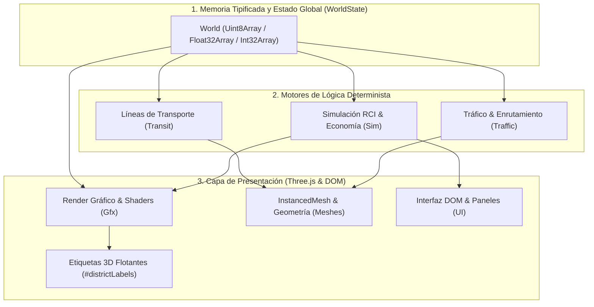

# 📚 Vira City — Documentación Técnica del Sistema

Bienvenido a la documentación técnica oficial de **Vira City**, un simulador de gestión urbana y construcción de ciudades en tiempo real (*city builder*) desarrollado en **TypeScript**, **Three.js** y **Vite**.

Este compendio detalla la arquitectura de bajo nivel, el modelo matemático de simulación, la gestión de memoria *zero-garbage-collection*, los sistemas de tráfico y transporte público, el pipeline de renderizado gráfico y la interfaz de usuario.

---

## 🗺️ Mapa de Documentación

| Documento | Descripción y Alcance |
| :--- | :--- |
| **[architecture.md](file:///home/dev/projects/city-builder/docs/architecture.md)** | Visión general del motor, convención de coordenadas, modelo de memoria en arrays planos (`TypedArray`) y bucle principal. |
| **[world-and-terrain.md](file:///home/dev/projects/city-builder/docs/world-and-terrain.md)** | Generación procedural de terreno, lagos orgánicos, relieve (`hc`), cuadrícula viaria, topología de cruces y parcelas. |
| **[simulation-and-economy.md](file:///home/dev/projects/city-builder/docs/simulation-and-economy.md)** | Ciclo RCI, cálculo de demanda, felicidad, ciclo de vida de edificios, coberturas de servicios, presupuestos y serialización RLE. |
| **[traffic-and-transit.md](file:///home/dev/projects/city-builder/docs/traffic-and-transit.md)** | Algoritmo de enrutamiento vehicular, costes de congestión, agentes peatonales y ciclistas, y redes de transporte masivo (autobús, tranvía, tren, metro). |
| **[rendering-and-shaders.md](file:///home/dev/projects/city-builder/docs/rendering-and-shaders.md)** | Motor Three.js, mallas instanciadas (`InstancedMesh`), shaders GLSL personalizados, texturas de datos GPU y etiquetas 3D flotantes. |
| **[ui-and-tools.md](file:///home/dev/projects/city-builder/docs/ui-and-tools.md)** | Sistema de herramientas de construcción (`Tools`), trazado de carreteras (recta, curva, S-bend, rejilla), dock inferior y paneles flotantes. |
| **[districts-and-policies.md](file:///home/dev/projects/city-builder/docs/districts-and-policies.md)** | Sistema de distritos municipales, 7 especializaciones económicas, 8 políticas urbanas y modificadores en vivo (Fase 1). |
| **[water-and-sanitation.md](file:///home/dev/projects/city-builder/docs/water-and-sanitation.md)** | Redes de agua limpia, colectores fecales, depuradoras, contaminación hidrológica, dispersión por viento dinámico y ciclo funerario (Fase 2). |
| **[social-unrest-and-strikes.md](file:///home/dev/projects/city-builder/docs/social-unrest-and-strikes.md)** | Malestar social, huelgas de servicios esenciales, cortes por manifestaciones, barricadas 3D y convenios sindicales (Fase 3.5). |
| **[save-system-and-desktop.md](file:///home/dev/projects/city-builder/docs/save-system-and-desktop.md)** | Persistencia multiranura híbrida (IndexedDB/Tauri), capturas 3D, autoguardado rotativo, archivos `.viracity` y empaquetado desktop (Fase 3.8). |
| **[internationalization-and-localization.md](file:///home/dev/projects/city-builder/docs/internationalization-and-localization.md)** | Arquitectura i18n, diccionarios multilingües (EN, ES, DE, FR, ZH, JA), cambio de idioma en caliente y formateo regional (Fase 3.9). |
| **[demographics-and-epidemics.md](file:///home/dev/projects/city-builder/docs/demographics-and-epidemics.md)** | Pirámide etaria, desajuste laboral, fuga de cerebros, gentrificación, epidemias SIR y turismo (Fase 5). |
| **[weather-and-disasters.md](file:///home/dev/projects/city-builder/docs/weather-and-disasters.md)** | Clima dinámico, partículas 3D de lluvia y nieve, incendios a sotavento, mega-proyectos (Ópera, Estadio, Aeropuerto) y rescate por bancarrota (Fase 6). |
| **[refactoring-strategy.md](file:///home/dev/projects/city-builder/docs/refactoring-strategy.md)** | Plan de refactorización limpia (Fase 1.5): eliminación de `@ts-nocheck`, desacoplamiento de `window.CB` y modularización. |

---

## 🏛️ Filosofía Arquitectónica del Proyecto

1. **Rendimiento Zero-GC:** Todas las estructuras masivas del mapa ($208 \times 208$ casillas = 43.264 celdas) se almacenan en arrays tipificados planos contiguos (`Uint8Array`, `Float32Array`, `Int32Array`) para evitar recolección de basura (*Garbage Collection pauses*) y asegurar 60 FPS estables.
2. **Determinismo Desacoplado:** La simulación se ejecuta a pasos de tiempo fijos discretos desacoplados del renderizado gráfico de la GPU.
3. **Mallas Instanciadas (`InstancedMesh`):** Los miles de edificios, coches, peatones, postes y árboles comparten geometrías comunes mediante instanciación de matrices y colores en Three.js, minimizando drásticamente las llamadas de dibujado (*draw calls*).
4. **Protocolo Estricto de Agentes:** Todo nuevo desarrollo debe mantener la coherencia tipográfica de TypeScript (`npm run typecheck`) y actualizar la documentación según las normas descritas en **[AGENTS.md](file:///home/dev/projects/city-builder/AGENTS.md)**.
