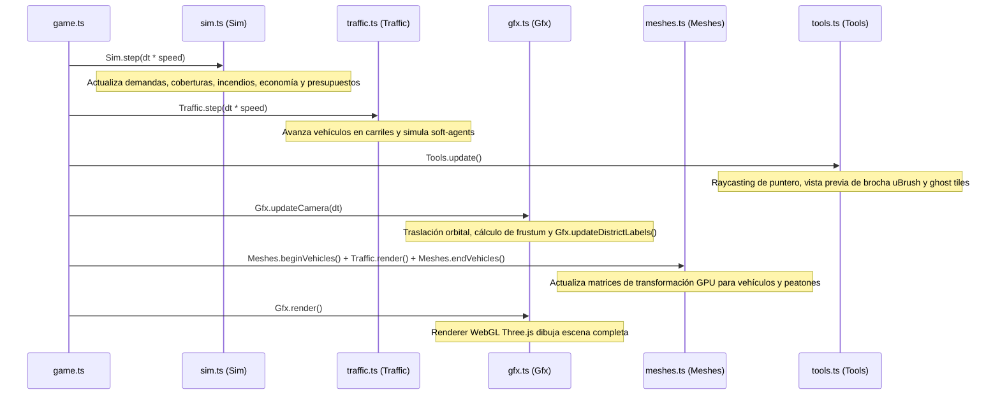

# 🏛️ Arquitectura General del Sistema

## 1. Estructura de Módulos y Código Fuente

El código se organiza en módulos de responsabilidad única bajo el directorio `src/`:

```
src/
├── core/            # Constantes globales, definiciones de carreteras/servicios y utilidades matemáticas
│   ├── constants.ts # C: Constantes de tamaño, hitos, carreteras, costes y servicios
│   ├── utils.ts     # U: Funciones matemáticas, hash, ruido FBM, clamps, interpolaciones y RLE
│   └── index.ts     # Exportaciones agregadas
├── world/           # Estado topológico de la cuadrícula, terreno, carreteras, cruces y distritos
│   ├── world.ts     # World: Buffer de alturas, enlaces viarios, árboles, zonas y distritos
│   └── index.ts     # Exportaciones agregadas
├── sim/             # Motor de simulación socioeconómica, demandas RCI, servicios y presupuestos
│   ├── sim.ts       # Sim: Ciclo de vida de edificios, cálculo de felicidad, impuestos y guardado
│   └── index.ts     # Exportaciones agregadas
├── traffic/         # Sistema de navegación de vehículos, asignación de carriles y soft-agents
│   ├── traffic.ts   # Traffic: Grafo de navegación A*, congestión, ciclistas y peatones
│   └── index.ts     # Exportaciones agregadas
├── transit/         # Gestión de redes de transporte público masivo
│   ├── transit.ts   # Transit: Líneas, paradas, vehículos asignados y rentabilidad
│   └── index.ts     # Exportaciones agregadas
├── render/          # Pipeline gráfico Three.js y geometría instanciada
│   ├── gfx.ts       # Gfx: Cámara orbital, iluminación, shaders personalizados y etiquetas 3D
│   ├── meshes.ts    # Meshes / GB: Constructor de instanciaciones para edificios, árboles y vehículos
│   └── index.ts     # Exportaciones agregadas
├── tools/           # Interacción de construcción, pinceles de carreteras/zonas/distritos
│   ├── tools.ts     # Tools: Modos de dibujo, previsualización de sombras, brocha de demolición
│   └── index.ts     # Exportaciones agregadas
├── ui/              # Capa de interfaz de usuario DOM y paneles de gestión
│   ├── ui.ts        # UI: Toolbar inferior, panel cívico superior, info-views y panel de distritos
│   └── index.ts     # Exportaciones agregadas
├── types/           # Interfaces y tipos TypeScript
│   └── index.ts     # Modelos District, Building, ToolState, Vehicle, TransitLine, etc.
├── game.ts          # Bucle principal de juego (requestAnimationFrame) y orquestación
└── main.ts          # Punto de entrada de la aplicación Vite
```

---

## 2. Sistema de Coordenadas y Escala

| Dimensión | Valor | Descripción |
| :--- | :--- | :--- |
| **Cuadrícula ($W$)** | `208` casillas | El mapa total mide $208 \times 208 = 43.264$ casillas. |
| **Área jugable ($P_0, P_1$)** | `48` a `160` | La zona de inicio jugable es una ventana central de $112 \times 112$ casillas. |
| **Tamaño de Casilla ($T$)** | `20.0` metros | Cada casilla mide $20\text{ m} \times 20\text{ m}$ en el espacio 3D real. |
| **Ancho total del mapa** | `4.160` metros | El mundo mide $4,16\text{ km} \times 4,16\text{ km}$. |
| **Indexación de Casillas** | `i = y * W + x` | Mapeo bidireccional mediante `U.idx(x, y)`, `U.tx(i)` y `U.ty(i)`. |
| **Vértices de Terreno** | $(W + 1) \times (W + 1)$ | Matriz de alturas en esquinas de casillas (`hc`) de $209 \times 209 = 43.681$ puntos. |

### Transformación de Coordenadas:
- **De Casilla a Mundo:** $wx = (x + 0.5) \cdot T$, $wz = (y + 0.5) \cdot T$.
- **De Mundo a Casilla:** $x = \lfloor wx / T \rfloor$, $y = \lfloor wz / T \rfloor$.

---

## 3. Modelo de Memoria Zero-GC (`Flat Typed Arrays`)

Para evitar paradas de recolección de basura (*Garbage Collection stuttering*), el estado masivo de la ciudad no reside en objetos dinámicos dispersos en el montón (*heap*), sino en arrays tipificados continuos indexados por casilla `i`:

```typescript
// Dimensiones: N = W * W = 43.264
World.hc     = new Float32Array((W + 1) * (W + 1)); // Alturas de esquinas de relieve
World.road   = new Uint8Array(N);                   // Tipo de carretera (0 = ninguna, 1..N = C.ROADS)
World.link   = new Uint8Array(N);                   // Máscara de conexiones con 4 vecinos (bits 0..3)
World.rdir   = new Uint8Array(N);                   // Dirección principal de flujo (0=N, 1=E, 2=S, 3=W)
World.rpart  = new Uint8Array(N);                   // Configuración de mediana y doble calzada
World.curv   = new Uint8Array(N);                   // Flag de curvatura de segmento
World.jcl    = new Int32Array(N).fill(-1);          // ID del clúster de intersección (-1 = sin cruce)
World.rail   = new Uint8Array(N);                   // Vías férreas (0 = sin vía, 1 = tren, 2 = metro)
World.zone   = new Uint8Array(N);                   // Zonificación (1..3 res, 4..5 com, 6..7 ind/off)
World.bld    = new Int32Array(N);                   // ID del edificio que ocupa la casilla (0 = libre)
World.tree   = new Uint8Array(N);                   // Densidad arbórea procedural (0..3)
World.zonable= new Uint8Array(N);                   // Flag si la casilla está a <= 3 casillas de vía
World.conn   = new Uint8Array(N);                   // Flag si la casilla está conectada a la autopista exterior
World.district = new Uint8Array(N);                 // ID del distrito municipal (0 = no asignado, 1..254)
```

---

## 4. El Bucle Principal del Juego (`Main Loop`)

Ubicado en [src/game.ts](file:///home/dev/projects/city-builder/src/game.ts), se ejecuta en cada fotograma mediante `requestAnimationFrame(loop)`:


