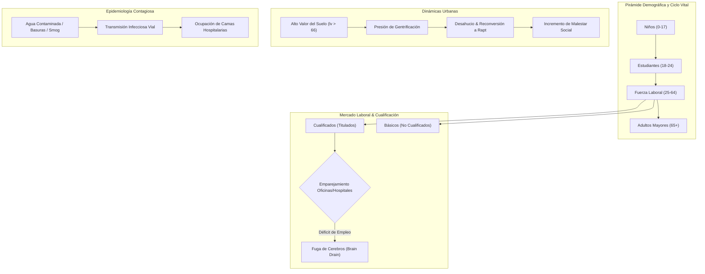

# 👥 Demografía, Mercado Laboral, Gentrificación y Epidemias — Vira City (`docs/demographics-and-epidemics.md`)

Este documento describe la arquitectura técnica, modelos matemáticos, dinámicas epidemiológicas y mecánicas de gentrificación implementadas en la **Fase 5** de Vira City.

---

## 🧭 1. Visión General del Sistema

El módulo demográfico y epidemiológico ([src/sim/demographics.ts](file:///home/dev/projects/city-builder/src/sim/demographics.ts)) trasciende el conteo numérico simple de población para transformar a los ciudadanos en una sociedad estratificada con ciclos vitales, niveles educativos, exposición a patógenos contagiosos y vulnerabilidad socioeconómica ante la especulación inmobiliaria.

---

## 📊 2. Pirámide Demográfica y Cohortes Vitales

La población total $P$ se descompone en 4 cohortes etarias discretas en tiempo real:

1. **Niños (`children`, 0–17 años):** Dependientes del sistema escolar de primaria y guarderías. No forman parte de la masa laboral. Su proporción estimula la natalidad futura y demanda parques infantiles.
2. **Estudiantes Universitarios (`students`, 18–24 años):** Ciudadanos en formación técnica y superior matriculados en institutos y universidades. Nutren la bolsa de mano de obra cualificada al graduarse.
3. **Fuerza Laboral Activa (`workforce`, 25–64 años):** El motor económico de la ciudad. Genera impuestos directos sobre la renta y ocupa vacantes industriales, comerciales y de servicios.
4. **Adultos Mayores / Jubilados (`seniors`, 65+ años):** Retirados de la actividad laboral productiva. Demandan mayor cobertura sanitaria, centros de mayores y atención hospitalaria continuada.

### Indicadores Vitales:
* **Esperanza de Vida (`lifeExpectancy`):** Calculada dinámicamente entre 60 y 88 años:
  $$\text{LifeExp} = 65 + 15 \times \text{coberturaSalud} + 5 \times \text{purezaAgua} - 12 \times \text{poluciónMedia}$$
* **Tasa de Fertilidad (`fertilityRate`):** Oscila entre 0.8 y 3.2 nacimientos por cada 1.000 habitantes, viéndose incentivada por la felicidad general, espacios verdes y disponibilidad de vivienda unifamiliar.

---

## 🎓 3. Mercado Laboral, Desajuste y Fuga de Cerebros (*Brain Drain*)

### 3.1 Segmentación de Empleos y Habilidades
Los puestos de trabajo de la ciudad se diferencian en dos categorías:
* **Empleos de Alta Cualificación (`skilledJobs`):** Oficinas (`off`), rascacielos comerciales de alta densidad (`chigh`), universidades, hospitales generales, centros de convenciones y sedes aeroportuarias.
* **Empleos Básicos (`unskilledJobs`):** Industria manufacturera (`ind`), talleres mecánicos, agricultura, explotaciones forestales, comercio minorista básico y brigadas de mantenimiento.

### 3.2 Índice de Desajuste Laboral (*Mismatch Index*)
Calcula el desfase relativo entre la capacitación de la fuerza laboral y las vacantes ofertadas:
$$\text{laborMismatchIndex} = \min\left(100, \left(\frac{|\text{skilledWorkers} - \text{skilledJobs}| + |\text{unskilledWorkers} - \text{unskilledJobs}|}{\text{workforce} + 1}\right) \times 100\right)$$

### 3.3 Mecánica de Fuga de Cerebros (*Brain Drain*)
Si los trabajadores cualificados superan holgadamente la oferta de oficinas y alta tecnología ($\text{skilledWorkers} > 1.35 \times \text{skilledJobs}$ con más de 30 graduados en desempleo técnico), se activa la **Fuga de Cerebros**:
* Una tasa mensual de jóvenes talentos (`brainDrainRate`, entre 2 y 40 profesionales/mes) emigra permanentemente fuera de la ciudad.
* Reduce la demanda de zonificación de oficinas de alta densidad y restringe el crecimiento de distritos tecnológicos.

---

## 🏙️ 4. Gentrificación y Desplazamiento Residencial

Cuando barrios residenciales de baja densidad (`rlow`, casitas unifamiliares de niveles 1 y 2) quedan rodeados de infraestructuras de lujo, metro y alta cobertura de parques, el valor del suelo aumenta drásticamente ($\text{lv} > 66$).

1. **Presión de Alquiler:** Los residentes de rentas bajas no pueden sostener la subida impositiva ni el coste de vida.
2. **Reconversión Forzosa:** Las casas unifamiliares se demuelen para erigir bloques de apartamentos densos (`rapt`).
3. **Desplazamiento Forzado:** Los vecinos expulsados engrosan la cifra de `displacedCitizens` y generan un repunte de malestar social (`unrest`).
4. **Protección Municipal:** Si el distrito tiene activa la ordenanza de **Control de Alquileres** (`policies.rentControl`), la gentrificación queda bloqueada, preservando la identidad del barrio.

---

## 🦠 5. Modelo Epidemiológico y Saturación Sanitaria

El modelo de patógenos simula brotes de contagio basados en vectores de transmisión urbana:
* **Focos de Infección:** Tuberías de agua no tratadas, acumulación prolongada de basuras sin recoger o nubes de smog industrial denso.
* **Contagio Vial:** La enfermedad salta de edificio a edificio a través de las conexiones de carretera siguiendo un modelo de contacto SIR.
* **Saturación Hospitalaria:** Los hospitales y clínicas disponen de un volumen finito de camas. Cuando los enfermos superan el 85% de la capacidad de camas, la tasa de mortalidad se triplica y los ciudadanos no atendidos fallecen en sus hogares.

### Directivas de Intervención Sanitaria
Desde el panel de demografía, el alcalde puede activar medidas extraordinarias:
1. **Desinfección Municipal Masiva ($3.000):** Baldeo químico de calzadas y purgado de colectores; reduce a la mitad el riesgo de transmisión durante 90 días.
2. **Campaña de Vacunación de Emergencia ($4.500):** Distribución intensiva de vacunas en dispensarios que inmuniza a niños y mayores, reduciendo la susceptibilidad comunitaria.
3. **Cuarentena Sanitaria Dirigida ($1.500/mes):** Restringe aforos en comercios y establece controles viales; disminuye el contagio un 65% a costa de una reducción temporal en ingresos comerciales.

---

## 🏨 6. Infraestructuras de Turismo y Hostelería

Se incorporan tres servicios mayores en el catálogo con geometrías 3D de estilo arquitectónico único:
1. **Gran Hotel de Lujo (`hotel_grand`, 3x3):** Palacio neoclásico de cinco estrellas para viajeros pudientes y de negocios.
2. **Centro Internacional de Convenciones (`convention_center`, 4x3):** Complejo de pabellones expositivos y congresos mundiales.
3. **Resort de Ocio y Parque Acuático (`resort_leisure`, 4x4):** Resort vacacional con lagunas tropicales, piscinas y toboganes.

* **Impacto Económico:** Incrementa la afluencia de visitantes mensuales (`touristCount`) y eleva la tasa de ocupación hotelera (`hotelOccupancy`), inyectando ingresos directos en comercios locales y restaurantes.

---

## 🖥️ 7. Integración en la Interfaz (UI) e Info Views

* **Panel Demográfico y de Salud:** Accesible desde el menú superior **Civic $\rightarrow$ Demographics & Health** ([src/ui/panels/demographics.ts](file:///home/dev/projects/city-builder/src/ui/panels/demographics.ts)).
* **Nuevas Capas GPU de Infovisión:**
  * `'epidemic'`: Mapa térmico de vectores infecciosos y concentración de casos sintomáticos.
  * `'gentrification'`: Muestra las zonas de alta fricción entre valor de suelo especulativo y viviendas unifamiliares vulnerables.
* **Soporte Completo i18n:** Traducción integral en inglés, español, alemán, francés, chino simplificado y japonés.
