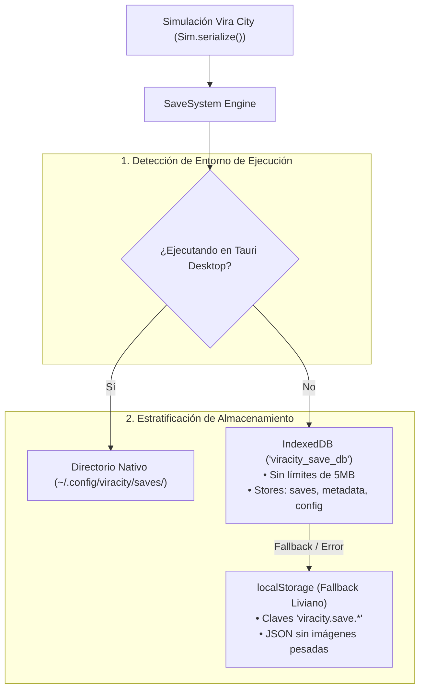

# 💾 Sistema de Guardado Avanzado, Exportación `.viracity` y Empaquetado Desktop (`docs/save-system-and-desktop.md`)

Este documento especifica la arquitectura de persistencia multiranura, captura de capturas 3D en tiempo real, gestión de autoguardados rotativos, importación/exportación de archivos `.viracity` e integración desktop nativa mediante **Tauri v2** correspondiente a la **Fase 3.8**.

---

## 🏛️ 1. Arquitectura de Persistencia Híbrida

El motor de persistencia (`SaveSystem` en [src/sim/saveSystem.ts](file:///home/dev/projects/city-builder/src/sim/saveSystem.ts)) implementa un esquema de almacenamiento a tres niveles diseñado para superar de forma transparente las limitaciones tradicionales de cuota de almacenamiento web:



### 1.1 Niveles de Persistencia:
1. **Escritorio Nativo (Tauri v2):**
   - Si la aplicación detecta `window.__TAURI_INTERNALS__` o `window.__TAURI__`, delega las operaciones de lectura y escritura al sistema de archivos del sistema operativo mediante comandos IPC Rust en [src/sim/tauriBridge.ts](file:///home/dev/projects/city-builder/src/sim/tauriBridge.ts).
   - Ubicaciones estándar:
     - **Linux / Steam Deck:** `~/.config/viracity/saves/`
     - **Windows:** `%APPDATA%/ViraCity/saves/`
     - **macOS:** `~/Library/Application Support/ViraCity/saves/`
2. **IndexedDB Navegador (Principal Web):**
   - Base de datos transaccional `viracity_save_db` con tres almacenes de objetos independientes:
     - `saves`: Almacena el payload completo de la ciudad (`SerializedCity`) junto con sus metadatos.
     - `metadata`: Almacena únicamente el descriptor `SaveMeta` para posibilitar listas y filtros instantáneos sin deserializar megabytes de celdas y carreteras.
     - `config`: Preferencias del usuario respecto al intervalo de autoguardado rotativo.
3. **localStorage (Reserva de Emergencia):**
   - Utilizado si el navegador restringe IndexedDB (navegación privada estricta o cuota rechazada).
   - Para evitar `QuotaExceededError`, las miniaturas en base64 se omiten en este nivel, conservando la integridad de la simulación.

---

## 📸 2. Captura de Miniaturas 3D en Caliente

En [src/render/gfx.ts](file:///home/dev/projects/city-builder/src/render/gfx.ts), el método `Gfx.captureScreenshot(320, 180)` permite fotografiar el estado exacto de la metrópoli en el instante del guardado:

1. Invoca un pase de renderizado forzado sobre la cámara activa (`Gfx.cam.c`) para asegurar el contenido del búfer gráfico de Three.js.
2. Dibuja el lienzo WebGL redimensionado sobre un elemento `<canvas>` offscreen de resolución $320 \times 180$ píxeles.
3. Exporta una cadena DataURI en formato JPEG (`quality: 0.72`) de apenas $\sim 10 - 15\text{ KB}$, manteniendo el peso de cada ranura mínimo y garantizando tiempos de carga ultrarrápidos.

---

## 🔄 3. Sistema de Autoguardado Rotativo (*Rolling Autosaves*)

Para prevenir pérdidas de progreso sin saturar el espacio del jugador, el motor incorpora rotación de autoguardado en tres ranuras cíclicas:

- **Ranuras Asignadas:** `autosave_1`, `autosave_2` y `autosave_3`.
- **Rotación Cíclica:** Cada ciclo de autoguardado sobreescribe la ranura más antigua en orden secuencial ($1 \rightarrow 2 \rightarrow 3 \rightarrow 1$).
- **Intervalo Configurable:** Desde el panel de gestión o [src/ui/panels/settings.ts](file:///home/dev/projects/city-builder/src/ui/panels/settings.ts), el jugador puede alternar entre 5 minutos (por defecto), 10 minutos, 15 minutos o desactivar el temporizador.
- **Guardado Rápido (*Quick Save / Quick Load*):**
  - <kbd>Ctrl + S</kbd> o <kbd>F5</kbd>: Dispara un guardado rápido en la ranura `quicksave`.
  - <kbd>F9</kbd>: Carga de forma inmediata el último guardado rápido registrado.

---

## 📦 4. Exportación e Importación de Archivos `.viracity`

### 4.1 Contenedor de Archivo `.viracity`
El formato `.viracity` es un contenedor estructurado JSON con encabezado de verificación de integridad:

```json
{
  "format": "viracity",
  "version": 1,
  "exportedAt": 1732093845000,
  "meta": {
    "id": "slot_1",
    "name": "Port Alder",
    "type": "manual",
    "timestamp": 1732093845000,
    "dateStr": "Year 3, Month 4",
    "pop": 24500,
    "money": 348200,
    "happy": 82,
    "milestone": 5,
    "milestoneName": "Metropolis",
    "seed": 849204,
    "map": "valley",
    "version": 1
  },
  "city": { ... }
}
```

### 4.2 Carga por Arrastrar y Soltar (*Drag & Drop*)
- En [src/sim/saveSystem.ts](file:///home/dev/projects/city-builder/src/sim/saveSystem.ts), el método `SaveSystem.initDragAndDrop()` monitoriza eventos de arrastre sobre el navegador.
- Al sobrevolar la ventana con un archivo `.viracity` o `.json`, se despliega una cortina traslúcida (*glassmorphism overlay*) indicando al jugador dónde soltar el archivo.
- Al soltar el archivo, se valida la presencia de arrays de carreteras y edificios, se almacena en el gestor y se pregunta al jugador si desea cargar la ciudad inmediatamente.

---

## 🖥️ 5. Interfaz de Usuario: Modal del Gestor de Guardados (Save & Load Hub)

El componente [src/ui/panels/saveHub.ts](file:///home/dev/projects/city-builder/src/ui/panels/saveHub.ts) expone un centro de control visual modernizado con estética *cyber-glassmorphism* totalmente en inglés:

1. **Puntos de Entrada:**
   - Botón `📂 Load City / Save Hub` en la pantalla de bienvenida ([index.html](file:///home/dev/projects/city-builder/index.html)).
   - Botón `📂 Save & Load Hub` en el panel de configuración de la ciudad ([src/ui/panels/settings.ts](file:///home/dev/projects/city-builder/src/ui/panels/settings.ts)).
2. **Filtros por Pestañas:** Acceso inmediato a *All Saves*, *Manual*, *Autosaves*, *Quick Saves* o *Imported*.
3. **Tarjetas de Partida Enriquecidas:**
   - Vista previa con captura 3D en relación de aspecto 16:9 y placa distintiva de tipo de guardado con relieve translúcido.
   - Nombre de la ciudad, tiempo relativo transcurrido (*Just now*, *5 min ago*, *Nov 20 at 10:15*).
   - Métricas clave en tiempo real: Población (`Citizens`), Tesorería (`Treasury`), Satisfacción (`Happiness`) y Hito alcanzado (`Milestone`).
   - Botones de acción contextual: **Load City**, **Save (Overwrite)**, **Export (.viracity)**, **Rename** y **Delete**.

---

## 🦀 6. Configuración y Empaquetado Desktop con Tauri v2

La carpeta `src-tauri/` proporciona el andamiaje completo para la compilación en binarios de escritorio independientes:

- **[src-tauri/Cargo.toml](file:///home/dev/projects/city-builder/src-tauri/Cargo.toml):** Declaración de dependencias Rust (`tauri v2.0`, `serde`, `serde_json`, `dirs`).
- **[src-tauri/tauri.conf.json](file:///home/dev/projects/city-builder/src-tauri/tauri.conf.json):** Configuración del identificador `com.viracity.game`, dimensiones de ventana ($1280 \times 720$), hooks de empaquetado y comandos de compilación.
- **[src-tauri/src/main.rs](file:///home/dev/projects/city-builder/src-tauri/src/main.rs):** Manejadores nativos IPC (`save_city_file`, `load_city_file`, `list_city_files`, `delete_city_file`, `get_saves_dir`).
- **Scripts de Automatización en [package.json](file:///home/dev/projects/city-builder/package.json):**
  - `npm run tauri:dev`: Ejecuta la versión de escritorio en modo depuración.
  - `npm run tauri:build`: Compila ejecutables binarios nativos optimizados ($\sim 12\text{ MB}$) para Linux (`.deb`, `.AppImage`) y Windows (`.msi`, `.exe`).
