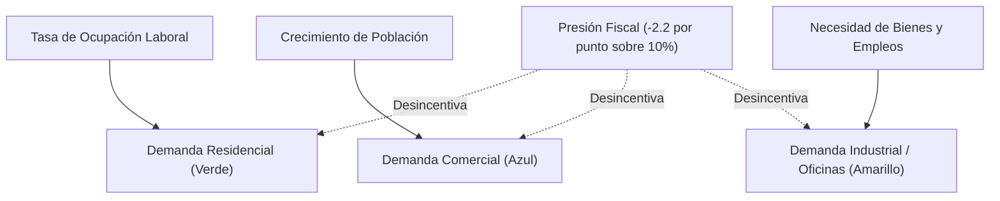
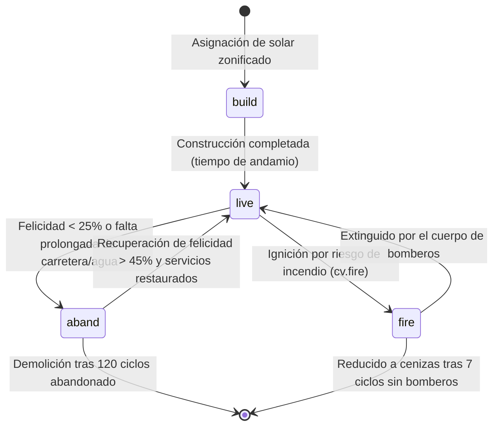
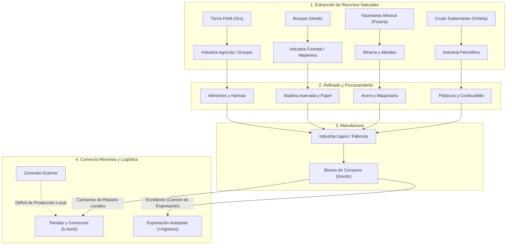

# 📈 Simulación Socioeconómica, RCI y Presupuestos

El motor de simulación [src/sim/sim.ts](file:///home/dev/projects/city-builder/src/sim/sim.ts) gobierna el crecimiento demográfico, la evolución del tejido urbano, la recaudación fiscal y los servicios públicos.

---

## 1. Ciclo RCI y Cálculo de Demanda

La demanda de zonas se recalcula periódicamente en `computeDemand()`:

- **Residencial:** Aumenta cuando las empresas tienen vacantes de empleo sin cubrir y la tasa de desempleo es baja ($< 5\%$).
- **Comercial:** Depende de la población total residente, su capacidad de gasto y la cercanía de servicios.
- **Industrial y Oficinas:** Depende del número de trabajadores desempleados y de la necesidad de abastecer a los comercios locales.

---

## 2. Ciclo de Vida de los Edificios

Cada edificio en `Sim.buildings` es una entidad con su estado:

### Factores de Felicidad Residencial:
$$H_{res} = 42 + 14 \cdot \text{salud} + 12 \cdot \text{policía} + 9 \cdot \text{educación} + 15 \cdot \text{parques} + 6 \cdot \text{bomberos} + 10 \cdot \text{monumentos} - 38 \cdot \text{polución} - 12 \cdot \text{ruido} - (\text{impuesto} - 10) \cdot 2.2 + \text{bonus\_empleo} + \text{bonus\_distrito}$$

### Penalizaciones Críticas de Servicios Básicos (Fase 2):
Los edificios residenciales y comerciales monitorean continuamente el ciclo de agua, alcantarillado y sanidad (véase [docs/water-and-sanitation.md](file:///home/dev/projects/city-builder/docs/water-and-sanitation.md)):
- **Corte de Agua Potable (`nowater`):** Penalización de $-30\%$ de felicidad; riesgo elevado de abandono.
- **Aguas Residuales Desbordadas (`sewage`):** Penalización de $-25\%$ de felicidad y foco local de contaminación.
- **Intoxicación por Agua Contaminada (`water_polluted`):** Detona un brote epidemiológico masivo donde la tasa de enfermos (`b.sick`) se multiplica por 4x.
- **Fallecidos Sin Recoger (`dead`):** La presencia de cadáveres en el inmueble a la espera de coches fúnebres impone $-35\%$ de felicidad y acelera el abandono si no es atendido por cementerios o crematorios.

---

## 3. Coberturas de Servicios y Propagación BFS

Los servicios no actúan por simple radio euclídeo, sino que se propagan a lo largo de la red de carreteras conectadas mediante una búsqueda en anchura (*Breadth-First Search*) con decaimiento lineal en `computeCoverage()`:

| Servicio | Clave | Radio Vial ($T$) | Decaimiento / Efecto |
| :--- | :--- | :--- | :--- |
| **Policía** | `cv.police` | $28\text{ casillas}$ | Reduce la criminalidad y previene disturbios. |
| **Bomberos** | `cv.fire` | $26\text{ casillas}$ | Reduce el riesgo de ignición de incendios estructurales. |
| **Salud** | `cv.health` | $30\text{ casillas}$ | Eleva la esperanza de vida y la felicidad. |
| **Educación** | `cv.edu` | $32\text{ casillas}$ | Permite a los edificios subir de nivel (Nivel 1 a 5). |
| **Parques** | `cv.park` | $18\text{ casillas}$ | Aumenta el valor del suelo y la satisfacción inmediata. |
| **Vertederos** | `cv.garbage` | $35\text{ casillas}$ | Rutas de camiones que recogen acumulación de basura. |
| **Polución** | `cv.pollution` | $14\text{ casillas}$ | Generada por industrias; reduce salud y valor del suelo. |
| **Ruido** | `cv.noise` | $10\text{ casillas}$ | Generado por autopistas, trenes y ocio comercial nocturno. |
| **Valor de Suelo** | `cv.lv` | Campo derivado | Atrae edificios de mayor nivel y mayores ingresos fiscales. |

---

## 4. Presupuesto Municipal y Economía

### 4.1 Ingresos Mensuales
- **Impuestos RCI:** Tipos independientes configurables de $0\%$ a $30\%$ (el $10\%$ se considera fiscalmente neutro).
- **Tarifas de Transporte:** Ingresos cobrados por billete en líneas de autobús, tranvía y tren.
- **Exportaciones de Mercancías:** Ingresos recaudados por la venta de excedentes de bienes manufacturados y materias primas a los mercados exteriores a través de la autopista (`last.inc.export`).

### 4.2 Gastos Mensuales
- **Mantenimiento de Edificios Cívicos:** Coste fijo por comisaría, parque de bomberos, clínicas, escuelas, etc.
- **Mantenimiento de Carreteras y Vías:** Coste por casilla de asfalto y vía férrea en base a su categoría.
- **Vehículos de Transporte:** Mantenimiento por unidad de autobús, tranvía o tren activo.
- **Suministros de Agua y Luz:** Calculados automáticamente en base a la población ($\text{pop} \cdot 0.35$).
- **Coste de Políticas Municipales:** Gastos mensuales por cada 100 casillas de distrito activadas (reciclaje, detectores, etc.).
- **Amortización de Préstamos:** Devolución mensual de créditos bancarios con un $12\%$ de interés en 24 plazos.
- **Sobrecostes de Importación de Bienes:** Aranceles y fletes sufragados por la ciudad al importar productos comerciales cuando la industria local es deficitaria (`last.exp.imports`).

---

## 5. Serialización y Persistencia de Partidas (Save/Load)

En `Sim.serialize()` y `Sim.load(d)`, el estado completo se comprime mediante codificación por longitud de series (**RLE - Run-Length Encoding**) a través de `U.encodeRLE` y `U.decodeRLE`:
- Se serializan todos los arrays del mapa (`road`, `link`, `rdir`, `rpart`, `curv`, `pcell`, `rail`, `zone`, `tree`, `resource`, `district`).
- Se serializan las modificaciones de terreno (`hce`), configuraciones de cruces (`jcfg`), líneas de transporte y objetos de distrito.
- Se persisten los atributos de la cadena de suministro por edificio: `stock`, `stockMax`, `stockoutHours`, `industryType` y `outputRate`.
- El archivo resultante es JSON compacto, ultraligero y compatible hacia atrás.

---

## 6. Recursos Naturales y Cadenas de Suministro (Supply Chains)

Vira City incorpora un sistema de economía productiva de 4 niveles inspirado en *Cities: Skylines* y *CityRT*:

### 6.1 Capa de Recursos en Memoria
El array plano continuo `World.resource: Uint8Array(W * W)` ($43.264$ casillas) almacena:
- `0`: Sin recurso (`C.RES_NONE`)
- `1`: Tierra Fértil (`C.RES_FERTILE`, amarillo dorado `#eab308`)
- `2`: Masa Forestal (`C.RES_FOREST`, verde esmeralda `#16a34a`)
- `3`: Minerales / Mena (`C.RES_ORE`, azul pizarra `#64748b`)
- `4`: Petróleo / Crudo (`C.RES_OIL`, negro/violeta oscuro `#1e1b4b`)

### 6.2 Bonificaciones de Extracción y Especialización
Cuando un polígono industrial se declara con especialización de distrito (`farming`, `forestry`, `mining`, `oil`) y sus fábricas se asientan sobre el recurso correspondiente, disfrutan de un $+60\%$ a $+80\%$ de eficiencia extractiva. En caso de asentarse sobre terreno estéril o sin recurso coincidente, su producción cae y deben procesar materias importadas.

### 6.3 Desabastecimiento Comercial (*Stockouts*)
Cada comercio dispone de un almacén `b.stock` con capacidad máxima `b.stockMax = 50 \cdot \text{nivel}`.
- Cada hora de simulación, las compras ciudadanas consumen mercancías:
  $$\Delta \text{stock} = \max(0.4, (0.12 \cdot \text{cap} + 0.06 \cdot \text{cust}) \cdot \text{custRatio})$$
- Si `b.stock <= 0`, el comercio entra en estado de alerta `b.prob = 'stockout'` ("No goods to sell"):
  - Se genera un icono de aviso en la vista de la ciudad.
  - La satisfacción de clientes cae en picado ($-26\%$).
  - Si el desabastecimiento persiste durante más de $48$ horas consecutivas, el comercio entra en quiebra y queda **abandonado** (`b.state = 'aband'`).

### 6.4 Logística Física de Reparto y Comercio Exterior
- **Reposición:** Cuando las existencias caen por debajo del $40\%$, el comercio solicita una entrega.
- Si existe una fábrica local con existencias, se despacha un camión de mercancías físico (`kind: 'truck'`) que circula por la red viaria hasta el comercio para reponer hasta $25$ unidades.
- Si no hay industria local suficiente, el camión entra desde la conexión exterior (`World.outIn`), acarreando un coste por flete arancelario para la ciudad.
- **Exportación:** Las fábricas locales con almacén superior al $75\%$ despachan camiones hacia `World.outOut`, generando divisas de exportación directas para el presupuesto municipal.
