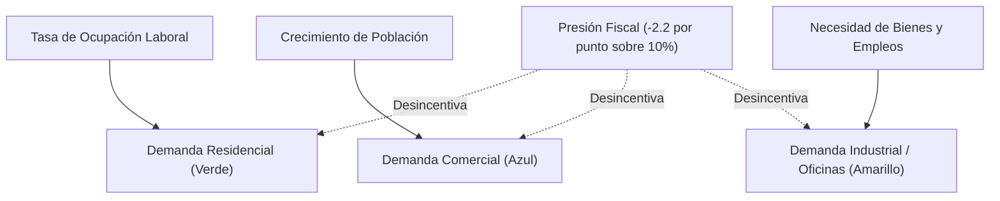
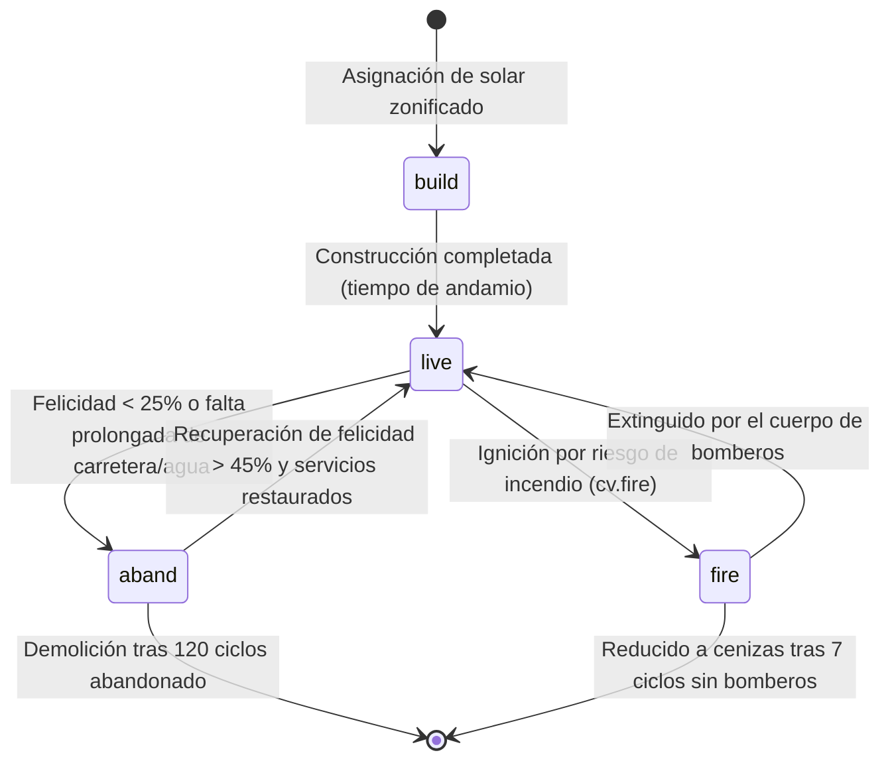

# 📈 Simulación Socioeconómica, RCI y Presupuestos

El motor de simulación [src/sim/sim.ts](file:///home/dev/projects/city-builder/src/sim/sim.ts) gobierna el crecimiento demográfico, la evolución del tejido urbano, la recaudación fiscal y los servicios públicos.

---

## 1. Ciclo RCI y Cálculo de Demanda

La demanda de zonas se recalcula periódicamente en `computeDemand()`:

- **Residencial:** Aumenta cuando las empresas tienen vacantes de empleo sin cubrir y la tasa de desempleo es baja ($< 5\%$).
- **Comercial:** Depende de la población total residente, su capacidad de gasto y la cercanía de servicios.
- **Industrial y Oficinas:** Depende del número de trabajadores desempleados y de la necesidad de abastecer a los comercios locales.

---

## 2. Ciclo de Vida de los Edificios

Cada edificio en `Sim.buildings` es una entidad con su estado:

### Factores de Felicidad Residencial:
$$H_{res} = 42 + 14 \cdot \text{salud} + 12 \cdot \text{policía} + 9 \cdot \text{educación} + 15 \cdot \text{parques} + 6 \cdot \text{bomberos} + 10 \cdot \text{monumentos} - 38 \cdot \text{polución} - 12 \cdot \text{ruido} - (\text{impuesto} - 10) \cdot 2.2 + \text{bonus\_empleo} + \text{bonus\_distrito}$$

---

## 3. Coberturas de Servicios y Propagación BFS

Los servicios no actúan por simple radio euclídeo, sino que se propagan a lo largo de la red de carreteras conectadas mediante una búsqueda en anchura (*Breadth-First Search*) con decaimiento lineal en `computeCoverage()`:

| Servicio | Clave | Radio Vial ($T$) | Decaimiento / Efecto |
| :--- | :--- | :--- | :--- |
| **Policía** | `cv.police` | $28\text{ casillas}$ | Reduce la criminalidad y previene disturbios. |
| **Bomberos** | `cv.fire` | $26\text{ casillas}$ | Reduce el riesgo de ignición de incendios estructurales. |
| **Salud** | `cv.health` | $30\text{ casillas}$ | Eleva la esperanza de vida y la felicidad. |
| **Educación** | `cv.edu` | $32\text{ casillas}$ | Permite a los edificios subir de nivel (Nivel 1 a 5). |
| **Parques** | `cv.park` | $18\text{ casillas}$ | Aumenta el valor del suelo y la satisfacción inmediata. |
| **Vertederos** | `cv.garbage` | $35\text{ casillas}$ | Rutas de camiones que recogen acumulación de basura. |
| **Polución** | `cv.pollution` | $14\text{ casillas}$ | Generada por industrias; reduce salud y valor del suelo. |
| **Ruido** | `cv.noise` | $10\text{ casillas}$ | Generado por autopistas, trenes y ocio comercial nocturno. |
| **Valor de Suelo** | `cv.lv` | Campo derivado | Atrae edificios de mayor nivel y mayores ingresos fiscales. |

---

## 4. Presupuesto Municipal y Economía

### 4.1 Ingresos Mensuales
- **Impuestos RCI:** Tipos independientes configurables de $0\%$ a $30\%$ (el $10\%$ se considera fiscalmente neutro).
- **Tarifas de Transporte:** Ingresos cobrados por billete en líneas de autobús, tranvía y tren.

### 4.2 Gastos Mensuales
- **Mantenimiento de Edificios Cívicos:** Coste fijo por comisaría, parque de bomberos, clínicas, escuelas, etc.
- **Mantenimiento de Carreteras y Vías:** Coste por casilla de asfalto y vía férrea en base a su categoría.
- **Vehículos de Transporte:** Mantenimiento por unidad de autobús, tranvía o tren activo.
- **Suministros de Agua y Luz:** Calculados automáticamente en base a la población ($\text{pop} \cdot 0.35$).
- **Coste de Políticas Municipales:** Gastos mensuales por cada 100 casillas de distrito activadas (reciclaje, detectores, etc.).
- **Amortización de Préstamos:** Devolución mensual de créditos bancarios con un $12\%$ de interés en 24 plazos.

---

## 5. Serialización y Persistencia de Partidas (Save/Load)

En `Sim.serialize()` y `Sim.load(d)`, el estado completo se comprime mediante codificación por longitud de series (**RLE - Run-Length Encoding**) a través de `U.encodeRLE` y `U.decodeRLE`:
- Se serializan todos los arrays del mapa (`road`, `link`, `rdir`, `rpart`, `curv`, `pcell`, `rail`, `zone`, `tree`, `district`).
- Se serializan las modificaciones de terreno (`hce`), configuraciones de cruces (`jcfg`), líneas de transporte y objetos de distrito.
- El archivo resultante es JSON compacto, ultraligero y compatible hacia atrás.
