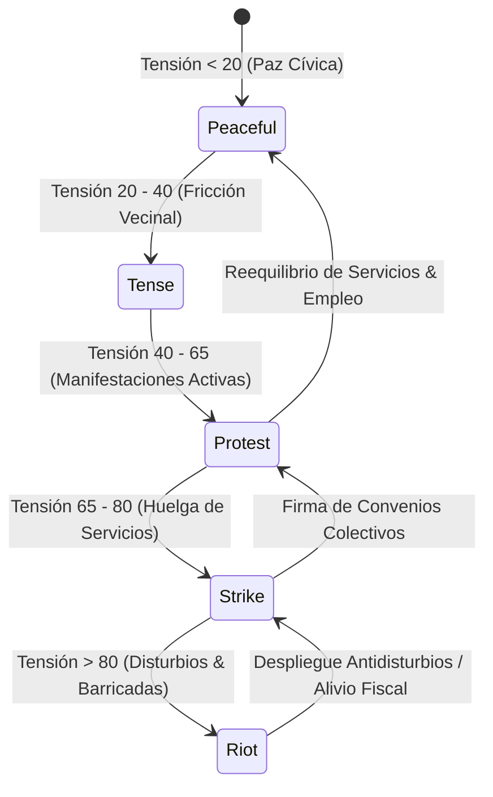

# ✊ Malestar Social, Huelgas y Conflictividad Cívica (`docs/social-unrest-and-strikes.md`)

Este documento especifica la arquitectura técnica, modelo matemático y subsistemas de simulación correspondientes a la **Fase 3.5: Malestar Social, Huelgas, Manifestaciones y Conflictividad Fiscal**.

---

## 🧭 1. Visión General del Sistema

El subsistema de Malestar Social (`UnrestEngine` / `Unrest`) simula la tensión acumulada en la población urbana como respuesta directa a presiones fiscales desmedidas, desempleo crónico, polución descontrolada, desabastecimiento comercial y saturación o abandono de servicios públicos básicos.

A medida que el índice de malestar escala, la ciudad progresa orgánicamente desde quejas vecinales pacíficas hasta **manifestaciones con pancartas en calzadas**, **huelgas generales que paralizan los servicios esenciales** (basuras, bomberos, ambulancias, policía y transporte público) y finalmente **disturbios callejeros con barricadas de neumáticos y fuego** que bloquean físicamente la red viaria.



---

## 🧮 2. Modelo Matemático y Factores de Malestar

El nivel de malestar global se calcula como una puntuación continua $U \in [0, 100]$ evaluada periódicamente en cada hora de simulación (`Unrest.step`). El valor se normaliza a partir de 6 vectores de fricción ponderados:

$$U_{\text{target}} = \sum_{k} w_k \cdot F_k$$

| Factor ($k$) | Ponderación ($w_k$) | Indicador Base | Condición de Activación |
| :--- | :---: | :--- | :--- |
| **Presión Fiscal** (`taxPressure`) | $0.30$ | Tipos impositivos residenciales, comerciales e industriales | Tipos impositivos por encima del $9\%$, penalización severa a partir del $13\%$. |
| **Desempleo** (`unemployment`) | $0.25$ | Tasa de paro activa | Ciudadanos aptos sin puesto laboral asignado en la ciudad. |
| **Polución Urbana** (`pollution`) | $0.15$ | Contaminación del aire (pluma de viento) y aguas sucias | Proporción de celdas residenciales con índice de contaminación $> 35$. |
| **Déficit de Servicios** (`serviceDeficit`) | $0.15$ | Cobertura media de Bomberos, Policía, Sanidad y Colegios | Cobertura global inferior al $75\%$. |
| **Desabastecimiento** (`stockouts`) | $0.10$ | Comercios desabastecidos (`Sim.supply.stockoutStores`) | Tiendas comerciales que agotan stock de bienes locales o importados. |
| **Cadáveres Insepultos** (`corpses`) | $0.15$ | Fallecidos esperando coche fúnebre (`st.deadCount`) | Retraso o saturación del servicio de cementerios y crematorios. |

### Inercia y Suavizado Temporal
Para evitar fluctuaciones espasmódicas ante eventos temporales, el malestar se actualiza con suavizado exponencial:

$$U_{t} = (1 - \alpha) \cdot U_{t-1} + \alpha \cdot U_{\text{target}}, \quad \text{donde } \alpha = 0.08$$

---

## 🛑 3. Impacto Operativo de las Huelgas de Servicios Esenciales

Cuando el malestar supera los **65 puntos** (`strike`), los trabajadores municipales inician paros laborales. En `src/sim/sim.ts:dispatchServices()`, se verifica el estado de huelga de cada sector con `Unrest.isServiceStriking(svc)`:

```ts
if (Unrest.isServiceStriking(s.svc)) {
  // Los operarios se declaran en huelga: la dotación no sale de las cocheras
  continue;
}
```

### Consecuencias Sistémicas Inmediatas:
1. **Huelga de Basuras (`garbage`):**
   - Los camiones de recogida quedan inmovilizados.
   - Las basuras se acumulan en aceras y portales residenciales (`prob = 'garbage'`).
   - Se disparan las infecciones y la insalubridad pública.
2. **Huelga de Transporte Masivo (`transit`):**
   - La flota activa en líneas de autobús, tranvía y metro se estrangula al **$25\%$** de capacidad.
   - Las paradas y andenes colapsan por pasajeros en espera (`waitingQueue`).
3. **Huelga de Bomberos (`fire`):**
   - Los camiones autobomba no acuden a sofocar incendios.
   - Los incendios se propagan sin control a edificios vecinos hasta su colapso total.
4. **Huelga de Policía Local (`police`):**
   - Se suspenden las patrullas disuasorias en distritos.
   - La criminalidad y los altercados violentos crecen exponencialmente.
5. **Huelga Sanitaria y Triaje (`health`):**
   - Las ambulancias operan a ritmo de servicios mínimos.
   - Los enfermos y heridos permanecen sin atención médica en sus hogares (`prob = 'sick'`).

---

## 🚧 4. Tráfico, Manifestaciones y Barricadas Urbanas

### 4.1 Cortes de Calle por Manifestaciones (`ProtestCrowd`)
- Las concentraciones vecinales marchan en comitivas a lo largo de las calzadas en dirección al ayuntamiento o arterias principales.
- **Coste de Ruta:** En `src/traffic/pathfinding.ts:roadCostWithLoad()`, las celdas ocupadas por manifestantes aplican un multiplicador de impedancia de **$4.5\times$**, forzando al tráfico a buscar desvíos y generando retenciones.

### 4.2 Barricadas Físicas en Disturbios (`Barricade`)
- Al superar los **80 puntos** de malestar (`riot`), surgen barricadas en cruces y calzadas clave.
- **Coste de Ruta:** Las barricadas aplican un multiplicador de **$15\times$** (bloqueo virtualmente absoluto para coches, camiones y autobuses).
- **Modelado 3D Procedural (`vehicleGenerators.ts`):** Las barricadas se renderizan en Three.js con geometría paramétrica:
  - Estructura de maderas y pallets cruzados (`#8b5a2b`).
  - Barreras de tráfico con bandas diagonales reflectantes de advertencia (`#f59f00` / `#212529`).
  - Pilas de neumáticos usados de caucho vulcanizado (`#1e1e24`).
  - Barril metálico industrial ardiendo con llamas y ascuas incandescentes (`#f76707` y `#ffd43b`).

---

## 🏛️ 5. Mesa de Negociación Sindical y Paz Social

El panel lateral de **Paz Social** (`src/ui/panels/unrest.ts`) permite al alcalde negociar directamente con los representantes laborales:

### Sindicatos Representados:
1. **Sindicato de Limpieza y Residuos:** Demanda mejoras salariales y renovación de flotas ($450/mes).
2. **Federación Unitaria del Transporte:** Exige refuerzo de plantilla y turnos dignos ($600/mes).
3. **Unión de Sanitarios y Emergencias:** Reclama dotación para ambulancias y triaje ($550/mes).
4. **Plataforma de Asociaciones Vecinales:** Demanda contención fiscal y aire limpio ($350/mes).

Al formalizar un convenio laboral (`Unrest.acceptPact`):
- Se garantiza **paz laboral durante 12 meses**.
- Se desactiva la huelga en el sector correspondiente.
- Se reduce de inmediato la tensión cívica en 15 puntos.

### Medidas de Emergencia Municipal:
- **Despliegue de Unidades Antidisturbios:**
  - Coste: **$2,800**.
  - Acción: Desmantela todas las barricadas urbanas y despeja de inmediato las calles bloqueadas.
- **Fondo Municipal de Alivio Social:**
  - Coste: **$5,000**.
  - Acción: Subvención directa vecinal. Concede **6 meses de tregua social** incondicional y reduce el malestar en 25 puntos.

---

## 🖥️ 6. Infovistas GPU e Indicadores de Interfaz

1. **Infovista GPU `'unrest'` (`src/ui/panels/views.ts`):**
   - Mapa de calor en tiempo real proyectado directamente sobre el terreno y la malla viaria:
     - 🟢 Verde: Barrios en paz ($< 20$).
     - 🟡 Amarillo: Tensión incipiente ($20 - 40$).
     - 🟠 Naranja: Focos de manifestación ($40 - 65$).
     - 🔴 Rojo: Disturbios y barricadas ($> 65$).
2. **HUD Vital en Topbar (`index.html` / `src/ui/ui.ts`):**
   - Indicador `#statUnrest` con puntuación porcentual y estado en vivo (`Peaceful`, `Tense`, `Protest`, `Strike`, `Riot`).
   - Clic interactivo para abrir directamente la Mesa de Diálogo Social.
3. **Iconos de Problema 3D Flotantes:**
   - `strike` (✊) sobre parques de bomberos, comisarías o cocheras en huelga.
   - `barricade` (⛔) sobre calzadas cortadas.
   - `protest` (📢) sobre marchas vecinales activas.
