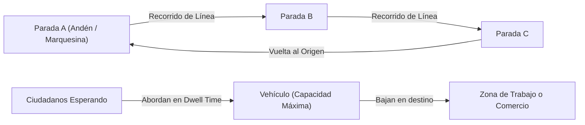

# 🚗 Tráfico, Navegación y Transporte Masivo

Los sistemas en [src/traffic/traffic.ts](file:///home/dev/projects/city-builder/src/traffic/traffic.ts) y [src/transit/transit.ts](file:///home/dev/projects/city-builder/src/transit/transit.ts) simulan el movimiento de miles de ciudadanos, mercancías, vehículos de emergencia y redes de transporte público.

---

## 1. El Grafo de Enrutamiento y Navegación A*

### 1.1 Función de Coste Vial (`roadCost`)
El coste de atravesar una casilla de carretera $i$ combina la longitud geométrica ($T=20\text{ m}$), la velocidad límite de la vía y el nivel de congestión en tiempo real:

$$\text{ratio} = \frac{\text{Traffic.load}[i]}{\text{R.cap}}$$
$$\text{cong} = 1 + 4 \cdot \max(0, \text{ratio} - 0.35)^2$$
$$\text{coste} = \left(\frac{T}{\text{R.speed}}\right) \cdot \text{cong}$$

- **Penalización por giros:** Girar a la izquierda añade $+0.6\text{ s}$ por cruzar tráfico contrario; cambios de sentido (*U-turns*) añaden $+8.0\text{ s}$.
- **Restricción ZBE (Distritos):** Si la casilla pertenece a un distrito con la política `heavyTrafficBan` activada y es una calle local (`R.grp === 'small'`), se añade un recargo de $+8.0\text{ s}$ para disuadir el tráfico pesado de atravesar el vecindario.

### 1.2 Caché de Rutas (`pathCache`)
Para maximizar los FPS, las rutas calculadas se guardan en una caché LRU indexada por `src * N + dst` que se invalida automáticamente cuando la red vial cambia (`World.roadVer++`).

---

## 2. Tipos de Vehículos y Ciclo de Vida

Los vehículos se registran en `Traffic.vehicles`:

| Tipo | Velocidad Base | Longitud ($L$) | Rol en la Ciudad |
| :--- | :--- | :--- | :--- |
| **`car`** | $13.8\text{ m/s}$ ($50\text{ km/h}$) | $4.5\text{ m}$ | Viajes pendulares de ciudadanos (casa $\leftrightarrow$ trabajo/ocio). |
| **`suv`** | $13.8\text{ m/s}$ | $4.8\text{ m}$ | Tráfico privado de familias de clase media/alta. |
| **`van`** | $12.5\text{ m/s}$ | $5.5\text{ m}$ | Mudanzas hacia nuevas viviendas construidas. |
| **`truck`** | $10.0\text{ m/s}$ | $7.4\text{ m}$ | Reparto de bienes industriales a comercios y envíos exteriores. |
| **`bus`** | $11.0\text{ m/s}$ | $11.5\text{ m}$ | Transporte colectivo en líneas municipales de autobús. |
| **`tram`** | $11.0\text{ m/s}$ | $15.0\text{ m}$ | Tranvías que circulan por vías acanaladas en calzada. |
| **`police`** | $16.5\text{ m/s}$ | $4.6\text{ m}$ | Patrulla preventiva y respuesta prioritaria a crímenes. |
| **`fire`** | $14.0\text{ m/s}$ | $8.0\text{ m}$ | Camión de bomberos con prioridad de paso para extinguir fuegos. |
| **`ambulance`** | $15.5\text{ m/s}$ | $5.8\text{ m}$ | Asistencia médica urgente hacia viviendas con baja salud. |
| **`garbage`** | $9.0\text{ m/s}$ | $7.5\text{ m}$ | Recogida sistemática de residuos acumulados en parcelas. |

---

## 3. Agentes Ligeros: Ciclistas y Peatones (`Soft Agents`)

A través de `Traffic.spawnSoft()`, los ciudadanos que optan por no usar vehículo privado se mueven por aceras y senderos peatonales (`pcell`):

- **Peatones (`ped`):** Caminan a $1.4\text{ m/s}$ por aceras y sendas verdes.
- **Ciclistas (`bike`):** Se desplazan a $5.2\text{ m/s}$. El algoritmo evalúa el índice de confort ciclista `tileBikeScore(i)`:
  - Las calles pacificadas, aceras anchas y carriles bici exclusivos disparan la puntuación.
  - La política de distrito `bikeCity` suma automáticamente $+0.45$ al confort de todas las vías del distrito, derivando viajes en automóvil hacia la bicicleta.

---

## 4. Redes de Transporte Público (`Transit`)

El gestor [src/transit/transit.ts](file:///home/dev/projects/city-builder/src/transit/transit.ts) coordina las líneas regulares:

- **Líneas de Autobús (`bus`):** Flexibles, paradas sobre bordillo, bajo coste de infraestructura.
- **Tranvías en Calzada (`tram`):** Mayor capacidad ($60\text{ pasajeros}$), circulan por raíles integrados en calles de 4 carriles.
- **Trenes de Cercanías (`rail`):** Conectan barrios periféricos a gran velocidad sobre balasto elevado.
- **Metro Subterráneo (`metro`):** Estaciones soterradas de altísima capacidad ($200\text{ pasajeros}$) sin consumir espacio en superficie.

---

## 5. Arquitectura Modular del Motor de Tráfico (`src/traffic/`)

El subsistema de tráfico ha sido descompuesto en módulos especializados de alto rendimiento:

- **[src/traffic/traffic.ts](file:///home/dev/projects/city-builder/src/traffic/traffic.ts):** Orquestador central de vehículos, despacho de peticiones (`request`), gestión de flotas y renderizado de mallas instanciadas.
- **[src/traffic/pathfinding.ts](file:///home/dev/projects/city-builder/src/traffic/pathfinding.ts):** Algoritmo A* bidireccional sobre la cuadrícula vial, evaluación de giros prohibidos y coste dinámico por congestión.
- **[src/traffic/trajectories.ts](file:///home/dev/projects/city-builder/src/traffic/trajectories.ts):** Cálculo de curvas Bézier cuadráticas (`Bezier2D`), alineación de transiciones entre carriles (`boundaryLanes`) y desfases laterales de acera/calzada.
- **[src/traffic/signals.ts](file:///home/dev/projects/city-builder/src/traffic/signals.ts):** Máquina de estados de semáforos (fases verde/ámbar/todo-rojo), arbitraje de señales de stop y detección de bloqueos en puntos de spawn.
- **[src/traffic/visitorActivities.ts](file:///home/dev/projects/city-builder/src/traffic/visitorActivities.ts):** Simulación peatonal en parques y plazas: paseos procedimentales, sentarse en bancos, columpios, toboganes, skateparks y física de baloncesto.

---

## 6. Impedancia por Conflicto Social y Huelgas de Transporte (Fase 3.5)

El sistema de tráfico y transporte integra las consecuencias del malestar social:

### 6.1 Cortes por Manifestaciones y Barricadas
En `src/traffic/pathfinding.ts:roadCostWithLoad()`, las celdas afectadas por conflictividad modifican el coste de enrutamiento $A^*$:
- **Manifestaciones Vecinales (`Unrest.isProtestOnRoad`):** Multiplican el coste por **$4.5\times$**, forzando al tráfico privado y comercial a buscar vías secundarias.
- **Barricadas de Disturbios (`Unrest.isRoadBlocked`):** Multiplican el coste por **$15.0\times$**, bloqueando de facto la calle para turismos y transporte público hasta su retirada o intervención policial.

### 6.2 Estrangulamiento de Transporte Masivo por Huelga
En `src/transit/transit.ts:spawnVehicles()`, si la huelga de transporte está activa (`Unrest.state.strikes.transit`):
- El número máximo de convoyes y autobuses por línea se limita al **$25\%$** de la dotación nominal.
- Se producen saturaciones agudas en andenes y colas masivas de viajeros en espera.
- La firma del convenio con la *Federación Unitaria del Transporte* restaura de inmediato la frecuencia al $100\%$.

---

## 7. Movilidad Multimodal, Metro Subterráneo y Micro-Movilidad (Fase 4)

La **Fase 4** transforma el transporte en un ecosistema multimodal integrado de alta fidelidad:

### 7.1 Modo de Cámara Subterránea y Modelado 3D de Túneles
- **Visualización Subterránea (`Gfx.setUnderground()`):** Permite inspeccionar la red ferroviaria profunda y tuberías mediante renderizado de profundidad permeable (`depthTest: false`, material shader especializado `Gfx.mats.subway` y renderOrder `20`).
- **Túneles de Metro Paramétricos (`genSubwayTile`):** Las vías subterráneas (`World.rail === 2`) se sitúan a $Y = \text{groundH} - 10\text{ m}$. Generan tubos de hormigón reforzado abovedados con balasto oscuro, raíles gemelos de acero (`COL.rail`), pasarela técnica y luminarias de techo cálidas (`#fef08a`).
- **Estaciones Subterráneas:** Cavernas ampliadas con andenes dobles elevados, franja de seguridad amarilla táctil (`#eab308`), bancos de espera, paneles de línea con el color corporativo e iluminación fluorescente.
- **Pabellones de Acceso en Superficie:** Escaleras de granito descendentes hacia la cota subterránea, marquesina de vidrio y acero, y tótem con el emblema luminoso del Metro (`#dc2626`).

### 7.2 Infraestructura de Catenaria en Avenidas de Tranvía
- **Postes de Catenaria Instanciados:** En calzadas con raíles de tranvía (`R.tram`), se generan mástiles metálicos tubulares de acero de $5.8\text{ m}$ de altura en la acera o mediana, con ménsulas horizontales en voladizo, tirantes diagonales y cable de contacto continuo aéreo a $5.2\text{ m}$ sobre los raíles.

### 7.3 Infraestructuras de Conexión Multimodal y Micro-Movilidad
- **Intercambiador Modal de Transporte (`transit_hub`):** Terminal central de $3 \times 3$ casillas que unifica dársenas de autobús con marquesinas, acceso directo a andenes de metro, parada de tranvía y aparcamiento de bicicletas. Reduce los tiempos de trasbordo entre líneas en un **$75\%$** y amplía el radio de transbordo peatonal a 7 casillas.
- **Estación de Bicis Compartidas (`bikeshare`):** Puesto inteligente de $1 \times 1$ con terminal solar y bancada de bicicletas. Facilita el acceso ciclista a ciudadanos que no poseen bicicleta propia en un radio de 14 casillas.
- **Aparcamiento Disuasorio Park & Ride (`park_and_ride`):** Parking periférico de $2 \times 2$ con plazas señalizadas, cargadores de vehículo eléctrico y enlace cubierto a estaciones de metro/tren para desviar a los conductores del centro urbano.
- **Plaza Cívica Peatonal (`ped_plaza`):** Espacio urbano peatonal de $2 \times 2$ con pavimento decorativo, fuente monumental, terrazas de cafetería con sombrillas y arbolado que potencia la caminabilidad y el comercio.

### 7.4 Modelo Matemático de Elección Modal (Logit Multinomial)
En `Sim.chooseMode()` se implementa un modelo de utilidad aleatoria de elección discreta para cada desplazamiento pendular:

$$U_{\text{walk}} = \beta_{0, \text{walk}} - 0.05 \cdot T_{\text{walk}} - 0.08 \cdot (D - 5)^2 + U_{\text{plaza}} - U_{\text{clima}}$$
$$U_{\text{bike}} = \beta_{0, \text{bike}} - 0.035 \cdot T_{\text{bike}} + 2.8 \cdot S_{\text{bike}}^{1.4} + U_{\text{bikeshare}} + U_{\text{policy}} - U_{\text{clima}}$$
$$U_{\text{transit}} = \beta_{0, \text{transit}} - 0.045 \cdot T_{\text{transit}} + U_{\text{P+R}} + U_{\text{free}} - U_{\text{huelga}}$$
$$U_{\text{car}} = \beta_{0, \text{car}} - 0.04 \cdot T_{\text{car}} - 2.5 \cdot (1 - \text{Flow}) - U_{\text{ZBE}}$$

Las probabilidades de elección se obtienen aplicando la función softmax normalizada:

$$P(m) = \frac{\exp(U_m - \max_k U_k)}{\sum_j \exp(U_j - \max_k U_k)}$$

### 7.5 Panel de Rentabilidad y Analítica Financiera de Líneas
El panel de Transporte Público (`src/ui/panels/transit.ts`) monitoriza:
- **Recaudación por Billetes:** Pasajeros mensuales $\times$ Precio del billete fijado.
- **Coste Operativo:** Mantenimiento de convoyes y vehículos en servicio.
- **Margen Neto:** Beneficio o déficit operativo por línea y total de la red.
- **Tasa de Recuperación Tarifaria (*Farebox Recovery Ratio*):** Proporción del coste cubierta por ingresos de usuarios.
- **Índice de Abarrotamiento (*Occupancy Bar*):** Nivel de carga (Bajo $<30\%$, Equilibrado $30-75\%$, Concurrido $75-100\%$, Saturado $>100\%$).
- **Filtros y Ordenación:** Filtrado por modo (Autobús, Tranvía, Metro) y ordenación por viajeros, rentabilidad o nombre.
