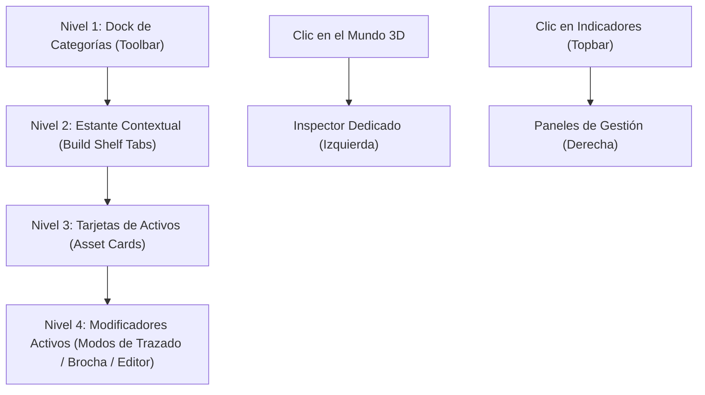

# 🛠️ Sistema de Herramientas de Construcción e Interfaz de Usuario

Los módulos [src/tools/tools.ts](file:///home/dev/projects/city-builder/src/tools/tools.ts) y [src/ui/ui.ts](file:///home/dev/projects/city-builder/src/ui/ui.ts) gobiernan la interacción del jugador, el trazado de infraestructuras, la navegación jerárquica y los paneles de supervisión cívica con una experiencia de usuario limpia inspirada en **Cities: Skylines**.

---

## 1. Modos de Trazado de Carreteras (`Road Modes`)

La herramienta de carreteras implementa 4 algoritmos de planificación geométrica:

| Modo | Tecla | Comportamiento |
| :--- | :--- | :--- |
| **`straight`** | `C` | Trazado en ángulo recto o línea ortogonal recta con algoritmo Bresenham / `lPath`. |
| **`curve`** | `C` | Trazado curvilíneo en 3 clics: punto de inicio, vértice de inflexión y punto de destino. Los tramos intermedios se marcan como curvados (`curv = 1`). |
| **`sbend`** | `C` | Curva en S de transición suave que enlaza tangencialmente con el último tramo dibujado. |
| **`grid`** | `C` | Trazado en caja: arrastrar entre dos esquinas genera automáticamente una cuadrícula de manzanas residenciales ortogonales. |

---

## 2. Herramientas de Construcción Disponibles (`ToolState`)

El objeto `Tools.tool` gestiona la acción activa:

- **`select`:** Inspecciona edificios, sigue vehículos en marcha (`vfollow`), o consulta andenes de transporte.
- **`road`:** Construye calles, avenidas, autopistas y puentes.
- **`pipe`:** Tiende redes subterráneas de tuberías exclusivamente bajo carreteras existentes (`World.road[i] > 0`) con 3 modos: agua potable (`clean`), alcantarillado (`sewage`) o ambas integradas (`dual`), con trazado continuo Bresenham, previsualización de costes y modelado 3D cilíndrico con juntas de acople.
- **`path`:** Tiende aceras peatonales y carriles bici segregados (`pk`).
- **`rail`:** Tiende vías de ferrocarril superficial o túneles de metro subterráneo (`rr`).
- **`zone` / `dezone`:** Asigna o desasigna densidades residenciales, comerciales o industriales en casillas zonables.
- **`bulldoze`:** Demolición por casilla individual o por arrastre de caja con reembolso parcial de fondos.
- **`svc`:** Emplaza edificios de servicios (hospitales, comisarías, parques) con rotación (`R`).
- **`stop` / `line` / `lineEdit`:** Crea paradas en calzada o andenes y dibuja líneas de transporte masivo conectando paradas secuenciales.
- **`junction`:** Abre el editor de intersecciones para cambiar la señalización (semáforos, stops, rotonda) o configurar flechas de carril.
- **`district`:** Pinta o borra territorio de distritos municipales con radio configurable ($r \in [2, 7]$).

---

## 3. Arquitectura de Interfaz Cities: Skylines (Cero Solapamientos y Navegación Profunda)

La interfaz de usuario ha sido rediseñada para ofrecer una experiencia limpia, despejada y jerárquica en 4 niveles de profundidad:

### 3.1 Barra Cívica Superior Unificada (`.topbar`)
Barra fija de 48px, translúcida con desenfoque de cristal (`backdrop-filter: blur(14px)`), en una sola línea no rompible (*zero-wrapping*), optimizada para pantallas desde 1280px hasta 4K:
- **Identidad e Hitos:** Nombre de la metrópoli y botón píldora interactivo `#mileBtn` con barra de progreso. Al pulsar este botón, se despliega el cajón de objetivos `#goals` directamente bajo él.
- **Constantes Vitales Clicables (*Drill-Down Directo*):**
  - **Fondos (`#statMoney`):** Muestra el tesoro y flujo neto (`+$2.400 / mo`). Al hacer clic, abre directamente el panel de **Presupuesto e Impuestos**.
  - **Población (`#statPop`):** Censo y puestos ocupados. Al hacer clic, abre las **Estadísticas de la Ciudad**.
  - **Felicidad (`#statHappy`):** Satisfacción ciudadana media. Al hacer clic, abre las **Vistas e Infomapas de Calor**.
  - **Tensión Social (`#statUnrest`):** Índice de conflictividad laboral y disturbios (`0% Peaceful`). Al hacer clic, abre la **Mesa de Diálogo Social y Convenios**.
  - **Viento y Clima (`#statWind`):** Velocidad actual del viento en km/h, ráfagas y rosa de los vientos (ej: `14 km/h NE ↗`). Al hacer clic, abre inmediatamente la vista de **Polución y Dispersión Atmosférica**.
  - **Demanda RCI (`#demand`):** Indicadores verticales de presión residencial, comercial e industrial. Al hacer clic, abre la paleta de **Zonificación**.
- **Reloj y Velocidad:** Selector de marcha de simulación (Pausa `Space`, 1x, 2x, 4x) y reloj en tiempo real.
- **Menú de Gestión Agrupado por Hubs Categóricos y Ajustes (`#menu`):**
  En lugar de saturar la barra horizontal con 8 botones individuales que se desbordan en monitores portátiles o pantallas con escalado, los paneles se agrupan en **3 Hubs desplegables con diseño glassmorphic** más un botón de acceso directo e independiente para **Ajustes a Pantalla Completa**:
  1. 🏛️ **Civic & Society (`civic`):**
     - **✊ Peace & Unrest:** Huelgas de servicios, sindicatos y convenios colectivos.
     - **🏛️ Districts & Policies:** Ordenanzas de distrito y especializaciones económicas.
     - **🚌 Transit Networks:** Líneas de autobuses, tranvías, trenes y gestión de paradas.
  2. 💼 **Economy & Trade (`economy`):**
     - **💰 Budget & Treasury:** Fiscalidad, préstamos municipales y balances departamentales.
     - **📦 Supply & Logistics:** Terminales de carga, cadenas de suministro y fletes.
  3. 📊 **Insights & Views (`insights`):**
     - **👁️ Info Views:** Capas de información y mapas de calor (polución, agua, electricidad, valor del suelo).
     - **📈 City Statistics:** Demografía, empleo y gráficas históricas.
  4. ⚙️ **Settings Standalone (`settings`):**
     - Botón único directo en la barra superior que abre la **Ventana de Ajustes a Pantalla Completa**.
  - **Interacción y Feedback Visual:**
    - Botón de hub con chevron animado que rota al abrirse.
    - Indicador de estado activo (`.active-hub` con punto luminoso de neón y borde iluminado) cuando cualquiera de sus paneles hijos está abierto.
    - Cierre automático al hacer clic en un ítem, hacer clic fuera del menú o presionar la tecla `Escape`.

### 3.2 Ventana de Ajustes a Pantalla Completa (`#settingsModal`)
A diferencia de los paneles laterales ordinarios acotados a 360px, la configuración del juego se despliega en una **interfaz inmersiva a pantalla completa** con fondo glassmorphic desenfocado (`backdrop-filter: blur(24px)`), optimizada tanto para monitores 4K como para portátiles compactos (1366×768, 1440×900, 1280×800):
- **Barra de Cabecera Superior con Blindaje Antidesbordamiento:**
  - Título e identidad de Vira City con icono vectorial engranaje y protección `flex-shrink: 0`.
  - Pestañas de filtrado de categorías compactas y centradas (`Overview`, `Graphics`, `Simulation`, `Storage`, `Controls`) con desplazamiento horizontal oculto si el espacio es reducido.
  - Botón de retorno rápido `← Return to City` con indicador de tecla <kbd>ESC</kbd> y protección `flex-shrink: 0`, garantizando que nunca se desplace fuera del viewport.
- **Cuadrícula y Tarjetas Adaptables en Portátiles:**
  - En pantallas medianas y portátiles (1366px - 1600px), los selectores y tarjetas reducen su padding y altura a 30px/14px, permitiendo una visión panorámica limpia.
  - En pantallas de baja altura vertical (≤ 800px, estándar en pantallas de portátil de 768p y 800p), la cabecera se compacta a 44px y los espaciados verticales se optimizan a 10px para minimizar la necesidad de scroll.

### 3.3 Soporte de Diseño Responsivo para Pantallas Medianas, Portátiles y Pequeñas
Toda la interfaz de usuario se adapta de forma fluida a través de cuatro niveles de resolución con garantía estricta anti-desbordamiento (*zero-clipping*):
- **Monitores de Escritorio / Ultrawide (> 1600px):** Espaciado completo, todas las etiquetas textuales visibles, indicadores numéricos tabulares amplios y paneles holgados.
- **Portátiles y Pantallas Medianas (1366px a 1600px, incluye 1080p al 125% de escala SO = 1536px, MacBooks de 1440px):**
  - Barra superior compacta con holgura de más de 200px: `#menu` posee `flex-shrink: 0;` impidiendo cualquier recorte sobre el botón **Settings**.
  - Subtítulos no esenciales de estadísticas (`#popsub`, `#happysub`, `#unrest_lvl`) ocultados automáticamente, reduciendo el ancho de la franja de vitales de 595px a 395px (**-200px ahorrados**).
  - Píldora de metas e hitos compactada con barra de 42px y título acotado.
  - Reloj y botones de velocidad ajustados a 25×24px.
  - Botones de menú estilizados con tipografía de 11px y padding optimizado (7px).
- **Portátiles Estándar y Modos Ventana (1180px a 1366px, incluye 1366×768 y 1080p al 150% = 1280px):**
  - Subtítulo de dirección de viento ocultado.
  - Píldora de metas con barra de 32px y texto a 80px.
  - Botones de velocidad y reloj integrados en una sola línea compacta de 13.5px.
  - En `< 1180px`, los medidores de demanda RCI se repliegan (accesibles desde la paleta de zonas) y los botones del menú superior adoptan modo icono nítido con tooltip, reduciendo el menú a ~150px.
- **Pantallas Pequeñas / Tablets / Móviles (≤ 768px):**
  - **Barra Superior Táctil:** Altura de 44px con desplazamiento horizontal táctil nativo sin barras visibles (`-webkit-overflow-scrolling: touch`).
  - **Desplegables Adaptados:** Los menús desplegables de los hubs adoptan posición fija centrada en pantalla (`top: 48px; left: 8px; right: 8px; width: calc(100vw - 16px)`), evitando recortes en los bordes.
  - **Paneles en Modo Hoja Completa (*Full-Width Sheets*):** `#infoPanel`, `#sidePanel` y `#goals` ocupan el 100% del ancho móvil (`width: calc(100vw - 16px)`), con altura máxima ajustada y exclusión mutua automática (abrir el inspector cierra el panel de gestión lateral y viceversa).
  - **Toolbar y Paleta Táctiles:** Botones de construcción de 44×42px con tipografía de 8px e iconos vectoriales adaptados para toques precisos.
  - **Ajustes a Pantalla Completa Adaptable:** Cuadrícula de 1 sola columna con controles selectores de altura táctil (34px) y pestañas superiores con scroll horizontal.

### 3.4 Cajón Desplegable de Metas (`#goals`)
- Anclado de forma fija bajo el hito cívico (`top: 54px; left: 12px; width: 310px`).
- **Blindaje Anti-Solapamiento:** Si el jugador inspecciona cualquier edificio, vehículo o cruce, el cajón de objetivos se oculta automáticamente para dejar libre el cuadrante izquierdo al panel inspector (`#infoPanel`). Cuando el inspector se cierra, las metas se restauran automáticamente si estaban abiertas.
- Dispone de botón de cierre `✕` y atajo `Esc`.

### 3.5 Dock de Construcción Inferior (`#toolbar`)
- Centrado en la base de la pantalla (`bottom: 10px; left: 50%; transform: translateX(-50%)`).
- Botones de categoría con icono vectorial, etiqueta Barlow Condensed e indicador inferior de neón azul con animación suave cuando están activos.
- Botón de Demolición (`#bdz`) con resplandor carmesí de peligro al activarse.

### 3.6 Estante de Construcción Contextual (`#palette`)
- Se acopla de manera limpia justo encima del dock (`bottom: 74px; left: 50%; transform: translateX(-50%)`).
- **Barra Superior del Estante (`.phead-bar`):**
  - Título e icono de la categoría activa.
  - Pestañas de subcategoría (ej: en Carreteras: *Pequeñas*, *Medianas*, *Autopistas*, *Cruces*).
  - Selector de modos de trazado (Recto, Curva, Curva en S, Cuadrícula) o tamaños de brocha para distritos.
  - Botón de cierre directo `✕` y soporte para la tecla `Escape`.
- **Carrusel de Tarjetas (`.cards`):** Desplazamiento horizontal fluido con previsualizaciones en gradiente, coste de construcción y mantenimiento, requisitos de población y badge "New".

### 3.7 Panel Inspector de Entidades (`#infoPanel`)
- Ubicado en el lateral izquierdo (`top: 54px; left: 12px; width: 340px`).
- Proporciona inspección profunda de:
  - **Edificios:** Nivel de estrellas, habitantes/trabajadores, felicidad, progreso de mejora, cobertura de servicios y botón de demolición.
  - **Vehículos:** Estado de marcha, velocidad en km/h, carril, tiempo de viaje, botón de seguimiento de cámara (`Follow`) y cinta luminosa 3D de ruta (`drawPathRibbon`).
  - **Paradas de Tránsito:** Pasajeros esperando por línea y control de servicio.
  - **Cruces e Intersecciones:** Diagrama de fases semafóricas y conmutación individual de flechas de giro por carril.

### 3.6 Paneles Laterales de Gestión (`#sidePanel`)
- Ubicados en el lateral derecho (`top: 54px; right: 12px; width: 360px`).
- Altura acotada (`max-height: calc(100vh - 145px)`) que garantiza que nunca choquen ni con la barra superior ni con el estante inferior.
- Exclusión mutua automática: al abrir una herramienta de construcción en la paleta inferior, se cierra el panel lateral para mantener despejado el campo de visión de obra.

### 3.7 Sistema de Guías de Ayuda Contextual en Acordeón en Infovistas
En el panel de Vistas e Infomapas de Calor [src/ui/panels/views.ts](file:///home/dev/projects/city-builder/src/ui/panels/views.ts):
- **Selección y Expansión en un Solo Clic:** Al hacer clic en cualquier botón de infovista, se activa inmediatamente la capa de calor en el mundo 3D y se **despliega un cajón en acordeón interactivo** (`.view-accordion`) directamente debajo de la cuadrícula de botones, manteniendo la estética limpia y despejada de los botones originales.
- **Sin Pérdida de Contexto:** La cuadrícula de vistas permanece siempre accesible en la parte superior del panel; cambiar de vista conmuta el mapa de calor y actualiza instantáneamente el acordeón con la nueva información sin recargas ni pantallas intermedias.
- **Contenido del Acordeón Desplegable:**
  - Cabecera con título, pastilla de color y botón de pliegue/despliegue rápido (`▼ / ▶`).
  - Descripción funcional de la métrica en la simulación urbana.
  - Leyenda cromática con muestras (*swatches*), nombres y desglose de efectos para cada umbral de color.
  - Consejos de planificación y gestión urbanística (*City Planning Tips*).
- Disponible para todas las infovistas del motor (Recursos Naturales, Agua y Red de Tuberías, Alcantarillado y Colectores, Polución Hídrica, Tráfico, Valor del Suelo, Felicidad, Polución Atmosférica con Plumas de Viento, Ruido, Policía, Bomberos, Sanidad y Triaje, Defunciones y Servicios Funerarios, Educación, Vertederos, Parques, Transporte, Distritos y Malestar Social).

### 3.8 Panel de Paz Social y Mesa de Diálogo Sindical (`#sidePanel` / `unrest`)
Accesible desde el botón `Peace` del menú superior o haciendo clic sobre la pastilla vital `#statUnrest`:
- **Termómetro de Tensión Urbana:** Barra gráfica dinámica con indicador numérico (0 a 100) y etiqueta de nivel (`Peaceful`, `Tense`, `Protest`, `Strike`, `Riot`).
- **Desglose de Factores:** Barras proporcionales para presión fiscal, desempleo, polución, déficit de servicios, desabastecimiento comercial y cadáveres insepultos.
- **Estado de Huelgas:** Indicadores en vivo de paros en basuras, transporte, bomberos, policía y sanidad.
- **Mesa de Negociación:** Convenios colectivos interactivos con 4 sindicatos con coste mensual para garantizar paz laboral por 12 meses.
- **Acciones de Emergencia:** Botones de intervención directa para despliegue de unidades antidisturbios ($2,800) y fondo de alivio social ($5,000).

### 3.9 Gestor de Guardados Multiranura y Carga Drag & Drop (`#saveHubModal`)
Accesible desde la pantalla de bienvenida (`btnOpenSaveHub`) o desde el panel de Configuración (`st_hub`):
- **Selector de Partidas Visual:** Muestra tarjetas con capturas de pantalla 3D en tiempo real, estadísticas demográficas y económicas, y fecha del juego y real.
- **Gestión Completa de Ranuras:** Creación de nuevas ranuras de guardado, sobreescritura, exportación a archivo `.viracity`, renombrado y borrado seguro.
- **Importación por Arrastrar y Soltar:** Al soltar cualquier archivo `.viracity` o `.json` sobre la ventana del juego, se activa un telón translúcido de carga automática.
- **Configuración de Autoguardado:** Selector de cadencia de guardado automático rotativo (5, 10 o 15 minutos, o desactivado).

---

## 4. Control de Teclado y Ergonomía de Acceso Rápido

- **`Escape`:** Cierra ordenadamente ventanas modales activas $\rightarrow$ paleta de construcción $\rightarrow$ inspector $\rightarrow$ paneles de gestión laterales $\rightarrow$ cajón de objetivos.
- **`Ctrl + S` / `F5`:** Guardado Rápido (*Quick Save*).
- **`F9`:** Carga Rápida (*Quick Load*).
- **`B`:** Conmuta la herramienta de demolición (*Bulldoze*).
- **`C`:** Alterna entre los modos de trazado de calzada (Recto, Curvo, S-Bend, Grid).
- **`R`:** Rota el sentido de emplazamiento de edificios cívicos de servicio.
- **`Space`:** Pausa o reanuda la simulación a velocidad normal.
- **`1, 2, 3`:** Conmuta velocidades de simulación (1x, 2x, 4x).
- **`WASD / Flechas`:** Desplazamiento de cámara por el mapa.
- **`Clic Derecho + Arrastrar`:** Rotación orbital y cabeceo de la cámara.
