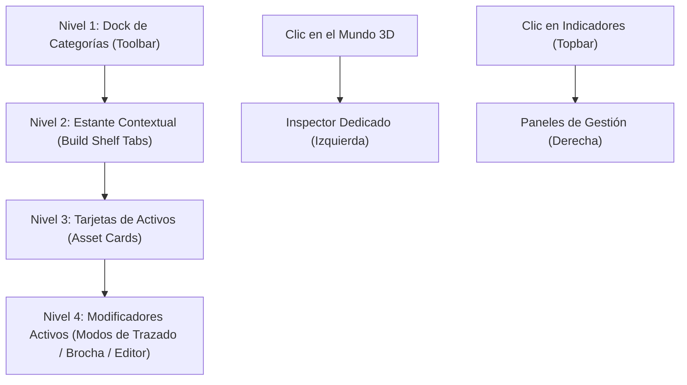

# 🛠️ Sistema de Herramientas de Construcción e Interfaz de Usuario

Los módulos [src/tools/tools.ts](file:///home/dev/projects/city-builder/src/tools/tools.ts) y [src/ui/ui.ts](file:///home/dev/projects/city-builder/src/ui/ui.ts) gobiernan la interacción del jugador, el trazado de infraestructuras, la navegación jerárquica y los paneles de supervisión cívica con una experiencia de usuario limpia inspirada en **Cities: Skylines**.

---

## 1. Modos de Trazado de Carreteras (`Road Modes`)

La herramienta de carreteras implementa 4 algoritmos de planificación geométrica:

| Modo | Tecla | Comportamiento |
| :--- | :--- | :--- |
| **`straight`** | `C` | Trazado en ángulo recto o línea ortogonal recta con algoritmo Bresenham / `lPath`. |
| **`curve`** | `C` | Trazado curvilíneo en 3 clics: punto de inicio, vértice de inflexión y punto de destino. Los tramos intermedios se marcan como curvados (`curv = 1`). |
| **`sbend`** | `C` | Curva en S de transición suave que enlaza tangencialmente con el último tramo dibujado. |
| **`grid`** | `C` | Trazado en caja: arrastrar entre dos esquinas genera automáticamente una cuadrícula de manzanas residenciales ortogonales. |

---

## 2. Herramientas de Construcción Disponibles (`ToolState`)

El objeto `Tools.tool` gestiona la acción activa:

- **`select`:** Inspecciona edificios, sigue vehículos en marcha (`vfollow`), o consulta andenes de transporte.
- **`road`:** Construye calles, avenidas, autopistas y puentes.
- **`path`:** Tiende aceras peatonales y carriles bici segregados (`pk`).
- **`rail`:** Tiende vías de ferrocarril superficial o túneles de metro subterráneo (`rr`).
- **`zone` / `dezone`:** Asigna o desasigna densidades residenciales, comerciales o industriales en casillas zonables.
- **`bulldoze`:** Demolición por casilla individual o por arrastre de caja con reembolso parcial de fondos.
- **`svc`:** Emplaza edificios de servicios (hospitales, comisarías, parques) con rotación (`R`).
- **`stop` / `line` / `lineEdit`:** Crea paradas en calzada o andenes y dibuja líneas de transporte masivo conectando paradas secuenciales.
- **`junction`:** Abre el editor de intersecciones para cambiar la señalización (semáforos, stops, rotonda) o configurar flechas de carril.
- **`district`:** Pinta o borra territorio de distritos municipales con radio configurable ($r \in [2, 7]$).

---

## 3. Arquitectura de Interfaz Cities: Skylines (Cero Solapamientos y Navegación Profunda)

La interfaz de usuario ha sido rediseñada para ofrecer una experiencia limpia, despejada y jerárquica en 4 niveles de profundidad:

### 3.1 Barra Cívica Superior Unificada (`.topbar`)
Barra fija de 48px, translúcida, en una sola línea no rompible (*zero-wrapping*), que garantiza que nunca tape los paneles inferiores:
- **Identidad e Hitos:** Nombre de la metrópoli y botón píldora interactivo `#mileBtn` con barra de progreso. Al pulsar este botón, se despliega el cajón de objetivos `#goals` directamente bajo él.
- **Constantes Vitales Clicables (*Drill-Down Directo*):**
  - **Fondos (`#statMoney`):** Muestra el tesoro y flujo neto (`+$2.400 / mo`). Al hacer clic, abre directamente el panel de **Presupuesto e Impuestos**.
  - **Población (`#statPop`):** Censo y puestos ocupados. Al hacer clic, abre las **Estadísticas de la Ciudad**.
  - **Felicidad (`#statHappy`):** Satisfacción ciudadana media. Al hacer clic, abre las **Vistas e Infomapas de Calor**.
  - **Demanda RCI (`#demand`):** Indicadores verticales de presión residencial, comercial e industrial. Al hacer clic, abre la paleta de **Zonificación**.
- **Reloj y Velocidad:** Selector de marcha de simulación (Pausa `Space`, 1x, 2x, 4x) y reloj en tiempo real.
- **Menú de Gestión Rápida:** Botones de acceso directo a Vistas, Distritos, Presupuesto, Transporte, Estadísticas y Opciones.

### 3.2 Cajón Desplegable de Metas (`#goals`)
- Anclado de forma fija bajo el hito cívico (`top: 54px; left: 12px; width: 310px`).
- **Blindaje Anti-Solapamiento:** Si el jugador inspecciona cualquier edificio, vehículo o cruce, el cajón de objetivos se oculta automáticamente para dejar libre el cuadrante izquierdo al panel inspector (`#infoPanel`). Cuando el inspector se cierra, las metas se restauran automáticamente si estaban abiertas.
- Dispone de botón de cierre `✕` y atajo `Esc`.

### 3.3 Dock de Construcción Inferior (`#toolbar`)
- Centrado en la base de la pantalla (`bottom: 10px; left: 50%; transform: translateX(-50%)`).
- Botones de categoría con icono vectorial, etiqueta Barlow Condensed e indicador inferior de neón azul con animación suave cuando están activos.
- Botón de Demolición (`#bdz`) con resplandor carmesí de peligro al activarse.

### 3.4 Estante de Construcción Contextual (`#palette`)
- Se acopla de manera limpia justo encima del dock (`bottom: 74px; left: 50%; transform: translateX(-50%)`).
- **Barra Superior del Estante (`.phead-bar`):**
  - Título e icono de la categoría activa.
  - Pestañas de subcategoría (ej: en Carreteras: *Pequeñas*, *Medianas*, *Autopistas*, *Cruces*).
  - Selector de modos de trazado (Recto, Curva, Curva en S, Cuadrícula) o tamaños de brocha para distritos.
  - Botón de cierre directo `✕` y soporte para la tecla `Escape`.
- **Carrusel de Tarjetas (`.cards`):** Desplazamiento horizontal fluido con previsualizaciones en gradiente, coste de construcción y mantenimiento, requisitos de población y badge "New".

### 3.5 Panel Inspector de Entidades (`#infoPanel`)
- Ubicado en el lateral izquierdo (`top: 54px; left: 12px; width: 340px`).
- Proporciona inspección profunda de:
  - **Edificios:** Nivel de estrellas, habitantes/trabajadores, felicidad, progreso de mejora, cobertura de servicios y botón de demolición.
  - **Vehículos:** Estado de marcha, velocidad en km/h, carril, tiempo de viaje, botón de seguimiento de cámara (`Follow`) y cinta luminosa 3D de ruta (`drawPathRibbon`).
  - **Paradas de Tránsito:** Pasajeros esperando por línea y control de servicio.
  - **Cruces e Intersecciones:** Diagrama de fases semafóricas y conmutación individual de flechas de giro por carril.

### 3.6 Paneles Laterales de Gestión (`#sidePanel`)
- Ubicados en el lateral derecho (`top: 54px; right: 12px; width: 360px`).
- Altura acotada (`max-height: calc(100vh - 145px)`) que garantiza que nunca choquen ni con la barra superior ni con el estante inferior.
- Exclusión mutua automática: al abrir una herramienta de construcción en la paleta inferior, se cierra el panel lateral para mantener despejado el campo de visión de obra.

---

## 4. Control de Teclado y Ergonomía de Acceso Rápido

- **`Escape`:** Cierra ordenadamente ventanas modales activas $\rightarrow$ paleta de construcción $\rightarrow$ inspector $\rightarrow$ paneles de gestión laterales $\rightarrow$ cajón de objetivos.
- **`B`:** Conmuta la herramienta de demolición (*Bulldoze*).
- **`C`:** Alterna entre los modos de trazado de calzada (Recto, Curvo, S-Bend, Grid).
- **`R`:** Rota el sentido de emplazamiento de edificios cívicos de servicio.
- **`Space`:** Pausa o reanuda la simulación a velocidad normal.
- **`1, 2, 3`:** Conmuta velocidades de simulación (1x, 2x, 4x).
- **`WASD / Flechas`:** Desplazamiento de cámara por el mapa.
- **`Clic Derecho + Arrastrar`:** Rotación orbital y cabeceo de la cámara.
