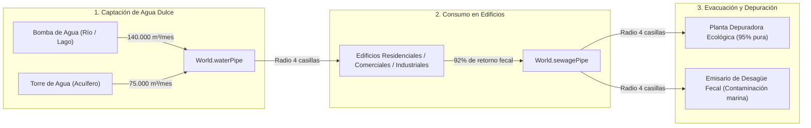

# 💧 Vira City — Redes de Agua, Saneamiento, Contaminación y Sanidad (`docs/water-and-sanitation.md`)

Este documento especifica la arquitectura técnica, los modelos matemáticos y las dinámicas de simulación correspondientes a la **Fase 2 de la Hoja de Ruta**: el ciclo integral del agua potable, la red de colectores fecales, la contaminación de aguas superficiales y freáticas, la dispersión atmosférica por viento dinámico y el ciclo sociosanitario y funerario.

---

## 🏗️ 1. Redes de Tuberías y Modelo de Memoria Zero-GC

El mapa de $W \times W = 208 \times 208 = 43.264$ casillas implementa capas continuas en `Uint8Array` para la infraestructura subterránea:

| Buffer en `World` | Tipo | Descripción |
| :--- | :--- | :--- |
| `World.waterPipe` | `Uint8Array(43.264)` | Red de tuberías presurizadas de agua potable ($1 = \text{activa}$). Coste: $15\$/\text{casilla}$. |
| `World.sewagePipe` | `Uint8Array(43.264)` | Red de colectores subterráneos de aguas residuales ($1 = \text{activo}$). Coste: $15\$/\text{casilla}$. |
| `Water.waterServed` | `Uint8Array(43.264)` | Máscara de servicio de agua presurizada ($R_{\text{pipe}} = 4\text{ casillas}$). |
| `Water.sewageServed` | `Uint8Array(43.264)` | Máscara de servicio de saneamiento y desagüe ($R_{\text{pipe}} = 4\text{ casillas}$). |

### 1.1 Trazado y Herramientas de Tuberías
En `src/tools/tools.ts`, la herramienta `tool: { type: 'pipe', pipeType: 'clean' | 'sewage' | 'dual' }` permite a los jugadores tender conducciones de forma interactiva bajo la red viaria:
- **Invariante Estricta de Trazado Bajo Carretera:** Las tuberías **sólo pueden instalarse por el subsuelo de carreteras existentes** (`World.road[i] > 0`). Si el cursor sobrevuela casillas sin asfaltar o terreno natural, la herramienta marca las casillas en rojo (`ok = false`) y bloquea el tendido mostrando el aviso `"Pipes can only be laid under roads"`.
- **Demolición en Cascada:** Al demoler una carretera con la excavadora (`killRoad`), cualquier conducción subterránea presente bajo dicho tramo queda retirada automáticamente para mantener la invariante.
- **Tubería de Agua Limpia (`clean`):** Conducción exclusiva para transportar agua dulce desde bombas o torres.
- **Colector de Alcantarillado (`sewage`):** Evacúa aguas negras hacia depuradoras o emisarios.
- **Conducto Dual Combinado (`dual`):** Tiende ambas conducciones en una misma zanja subterránea por $25\$/\text{casilla}$, ahorrando costes y tiempo de tendido.
- **Demolición Integrada:** La excavadora/bulldozer elimina tuberías subterráneas en casillas seleccionadas sin destruir la calzada en superficie si se selecciona la tubería directamente.

### 1.2 Modelado 3D de Tuberías, Cilindros y Juntas de Acople
En `src/render/meshes.ts` y `src/render/geometryBuilder.ts`, la infraestructura de tuberías se genera paramétricamente en 3D con un nivel de detalle propio de ingeniería civil:
- **Geometría Cilíndrica Continua:** Generada mediante `gb.cylX` y `gb.cylZ` con prismas poligonales de 8 caras, conectando ortogonalmente las casillas vecinas activas.
- **Continuidad Geométrica 3D y Conexión Hermética entre Casillas:**
  - El generador emplea la primitiva `GB.tube(P0, P1, r, seg, col)` que interpola la posición $(X, Y, Z)$ en el espacio 3D exacto siguiendo pendientes de relieve y viaductos.
  - Los vértices de frontera entre casillas ($Z = y \cdot T$ o $X = x \cdot T$) se calculan con idéntica formulación de cota (`pipeH(wx, wz)`), garantizando una unión a nivel de milímetro sin saltos verticales, desalineaciones ni huecos visibles.
  - En los nudos centrales, las ramas convergen en un único punto $P_{\text{center}}$ encapsulado por un colector cúbico-cilíndrico reforzado.
- **Juntas y Manguitos de Acople ("Juntas entre Cilindro y Cilindro"):**
  - **Manguitos de Unión Intermedios:** A mitad de tramo ($t \in [0.42, 0.58]$), un collarín cilíndrico engrosado ($r_{\text{joint}} = 1.45 \cdot r$) con abrazadera metálica exterior ($r_{\text{flange}} = 1.68 \cdot r$).
  - **Juntas de Frontera Simétricas:** En los bordes de casilla ($t \in [0.88, 1.0]$), acoples de brida que se fusionan con la mitad de la casilla vecina formando una junta doble hermética.
  - **Nudos y Colectores Centrales:** En cruces, curvas y bifurcaciones en T, una caja de distribución central o manifold abraza el encuentro de conducciones.
- **Código Cromático y Disposición Dual:**
  - **Agua Potable:** Cilindro azul cian (`#0284c7`), manguitos azul marino (`#0369a1`) y abrazaderas de acero galvanizado (`#cbd5e1`).
  - **Alcantarillado:** Cilindro naranja terracota (`#d97706`), manguitos naranja quemado (`#9a3412`) y abrazaderas de hierro fundido (`#475569`).
  - **Tendido Dual Paralelo:** Si una calzada aloja ambas redes, la tubería de agua discurre desplazada $-0.7\text{m}$ a la izquierda del eje y el alcantarillado $+0.7\text{m}$ a la derecha, formando una galería de servicios subterránea impecable.
- **Visibilidad Contextual y Renderizado X-Ray:**
  - El material `Gfx.mats.pipe` emplea `depthTest: false` y `renderOrder: 15`, permitiendo una visualización de rayos X nítida a través del firme de la calzada.
  - `Meshes.setPipeVisibility()` activa la visualización 3D automáticamente al abrir la herramienta de tuberías, al seleccionar la categoría de Agua en la barra de herramientas o al activar las vistas de Agua/Alcantarillado, ocultándose en la vista urbana estándar para no saturar el tráfico.

---

## 🌊 2. Balance Hidráulico y Cadena de Saneamiento



### 2.1 Ecuaciones de Demanda y Producción
Cada edificio calcula su demanda mensual de agua potable según su cohorte y ocupación:
$$\text{Uso}_{\text{Res}} = \max(10, \text{población} \times 1.8)\text{ m}^3$$
$$\text{Uso}_{\text{Com}} = \max(15, \text{empleos} \times 2.2)\text{ m}^3$$
$$\text{Uso}_{\text{Ind}} = \max(30, \text{empleos} \times 4.5)\text{ m}^3$$

El volumen total de aguas residuales generadas corresponde aproximadamente al $92\%$ del agua dulce suministrada:
$$\text{SewageLoad} = \text{WaterDemand} \times 0.92$$

### 2.2 Alertas y Consecuencias en Edificios
- **`prob = 'nowater'`:** Si el edificio no está en el radio de $4$ casillas de una tubería presurizada o $\text{WaterSupply} < \text{WaterDemand}$, la felicidad cae $-28$ puntos, se bloquea la evolución de nivel y el edificio corre riesgo de abandono.
- **`prob = 'sewage'`:** Si no hay colector de alcantarillado o la capacidad de las depuradoras/emisarios se satura, las aguas fecales se desbordan, reduciendo la felicidad $-22$ puntos y generando hedor.

---

## 🧪 3. Contaminación Hidrológica y Pureza de Red

### 3.1 Contaminación Acuática Superficial (`waterPollution: Float32Array`)
- Los emisarios de vertido directo (`sewage_drain`) expulsan aguas residuales crudas, incrementando en $+0.35$ la contaminación acuática en las casillas fluviales y marinas adyacentes.
- **Difusión:** En cada ciclo, el agua sucia se disipa y degrada naturalmente a una tasa del $4\%$ mensual por dilución marina.

### 3.2 Contaminación de la Capa Freática (`groundWaterPollution: Float32Array`)
- La contaminación superficial de fábricas y vertederos (`cv.pollution`) se filtra verticalmente al suelo a una tasa de absorción de $+0.03 \times \text{polución}$.
- Los acuíferos contaminados permanecen tóxicos durante años, purificándose lentamente a razón de un $1.5\%$ por ciclo si la fuente industrial en superficie cesa.

### 3.3 Contaminación Cruzada e Intoxicación Masiva
Si una **Bomba de Agua** capta líquido de una casilla marina con $\text{waterPollution} > 0.05$, o una **Torre de Agua** extrae agua de un suelo con $\text{groundWaterPollution} > 0.05$:
$$\text{Pureza} = \frac{\text{Caudal Limpio Bombeado}}{\text{Caudal Total Bombeado}}$$
Si la pureza de la red cae por debajo del $85\%$:
1. Los edificios conectados entran en alerta crítica **`prob = 'water_polluted'`** ("Poisoned water supply").
2. Se desata una epidemia de gastroenteritis e intoxicación química masiva que incrementa rápidamente el número de enfermos (`b.sick++`).
3. La felicidad residencial cae $-30$ puntos adicionales.

---

## 🌪️ 4. Viento Dinámico y Dispersión Atmosférica a Sotavento

Para dotar al simulador del máximo realismo físico, la contaminación atmosférica ya no es una estampa circular estática. Se introduce un vector de viento global variable en `Sim.wind`:

```ts
export interface WindState {
  angle: number;        // Dirección angular en radianes (0 = Este, π/2 = Sur, etc.)
  speed: number;        // Velocidad en km/h (de 10 a 65 km/h)
  targetAngle: number;  // Dirección objetivo del frente meteorológico
  targetSpeed: number;  // Velocidad objetivo
  gust: number;         // Ráfagas transitorias
  name: string;         // 'Light Air', 'Gentle Breeze', 'Moderate Breeze', 'Strong Gale'
  dirName: string;      // 'N', 'NE', 'E', 'SE', 'S', 'SW', 'W', 'NW'
}
```

### 4.1 Algoritmo de Advección y Penacho Cónico (`stampWindPlume`)
En [src/sim/coverage.ts](file:///home/dev/projects/city-builder/src/sim/coverage.ts), cada foco emisor (fábricas, centrales, vertederos) proyecta su penacho descomponiendo la distancia relativa $(dx, dy)$ sobre el vector unitario del viento $(\cos\theta, \sin\theta)$:
- **Distancia a sotavento (*downwind*):** $d_{\parallel} = dx \cos\theta + dy \sin\theta$
- **Distancia transversal (*crosswind*):** $d_{\perp} = |dx \sin\theta - dy \cos\theta|$

El radio longitudinal se dilata con la velocidad del viento:
$$R_{\parallel} = R_{\text{base}} \times \left(1 + 1.5 \frac{\text{speed}}{20}\right) \quad (\text{si } d_{\parallel} \ge 0)$$
$$R_{\parallel} = \max\left(1.5, R_{\text{base}} \times \frac{0.6}{1 + 0.9 \frac{\text{speed}}{20}}\right) \quad (\text{si } d_{\parallel} < 0 \text{, barlovento})$$

El radio transversal se ensancha suavemente a medida que el humo viaja a sotavento formando un cono elíptico realista:
$$R_{\perp} = \max\left(1.5, R_{\text{base}} \times \left(0.75 + 0.35 \frac{d_{\parallel}}{R_{\parallel}}\right)\right)$$

La concentración de contaminantes en la celda $(x, y)$ responde a la elipse:
$$\tilde{d}^2 = \left(\frac{d_{\parallel}}{R_{\parallel}}\right)^2 + \left(\frac{d_{\perp}}{R_{\perp}}\right)^2 \le 1.0 \implies f = \text{fuerza} \times (1 - \tilde{d}^2)^{0.85}$$

> [!TIP]
> **Planificación Urbana con Viento:** Si los vientos dominantes provienen del Oeste (`W`), situar las áreas residenciales a barlovento (hacia el Oeste de las chimeneas) mantendrá a los ciudadanos a salvo del penacho tóxico.

---

## 🏥 5. Sanidad de Emergencia y Ciclo Funerario

### 5.1 Despacho Activo de Ambulancias
Las clínicas (`clinic`), hospitales generales (`hospital`) y hospitales de campaña (`field_hospital`) ya no son coberturas pasivas o patrullas aleatorias:
1. Escanean en tiempo real edificios residenciales con ciudadanos enfermos (`b.sick > 0`).
2. Despachan una ambulancia (`kind: 'ambulance'`) con prioridad vial y sirena.
3. Al alcanzar el portal del edificio, la ambulancia trata a los convalecientes (`b.sick = 0`), retira la alerta `sick` y regresa al centro médico.
4. Si los pacientes permanecen sin atención médica por falta de cobertura o atascos viales, sucumben y fallecen (`b.dead++`).

### 5.2 Servicios Funerarios y Coches Fúnebres (`hearse`)
Cuando un ciudadano muere por vejez o enfermedad no atendida, el edificio genera una defunción (`b.dead > 0`) y muestra la alerta funeraria **`prob = 'dead'`** ("Deceased awaiting hearse"):
- **Cementerio Municipal (`cemetery`):** Parcela ajardinada con nichos y capacidad física de hasta $800$ sepulturas. Dispone de $4$ coches fúnebres.
- **Crematorio Moderno (`crematory`):** Instalación de incineración continua sin límite de capacidad. Dispone de $6$ coches fúnebres y emite una leve pluma de humo a sotavento.
- **Despacho del Coche Fúnebre:** Acude al domicilio afectado, retira el cadáver y lo transporta al cementerio (ocupando una tumba) o al crematorio.
- **Penalización por Cadáveres No Recogidos:** Si los difuntos se acumulan, el vecindario sufre una penalización de felicidad de hasta $-35$ puntos y el inmueble es abandonado por insalubridad.

---

## 🖥️ 6. Infovistas GPU e Indicadores HUD

1. **Widget de Viento en la Barra Cívica (`#tb_wind`):** Presenta en tiempo real la velocidad en km/h y el rumbo cardinal (ej. `🌬️ 28 km/h · SO`). Al hacer clic, abre de inmediato la infovista de Polución.
2. **Infovistas GPU en `views.ts`:**
   - **`water`:** Tuberías de agua limpia en azul cian vibrante y áreas de suministro.
   - **`sewage`:** Colectores de aguas fecales en naranja vivo y cobertura de drenaje.
   - **`water_pollution`:** Vertidos acuáticos en violeta tóxico y acuíferos contaminados en amarillo ocre.
   - **`pollution`:** Pluma atmosférica cónica sotavento orientada según el ángulo del viento actual.
   - **`health` / `death`:** Localización de enfermos y cadáveres en espera de atención.
