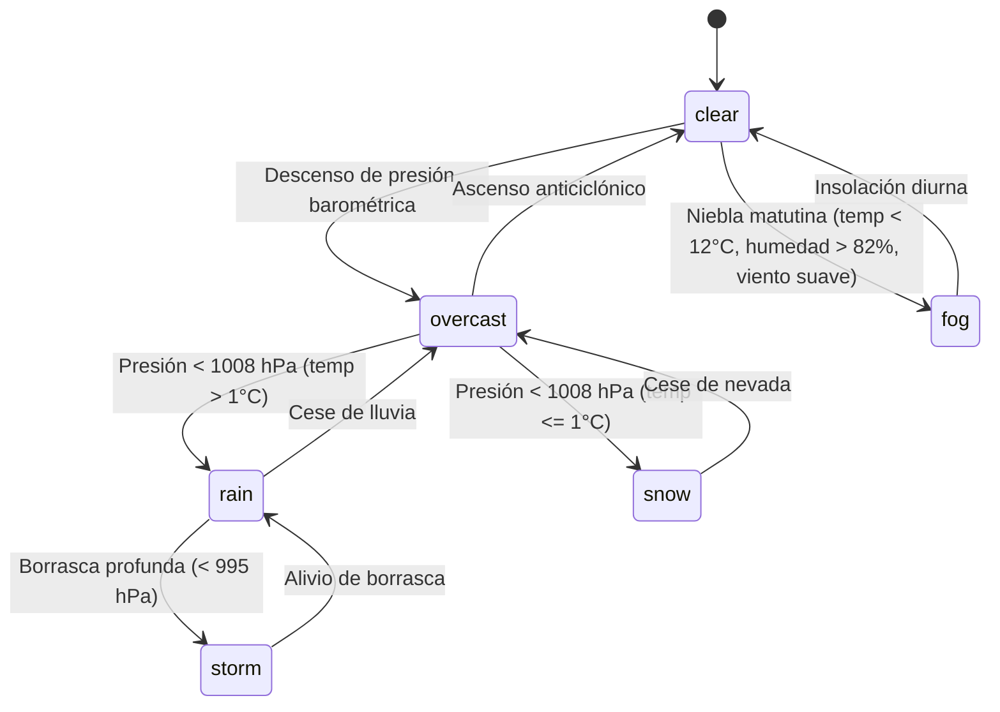
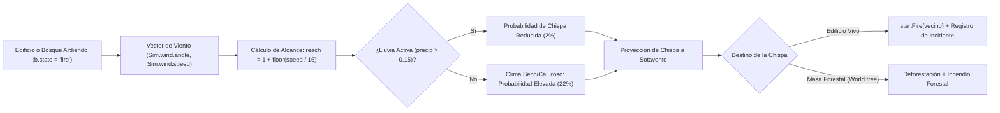
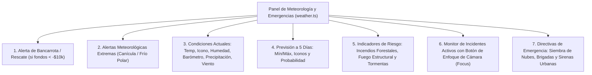

# ⛈️ Clima Dinámico, Eventos de Emergencia, Incendios a Sotavento y Mega-Edificios (`docs/weather-and-disasters.md`)

Este documento detalla la arquitectura técnica, las ecuaciones físicas de simulación, la propagación de incendios con vector de viento, el sistema de renderizado de partículas 3D en Three.js y el modelo de bancarrota municipal implementados en la **Fase 6** de **Vira City**.

---

## 🌪️ 1. Modelo Meteorológico y Ciclos Atmosféricos (`WeatherSystem`)

El subsistema meteorológico en [src/sim/weather.ts](file:///home/dev/projects/city-builder/src/sim/weather.ts) simula una atmósfera dinámica continua acoplada al ciclo estacional y horario del juego.

### 1.1 Variables de Estado Físico

| Parámetro | Rango Canónico | Descripción y Comportamiento |
| :--- | :--- | :--- |
| `temp` | $-12^\circ\text{C} \dots +38^\circ\text{C}$ | Temperatura ambiente en tiempo real. Fluctuación diurna ($\text{pico a las } 14:00$, $\text{mínimo a las } 05:00$) sobre la media estacional. |
| `humidity` | $20\% \dots 100\%$ | Humedad relativa atmosférica. Se incrementa con precipitación y nubosidad; desciende en olas de calor. |
| `pressure` | $980 \dots 1035\text{ hPa}$ | Presión barométrica. Borrascas profundas ($< 995\text{ hPa}$) desatan tormentas severas; anticiclones ($> 1018\text{ hPa}$) aseguran cielos despejados. |
| `precipitation` | $0.0 \dots 1.0$ | Intensidad de precipitación líquida o sólida en la cuadrícula urbana. |
| `clouds` | $0.0 \dots 1.0$ | Cobertura nubosa efectiva que atenúa la radiación solar y la luz ambiental. |
| `fogDensity` | $0.0 \dots 1.0$ | Densidad de niebla matutina generada con alta humedad ($>82\%$) y vientos calmos ($<14\text{ km/h}$). |

### 1.2 Máquina de Estados del Clima (`WeatherType`)

### 1.3 Anomalías Meteorológicas Extremas
- **Ola de Calor (*Heatwave*):** Anomalía estival que eleva la temperatura media en $+9^\circ\text{C}$, dispara la demanda eléctrica de aire acondicionado en $+25\%$, eleva el consumo de agua en $+35\%$ e incrementa drásticamente el riesgo de ignición de incendios.
- **Ola de Frío Polar (*Cold Snap*):** Caída gélida invernal con temperaturas bajo cero (hasta $-12^\circ\text{C}$), incrementando la demanda eléctrica de calefacción en $+25\%$ y forzando nevadas copiosas.

---

## 🌧️ 2. Sistema de Partículas 3D y Shaders Atmosféricos (`Gfx`)

En [src/render/gfx.ts](file:///home/dev/projects/city-builder/src/render/gfx.ts), las precipitaciones se renderizan en tiempo real mediante un emisor de partículas GPU sin asignaciones dinámicas de memoria (*zero-GC*).

### 2.1 Malla de Puntos (`THREE.Points`) con Desplazamiento por Viento
- **Buffer de Vértices Fijo:** `Float32Array(3000 * 3)` que representa 3.000 gotas de lluvia o copos de nieve confinados en una caja volumétrica de $220\text{ m} \times 80\text{ m} \times 220\text{ m}$ centrada en la posición focal de la cámara `(Gfx.cam.tx, Gfx.cam.ty, Gfx.cam.tz)`.
- **Ecuación de Movimiento:**
  $$\vec{p}_{t+\Delta t} = \vec{p}_t + \begin{pmatrix} v_{\text{wind}} \cdot \cos\theta_{\text{wind}} \cdot 0.45 \\ -v_{\text{caída}} \\ v_{\text{wind}} \cdot \sin\theta_{\text{wind}} \cdot 0.45 \end{pmatrix} \cdot \Delta t$$
  Donde $v_{\text{caída}} = 55\text{ m/s}$ para gotas de lluvia y $v_{\text{caída}} = 10\text{ m/s}$ para copos de nieve flotantes.
- **Envoltura Cíclica:** Las partículas que descienden por debajo de la cota $y < y_{\text{cam}} - 5$ se reinician instantáneamente en el techo $y = y_{\text{cam}} + 70$, garantizando una densidad continua sin crear nuevos objetos en el recolector de basura.

### 2.2 Relámpagos Procedurales y Audio Síntesis
- Durante tormentas severas (`type === 'storm'`), se generan descargas eléctricas periódicas con `Gfx.flashLightning()`, sobreiluminando el sol (`sun.intensity = 6.5`) y la niebla hacia blanco azulado (`#e0f2fe`).
- El trueno se sintetiza con la Web Audio API nativa en `UI.sfx('thunder')` modulando osciladores diente de sierra de 80 Hz a 20 Hz con decaimiento exponencial.

---

## 🔥 3. Propagación Celular de Incendios a Sotavento

El motor en [src/sim/sim.ts](file:///home/dev/projects/city-builder/src/sim/sim.ts) modela la dispersión de chispas y ascuas proyectadas en la dirección del viento.

- **Amortiguación por Lluvia:** Si la precipitación supera $0.30$, el agua mitiga progresivamente el fuego en los solares afectados (`b.fire -= 1`), llegando a extinguirlo por completo si la lluvia es torrencial ($> 0.50$).
- **Brigadas de Emergencia:** Al activar la directiva de movilización, la velocidad de respuesta de las dotaciones se duplica y la probabilidad de propagación a sotavento cae en un $60\%$.

---

## 🏛️ 4. Mega-Proyectos Emblemáticos Desbloqueables

Se incorporan tres grandes infraestructuras cívicas icónicas en [src/core/constants.ts](file:///home/dev/projects/city-builder/src/core/constants.ts) y [src/render/generators/buildingGenerators.ts](file:///home/dev/projects/city-builder/src/render/generators/buildingGenerators.ts):

| Mega-Edificio | Huella | Hito | Efecto Mecánico y Económico |
| :--- | :--- | :--- | :--- |
| **Palacio de la Ópera Metropolitana (`opera`)** | $4 \times 4$ | 6 (Ciudad Grande) | Palacio *Beaux-Arts* con escalinata monumental, columnata corintia, cúpula de cobre verde cardenillo y remate dorado. Aporta un $+25\%$ de felicidad cultural en un radio de 44 casillas e inyecta ingresos por turismo de alto poder adquisitivo ($+\$45/\text{hora}$). |
| **Estadio Olímpico Nacional (`stadium_arena`)** | $5 \times 5$ | 7 (Metrópolis) | Coliseo elíptico con gradas de dos niveles en azul eléctrico, pista de atletismo perimetral, césped esmeralda, cubierta tensada blanca y 4 torres de focos de $34\text{ m}$. Los fines de semana (sábados y domingos de 18:00 a 21:00) genera un pico de recaudación por taquilla ($+\$350/\text{hora}$) y dispara el uso del transporte público. |
| **Aeropuerto Internacional (`airport_intl`)** | $6 \times 4$ | 8 (Megalópolis) | Centro aeroportuario completo con pista asfaltada iluminada, umbrales de barras blancas (*piano keys*), calle de rodaje, terminal curvada de vidrio con 4 pasarelas telescópicas (*fingers*) y torre de control de $26\text{ m}$ con cabina hexagonal y radar giratorio. Incrementa la eficiencia de ingresos por exportación en un $+40\%$ e impulsa el turismo exterior. |

---

## 📉 5. Insolvencia Municipal y Modo Rescate de Austeridad

Para evitar que la tesorería caiga en déficit negativo sin consecuencias, se introduce el sistema de bancarrota municipal en [src/sim/sim.ts](file:///home/dev/projects/city-builder/src/sim/sim.ts):

### 5.1 Fases de la Crisis de Deuda
1. **Periodo de Gracia por Débito Crítico (Fondos $< -\$10.000$):**
   - Se activa la alerta en cabecera `#statMoney` parpadeando en amarillo y se inicia una cuenta atrás de **10 días de gracia**.
   - El jugador debe sanear las cuentas recortando gastos, subiendo impuestos o solicitando préstamos convencionales.
2. **Quiebra e Incumplimiento (*Default* - Fondos $< -\$25.000$ o Fin del Plazo):**
   - Si vence el plazo o la deuda supera los $-\$25.000$, la ciudad entra forzosamente en el **Modo de Rescate y Austeridad**.
3. **Pacto de Rescate Estatal de Emergencia:**
   - Inyección instantánea de liquidez: **$+\$50.000$** para salvar la tesorería.
   - **Condicionantes del Rescate (Duración: 12 meses):**
     - Sobrecoste del $+30\%$ en la construcción de nuevas obras públicas y vías.
     - Cargo mensual obligatorio por reestructuración de deuda ($-\$50/\text{hora} \approx -\$1.200/\text{mes}$).
     - Repunte de malestar social ($+25$ puntos de tensión vecinal en `Sim.stats.unrest`).
     - Al completar los 12 meses con saldo positivo, se restablece la solvencia crediticia y se levantan todas las restricciones.

---

## 🎛️ 6. Panel de Gestión de Clima y Emergencias (`weather`)

Disponible en el menú *Insights* (`menu.weather_title`) o haciendo clic en el widget meteorológico de cabecera `#statWeather`.

### Directivas Ejecutivas de Emergencia:
- **Operación de Siembra de Nubes (\$3.500):** Despliega yoduro de plata en las capas altas para forzar la condensación y provocar lluvias en menos de 4 horas, sofocando incendios forestales.
- **Movilización de Brigadas de Bomberos (\$4.000):** Convoca personal de reserva; duplica la velocidad de salida de los camiones de bomberos y su radio de cobertura durante 72 horas.
- **Sirenas de Alerta y Toque de Queda (\$1.000):** Activa la sirena municipal de aviso a la población, desincentivando desplazamientos a pie o en coche en un $60\%$ para evitar víctimas durante vendavales o inundaciones.
